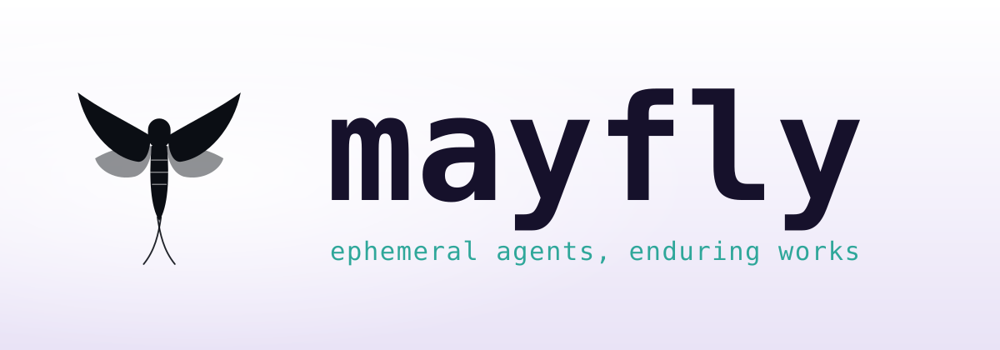
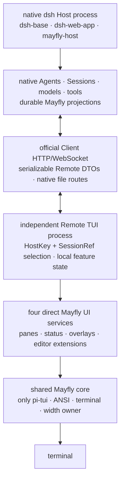

# Mayfly

<p align="center">
  <picture>
    <source media="(prefers-color-scheme: dark)" srcset="website/public/brand/banner-dark.svg">
    <source media="(prefers-color-scheme: light)" srcset="website/public/brand/banner-light.svg">
    
  </picture>
</p>

[](https://github.com/Ephemeral-AI-Lab/mayfly/actions/workflows/ci.yml)
[](https://www.npmjs.com/package/@ephemeral-ai/mayfly)
[](https://www.npmjs.com/package/@ephemeral-ai/mayfly)
[](#install-and-run)
[](#install-and-run)
[](LICENSE)

English | [中文](README.zh.md)

Mayfly is an independent terminal frontend for [DeepSeek Harness](https://github.com/deepseek-ai/deepseek-harness). The product runs as two processes: a native dsh **Host** and a **Remote TUI** connected through the official HTTP/WebSocket Client. The Host owns Agents, models, tools, and Sessions; the TUI owns input, themes, panels, and terminal rendering. Closing the TUI detaches it while Host work continues.

This development branch targets official Harness `0.2.2-alpha.2`. The published Mayfly `0.1.4-rc.2` is the immutable reference for appearance, keys, and workflows. Shared presentation is being carried into the split runtime; complete visual parity still requires the acceptance described in [split validation](docs/split-parity-validation.md).

## Install and run

Use Node `>=24.9.0`, pinned pnpm `11.7.0`, and an isolated official dsh `0.2.2-alpha.2` executable. These split packages are development artifacts; install from this checkout or verified release tarballs. The installer checks the dsh version and keeps the global installation unchanged.

```sh
pnpm install --frozen-lockfile
DSH_BIN=/path/to/dsh PROFILE=mayfly-split-accept script/install-dev.sh
```

The installer builds the workspace, creates a dedicated profile from the native Web template, and adds `@ephemeral-ai/mayfly-host`. It reuses an existing profile and rejects the shared `mayfly` and `default` profiles. Launch both processes:

```sh
# Terminal 1: Host
/path/to/dsh --profile mayfly-split-accept

# Terminal 2: TUI; copy the authenticated URL printed by the Host
MAYFLY_DSH_STARTUP_URL='<URL printed by Host>' script/mayfly-remote.sh
```

Model credentials, provider settings, permission presets, and session files belong to the Host. The Host emits one `mayfly host: <url>` readiness line. Supply that authenticated URL through `MAYFLY_DSH_STARTUP_URL`; the TUI rejects credentials in command-line arguments. `--host` accepts a non-secret HTTP(S) URL while obtaining its token from the environment.

The TUI supports an initial task, an existing Session, and a Host working directory:

```sh
# Set the authenticated URL once in this terminal
export MAYFLY_DSH_STARTUP_URL='<URL printed by Host>'
script/mayfly-remote.sh 'Explain this repository'
script/mayfly-remote.sh --resume <session-id>
script/mayfly-remote.sh --cwd /path/on/host 'Run the relevant checks'
```

`MAYFLY_SESSION_ID`, `MAYFLY_CWD`, and `MAYFLY_TASK` provide defaults when corresponding arguments are absent. A launch without a task or resume id stays sessionless until the first prompt. `/new` and `/clear` return to that start view without creating an empty Session or stopping existing work. Rebuild with `pnpm run build` after source edits; rerun the installer when the dependency graph changes. The exact-version global `@ephemeral-ai/mayfly-cli` package hands off to this same Remote entry; it does not start the Host.

## Use the TUI

The shared layout contains the conversation, activity and notification rows, editor, and status/views lane. It renders Markdown tables, closed Mermaid fences, tool cards, file diffs, approvals, and questions. Theme changes preserve the native editor's draft, cursor, undo, history, paste, and completion state. `/theme custom <path> [<base theme>]` reads a palette on the TUI machine; `/theme` changes live presentation without saving the Host's default. Use `/settings` or onboarding to change persisted preferences.

`/help` and slash completion reflect the selected Host's actual command catalog and the mounted local features. A writable Session adds native Host commands; readonly views do not advertise writable commands. Canonical command names remain singular: `/model`, `/provider`, `/preset`, and `/plugin`.

| Workflow | Commands and behavior |
| --- | --- |
| Session navigation | `/sessions` (`/resume`) opens the workspace/session browser; an id resumes directly. `/rename <title>` renames the selected Session. `/fork [atSeq]` creates and selects a branch; `/rewind` opens the reference earlier-turn picker with prompt/response previews and creates a selected branch while preserving the original Session. |
| Models and configuration | `/model [name]`, `/effort [level]` (`/thinking`), `/provider`, `/preset [name]`, `/permissions`, and `/settings` use native Host catalogs and writes. Before a Session exists, model and preset choices set Host defaults. |
| Plan mode | `/plan` enters plan mode, `/plan off` leaves it, and `/mode` or Shift+Tab toggles it. A sessionless choice is admitted before the first prompt; a failed admission sends no prompt. Alt+M cycles models within the current provider. |
| Information | `/context`, `/stats`, `/skills`, `/tools`, `/mcp`, `/files`, `/changes [seq]`, `/trace [copy <seq>\|copy all]`, and `/version` inspect native state or readonly Host projections. |
| Work and side conversations | `/jobs`, `/goal`, and `/schedule [all]` use the enabled Host services. `/btw <question>` opens a forked side conversation; `/agents` browses subagents. F7 returns to the previous conversation and F8 closes its view. Closing a view keeps Host work running. |
| Local output and exit | `/copy` writes to the TUI machine's clipboard; `/export [full] [name]` (`/save`) writes under local `mayfly-exports/`. `/quit` (`/q`, `/exit`) detaches and exits. |
| Additional Remote controls | `/host`, `/attach`, `/detach`, `/host-status`, `/account`, `/language`, and `/onboarding` appear in the Remote help section. |

Enter queues a prompt and Ctrl+Enter steers it through the official Client. Readonly conversations preserve drafts and refuse writes. A cold continuable child resumes only when the user explicitly replies through its native address. `/agents stop <id>` drains a live continuable leaf; a child with live descendants is refused. The selected conversation's interrupt uses native cancellation authority and keeps queued input.

## Partial behavior and upstream limits

These rows describe the remaining official API limits:

| Area | Implemented behavior and remaining boundary |
| --- | --- |
| Slash commands with files | Official alpha.2 `commands.execute` accepts encoded image attachments, without a file-upload receipt input. Image-bearing commands work. A command containing a staged file is refused with an explicit notice and its draft is restored; no command is sent. Ordinary prompts use the native file-upload path. |
| `/mcp` connection details | Official alpha.2 exposes no public configured-server/transport-health catalog. The panel lists servers discoverable from tool schemas and shows unknown connection state and absent transport/endpoint values. Resources/templates and explicit resource reads use native tools. A composition providing the optional sanitized catalog can add connection details. |
| `/skills` source metadata | Native skill discovery and skill content are available. The official catalog omits source/provider classification, so the panel explicitly marks those fields as unavailable instead of inferring them from paths. |
| Remote TUI extension hot loading | Host bundle changes use the native plugin manager. The official API provides no dynamic TUI extension mount; the preset browser marks this boundary. Frontend extensions require source integration and a TUI restart. |
| Cold child tool cards and controls | Passive native history and projections work. Without a live child Agent, custom presenters use generic durable tool cards and Agent-scoped controls report unavailable. Browsing never activates a child or borrows its parent's Agent. An explicit continuable-child reply uses the native addressed path. |
| `/update` Host startup check | `/update [<version>]` stages and checks the exact frontend release graph, confirms, upgrades both installations, verifies versions, and compensates failed changes. `/update recover` restores an interrupted transaction on its original Host. The official Host API provides no isolated Host boot check; the confirmation and result explicitly require restarting both processes and checking Host startup. Linked/read-only and non-npm frontend installations use their original installer. |

`/plugin` installs, updates, removes, and enables Host bundles through the native plugin manager. `/settings` supports revision-bound form changes and a local external editor for the actual Host settings document. These features have native APIs and are implemented. Plugin changes report their restart boundary; a cancelled or stale write is never silently retried. `/schedule` and other optional features state when their Host service is absent.

## Architecture and extensions

The release set contains five packages:

| Package | Responsibility |
| --- | --- |
| `@ephemeral-ai/mayfly-host` | Native Host composition, durable Mayfly projections, and generated `mayflyHost` Remote methods. |
| `@ephemeral-ai/mayfly-remote` | Official Client transport, Host/Session selection, feature controllers, and standalone TUI composition. |
| `@ephemeral-ai/mayfly` | Shared renderer, themes, editor/transcript controllers, and readonly presentation subpaths. No root plugin, dsh bundle, patch, or preset payload is published. |
| `@ephemeral-ai/mayfly-ui` | Renderer-neutral node contracts, builders, and the four UI services/provider. |
| `@ephemeral-ai/mayfly-cli` | Small global launcher with an exact-version dependency on Remote. |

<!-- BEGIN diagram:mayfly-layers -->
<!-- single source: docs/diagrams/mayfly-layers.en.mmd — edit the .mmd, then `pnpm run diagrams:sync` -->

<!-- END diagram:mayfly-layers -->

Host plugins are ordinary Cordis plugins using documented native dsh services. TUI plugins contribute nodes through `mayflyPanes`, `mayflyStatus`, `mayflyOverlays`, and `mayflyEditorExtensions` in the TUI's own Cordis tree. A plugin needing Host state uses the official Client/Remote protocol and serializable DTOs; Agent, Session, Tool Definition, callbacks, and renderer objects never cross processes. The removed in-process `mayflyCurrentAgent` and app/interaction entries are not public extension APIs. [Architecture](docs/mayfly-architecture.md) and [service seams](docs/mayfly-seams.md) describe the current boundaries.

## Development and verification

Use a dedicated worktree and `mayfly-<tag>` profile. `pnpm run verify:changed -- --plan` shows selected checks, `pnpm run verify:changed` runs them, and `pnpm run verify:full` runs the full architecture gate. Package imports resolve built `lib/`; a fresh checkout needs a build before tests that import package names.

[Split validation](docs/split-parity-validation.md) defines immutable reference acquisition, real Host/Remote HTTP/WebSocket and PTY scenarios, and cell-grid comparison. Smoke success and a reused shared component do not establish visual parity. Reference output must be captured independently of the candidate, and acceptance must include the selected workflows, terminal widths, themes, cancellation, and lifecycle cases.

Maintainer boundaries live in [AGENTS.md](AGENTS.md) and package instruction files. The published `0.1.4-rc.2` reference and historical source fixtures are validation inputs; they do not provide a second supported product installation path.
