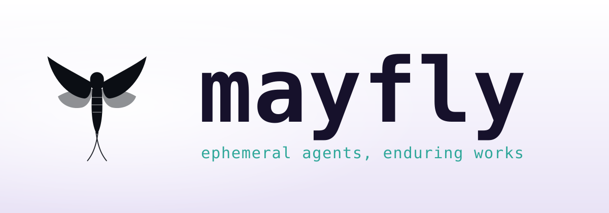
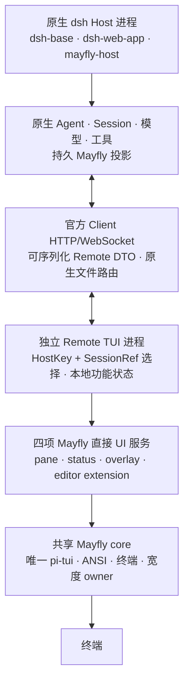

# Mayfly

<p align="center">
  <picture>
    <source media="(prefers-color-scheme: dark)" srcset="website/public/brand/banner-dark.svg">
    <source media="(prefers-color-scheme: light)" srcset="website/public/brand/banner-light.svg">
    
  </picture>
</p>

[](https://github.com/Ephemeral-AI-Lab/mayfly/actions/workflows/ci.yml)
[](https://www.npmjs.com/package/@ephemeral-ai/mayfly)
[](https://www.npmjs.com/package/@ephemeral-ai/mayfly)
[](#安装与启动)
[](#安装与启动)
[](LICENSE)

[English](README.md) | 中文

Mayfly 是 [DeepSeek Harness](https://github.com/deepseek-ai/deepseek-harness) 的独立终端前端。产品由两个进程组成：原生 dsh **Host** 和通过官方 HTTP/WebSocket Client 连接的 **Remote TUI**。Host 持有 Agent、模型、工具和 Session；TUI 持有输入、主题、面板与终端渲染。关闭 TUI 只解除连接，Host 上的工作继续运行。

当前开发分支面向官方 Harness `0.2.2-alpha.2`。已发布的 Mayfly `0.1.4-rc.2` 是外观、按键和工作流不可改写的参照。分体实现复用共享展示层；完整视觉一致性仍须按照[分体式验证](docs/split-parity-validation.md)完成验收。

## 安装与启动

使用 Node `>=24.9.0`、锁定的 pnpm `11.7.0` 和独立安装的官方 dsh `0.2.2-alpha.2` 可执行文件。分体包目前是开发产物，应从本工作区或经过验证的发布 tarball 安装。安装器会检查 dsh 版本，不修改全局安装。

```sh
pnpm install --frozen-lockfile
DSH_BIN=/path/to/dsh PROFILE=mayfly-split-accept script/install-dev.sh
```

安装器构建工作区，从原生 Web 模板创建专用 profile，再添加 `@ephemeral-ai/mayfly-host`。已有 profile 会复用，共享的 `mayfly` 和 `default` profile 会被拒绝。分别启动两个进程：

```sh
# 终端 1：Host
/path/to/dsh --profile mayfly-split-accept

# 终端 2：TUI；复制 Host 打印的认证 URL
MAYFLY_DSH_STARTUP_URL='<Host 打印的 URL>' script/mayfly-remote.sh
```

模型凭据、provider 设置、权限预设和 session 文件归 Host 所有。Host 就绪后打印一行 `mayfly host: <url>`。认证 URL 通过 `MAYFLY_DSH_STARTUP_URL` 提供；TUI 拒绝通过命令行参数传入凭据。`--host` 只接受不含密钥的 HTTP(S) URL，token 仍从环境变量取得。

TUI 支持初始任务、恢复已有 Session，以及指定 Host 工作目录：

```sh
# 在当前终端设置一次认证 URL
export MAYFLY_DSH_STARTUP_URL='<Host 打印的 URL>'
script/mayfly-remote.sh '解释这个仓库'
script/mayfly-remote.sh --resume <session-id>
script/mayfly-remote.sh --cwd /path/on/host '运行相关检查'
```

对应参数缺省时，`MAYFLY_SESSION_ID`、`MAYFLY_CWD` 和 `MAYFLY_TASK` 提供默认值。没有初始任务和恢复 id 时，启动界面在第一条 prompt 前不创建 Session。`/new` 和 `/clear` 返回该界面，不创建空 Session，也不停止已有工作。修改源码后运行 `pnpm run build`，依赖图变化后重新运行安装器。全局 `@ephemeral-ai/mayfly-cli` 通过精确版本依赖启动同一个 Remote 入口，不负责启动 Host。

## 使用 TUI

共享布局包括会话、活动与通知行、编辑器，以及状态与视图栏。支持 Markdown 表格、完整 Mermaid 代码块、工具卡片、文件 diff、审批和问题表单。切换主题会保留原生编辑器的草稿、光标、撤销、历史、粘贴和补全状态。`/theme custom <path> [<base theme>]` 读取 TUI 所在机器的调色板文件；`/theme` 只改变当前展示，不保存 Host 默认值。持久首选项通过 `/settings` 或首次设置向导修改。

`/help` 与斜杠补全反映所选 Host 的实际命令目录和已挂载的本地功能。可写 Session 会补充 Host 原生命令；只读视图不声明可写命令。规范命令名保持单数：`/model`、`/provider`、`/preset` 和 `/plugin`。

| 工作流 | 命令与行为 |
| --- | --- |
| Session 导航 | `/sessions`（`/resume`）打开 workspace/session 浏览器，带 id 时直接恢复。`/rename <title>` 重命名所选 Session；`/fork [atSeq]` 创建并切换到分支；`/rewind` 打开参照中的早期轮次选择器，显示 prompt/response 预览，创建并切换到分支，保留原 Session。 |
| 模型与配置 | `/model [name]`、`/effort [level]`（`/thinking`）、`/provider`、`/preset [name]`、`/permissions` 与 `/settings` 使用 Host 原生目录与写入。Session 尚不存在时，模型和 preset 选择设置 Host 默认值。 |
| 计划模式 | `/plan` 进入，`/plan off` 退出，`/mode` 或 Shift+Tab 切换。`/plan <message>` 通过原生命令发送计划 prompt，也可创建首个 Session。启动界面的模式选择会在第一条普通 prompt 前完成原生接纳；接纳失败不会发送 prompt。Alt+M 在当前 provider 内循环切换模型。 |
| 信息查看 | `/context`、`/stats`、`/skills`、`/tools`、`/mcp`、`/files`、`/changes [seq]`、`/trace [copy <seq>\|copy all]` 与 `/version` 查看原生状态或只读 Host 投影。 |
| 工作与旁支会话 | `/jobs`、`/goal` 与 `/schedule [all]` 使用 Host 已启用的服务。`/goal` 保留原生解析、状态输出与目标附件；状态栏的编辑操作把目标放回输入框。`/btw <question>` 打开继承当前完整历史的旁支会话，包括尚未完成的首个 turn；`/agents` 浏览子 Agent。F7 返回上一个会话，F8 关闭当前视图；关闭视图不停止 Host 工作。 |
| 本地输出与退出 | `/copy` 写入 TUI 所在机器的剪贴板；`/export [full] [<path>]`（`/save`）写入 TUI 所在机器：相对路径以其工作目录为基准，支持绝对路径，自动创建父目录并覆盖已有文件。`/quit`（`/q`、`/exit`）解除连接并退出。 |
| 附加 Remote 控制 | `/host`、`/attach`、`/detach`、`/host-status`、`/account`、`/language` 与 `/onboarding` 显示在帮助的 Remote 分组。 |

Enter 通过官方 Client 排队发送 prompt，Ctrl+Enter 发送 steer。只读会话保留草稿并拒绝写入。冷的 continuable 子会话只有在用户通过原生地址明确回复后才恢复。`/agents stop <id>` 只 drain 活跃的 continuable 叶节点；有活跃后代的子节点会被拒绝。中断所选会话使用原生取消权限并保留排队输入。

支持附件的原生命令会按原始顺序接收图片和已上传文件的 receipt。原生接纳拒绝时恢复草稿和附件。`/skills` 显示当前 Session 的原生来源、provider 元数据和目录完整性；Host 未提供可选的 Mayfly 目录能力时，会明确标注缺失的元数据。

## 部分实现与上游限制

以下是尚存的官方 API 限制：

| 范围 | 已实现行为与剩余边界 |
| --- | --- |
| `/mcp` 连接信息 | 官方 alpha.2 没有已配置服务器或传输健康状态的公共目录。面板只能列出通过工具 schema 发现的服务器，连接状态显示未知，transport/endpoint 缺省。资源、模板和明确的资源读取走原生工具；提供可选脱敏目录的组合可补充连接信息。 |
| Remote TUI 扩展热挂载 | Host bundle 变更使用原生 plugin manager。官方 API 没有动态 TUI 扩展挂载入口，preset 浏览器会明确标注此限制。前端扩展需要源码集成并重启 TUI。 |
| 冷子会话工具卡片与控制 | 原生历史和投影可被动读取。没有活跃子 Agent 时，自定义 presenter 降级为通用持久工具卡片，依赖 Agent 的控制报告不可用。浏览不会激活子 Agent 或借用父 Agent；明确的 continuable 子会话回复走原生寻址路径。 |
| `/update` Host 启动检查 | `/update [<version>]` 先准备并检查前端精确发布依赖图，经确认后升级两端、验证版本，并在失败时补偿恢复。`/update recover` 在原 Host 上恢复中断的事务。官方 Host API 没有独立 Host 启动检查；确认页和结果页会明确要求重启两进程并验证 Host 启动。链接、只读或非 npm 前端安装使用原安装方式升级。 |

`/plugin` 已通过原生 plugin manager 安装、更新、移除和启停 Host bundle；`/settings` 已支持绑定 revision 的表单写入，以及用本地外部编辑器修改实际 Host settings 文档。这些功能具有原生 API，已实现。插件修改会说明重启边界；取消或过期写入不会静默重试。`/schedule` 等可选功能会说明所需 Host 服务是否缺失。

## 架构与扩展

发布集包含五个包：

| 包 | 职责 |
| --- | --- |
| `@ephemeral-ai/mayfly-host` | 原生 Host composition、持久 Mayfly 投影和生成的 `mayflyHost` Remote 方法。 |
| `@ephemeral-ai/mayfly-remote` | 官方 Client transport、Host/Session 选择、功能控制器和独立 TUI composition。 |
| `@ephemeral-ai/mayfly` | 共享 renderer、主题、编辑器/会话控制器和只读展示 subpath；不发布根插件、dsh bundle、patch 或 preset 载荷。 |
| `@ephemeral-ai/mayfly-ui` | 渲染无关的节点契约、builder 和四个 UI service/provider。 |
| `@ephemeral-ai/mayfly-cli` | 通过精确版本依赖启动 Remote 的小型全局启动器。 |

<!-- BEGIN diagram:mayfly-layers -->
<!-- single source: docs/diagrams/mayfly-layers.zh.mmd — edit the .mmd, then `pnpm run diagrams:sync` -->

<!-- END diagram:mayfly-layers -->

Host 插件是使用原生 dsh service 的普通 Cordis 插件。TUI 插件在前端自己的 Cordis tree 中，通过 `mayflyPanes`、`mayflyStatus`、`mayflyOverlays` 和 `mayflyEditorExtensions` 贡献节点。需要 Host 状态时，使用官方 Client/Remote 协议及可序列化 DTO；Agent、Session、Tool Definition、回调和 renderer 对象不跨进程。已移除的进程内 `mayflyCurrentAgent` 和 app/interaction 入口不再是公共扩展 API。当前边界见[架构](docs/mayfly-architecture.md)与[服务边界](docs/mayfly-seams.md)。

## 开发与验证

使用独立 worktree 和 `mayfly-<tag>` profile。`pnpm run verify:changed -- --plan` 显示所选检查，`pnpm run verify:changed` 执行检查，`pnpm run verify:full` 执行完整架构验证。包名 import 解析构建后的 `lib/`；全新 checkout 在运行这类测试前需要构建。

[分体式验证](docs/split-parity-validation.md)规定不可改写的参照获取、真实 Host/Remote HTTP/WebSocket 与 PTY 场景，以及 cell-grid 对比。smoke 通过或复用了共享组件，均不能证明视觉一致性。参照输出必须独立于候选实现采集；验收需要覆盖所选工作流、终端宽度、主题、取消与生命周期情况。

维护边界见 [AGENTS.md](AGENTS.md) 和各包指引。已发布的 `0.1.4-rc.2` 以及历史源码 fixture 是验证输入，不构成第二条受支持的产品安装路径。
