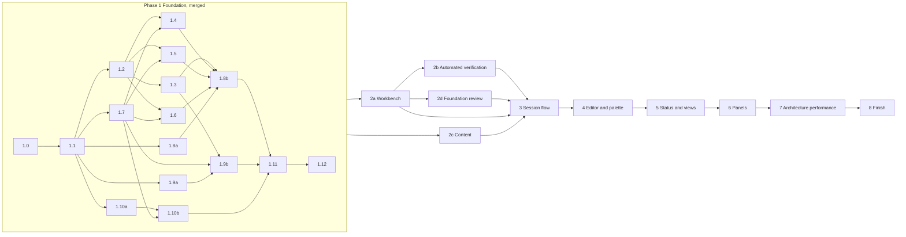

# Mayfly UI implementation roadmap

This roadmap turns the reviewed UI design into an ordered series of changes to `packages/`. It plans the work; it
ships no behavior. It was written on 2026-10-02 against `main` at `94de488`, DeepSeek Harness `0.2.0-rc.2`, and pi-tui
`0.84.2`; where it names a file, a type, or a service, that name exists in that tree unless the text says *new*. It
was revised on 2026-10-05, against the same tree, to put the whole basic layer and its performance work into one
foundation phase (D16-D20); §5 maps the earlier phase names onto the current ones. Implementation began on
2026-10-05; the status table in Phase 1 records what has landed, and the slice texts describe what was built once a
slice is marked done. It was revised again on 2026-10-09, after Phase 1 merged, for the phases that follow it (D21-D27):
no compatibility layer and no legacy code, each Mayfly component and its API finalized with the owner in the running
terminal, cost bounded by what is on screen instead of a text quota, decision tests instead of a coverage gate, and a
whole-architecture performance phase before the finish. The same day, after the workbench (2a) landed, Phase 2b was
rewritten as automated verification that runs only what a change can affect (D28, D29). The Phase 1 record keeps the
rules it was built under.

| Input | Role in the implementation |
| --- | --- |
| [`prototypes/ui-preview.mjs`](./prototypes/ui-preview.mjs) with its kit and components | **The starting sketch** (D22). It shows each scene's intent and runs beside the real renderer during review; it was the strict oracle of Phase 1 only. |
| The accepted live frames and the finalized sections of the spec | **The final look and behavior.** What the owner accepts in the running terminal is final; its frames become the component's goldens (§1, §7). |
| [component-library.md](./component-library.md) (the spec) | The rules behind the scenes: states, keys, degradation, vocabulary. A section that is finalized describes the accepted behavior. |
| [component-library-reference.md](./component-library-reference.md) | Wire mechanics and the backlog IDs (A2 … R25) this roadmap schedules (§9). |
| §2 of this file | The decisions taken after review, and (for Phase 1) every place the implementation knowingly differs from the prototype. |

Read §1 and §2 first. §3 states the UI API in real terms, §4 the target architecture, the engine, and content at any
size, §5 the phases, §6 where each Mayfly component gets its data and where it writes, §7 the development loop,
verification, and the work budgets, §8 risks, §9 traceability.

## 1. Rules for every phase

Phase 1 was built under the rules it states in its own text: the prototype as a strict oracle (D19), an additive API
that froze at its end (D16), and the full gate for every slice. From Phase 2 on, these rules hold:

1. **The accepted live frame is the oracle** (D22). A component is done when the owner accepts it in the running
   terminal, at the widths, states, and key walks agreed in review. The prototype scene is where a component starts and
   what it is compared with during review; a difference from it is a review decision, not a defect, and is not logged.
   The accepted frames become the component's goldens, captured from the real renderer (§7).
2. **No compatibility** (D21). `@ephemeral-ai/mayfly-ui`, the core seams, and the Mayfly modules change whenever a
   better design needs it: fields are renamed, removed, or retyped, and node kinds are replaced. A change updates every
   caller in the same change (Mayfly, `examples/`, the gallery, the shipped skills, and the Website reference) and
   leaves no alias, shim, deprecation, or fallback path. A finalized component's API is fixed until the owner reopens
   that component (D23).
3. **Mayfly components are pure.** They live in `packages/mayfly/src/components/` (*new*), import only
   `@ephemeral-ai/mayfly-ui` and their siblings, and turn plain facts into `ui.*` nodes. They read no width, paint no
   ANSI, own no timer, and see no key. A spec enforces it from the change that creates the area (Phase 3).
4. **The architecture rules hold.** Only `packages/mayfly/src/core/` imports pi-tui and owns width, ANSI, focus, layout,
   and clocks. Contributions go through the four services (`mayflyPanes`, `mayflyStatus`, `mayflyOverlays`,
   `mayflyEditorExtensions`); host slots use a core-private lease (§3.4). Effects are Fiber-owned; Agent-scoped writes
   use the exact Agent from `mayflyCurrentAgent`. Data comes from native dsh services and projections; no renderer folds
   session events into a second store.
5. **One component at a time, with the owner** (D23, D24). A component goes through draft, review rounds, and
   finalization (§7). Review rounds run in a dedicated `mayfly-<phase>` profile and run only the checks the change
   needs; finalization adds the decision tests, deletes the code the component replaces, and runs the changed gate; the
   component then merges to `main`, where CI runs the full gate. A phase ends with the full gate and the owner's
   acceptance of the whole phase. No release is cut from the middle of a phase.
6. **Identity is the cache key, and performance is continuous.** A node that reaches core is a frozen snapshot, so an
   unchanged subtree must cost nothing on publish: its admission, its compiled component, and its painted rows are
   reused by identity (§4.1). A component keeps an unchanged sub-node identical instead of rebuilding it. Cost is
   bounded by what is on screen, never by a quota on what is published (§4.2). The deterministic work budgets (§7.1)
   stay in the gate. A performance problem seen in review is fixed in that round when it is local; one that needs the
   architecture to change is recorded for Phase 7 (D27), which may break anything to remove it.

## 2. Decisions and differences

### 2.1 Decisions taken for the implementation

Taken with the reviewer on 2026-10-02, after the design was approved. D16 to D20 were taken on 2026-10-05, when the
phases were re-cut. D21 to D27 were taken with the owner on 2026-10-09, after Phase 1 merged; a decision they replace
keeps its row and names its successor, because the Phase 1 record cites it.

| ID | Decision | Consequence |
| --- | --- | --- |
| D1 | **Literal `ui.*` migration, staged.** The status footer, the main editor, and the transcript become pure components whose nodes core compiles, like any plugin surface. | Core gains a node-backed host slot (§3.4, slice 1.10) and the engine that makes it cheap (§4.1, slice 1.1). The transcript moves first, in Phase 3, the editor in Phase 4, and the footer in Phase 5. |
| D2 | **Row-2 views are panes** with a new `placement: 'views'` and a summary. | `mayflyPanes` grows (§3.4); a plugin adds a view with the same call Mayfly uses. |
| D3 | **Native options only** for permissions and plan review. | The permission panel and the onboarding step list the native presets (`read-only`, `workspace-write`, `danger-full-access`). The plan card offers *Approve and start*, *Keep planning…*, *Reject*; there is no *Accept edits* preset and no *Approve and auto-accept edits*. |
| D4 | **Decision cards use variant B, grant-first.** | The common grant is row 1 and focused, digits choose at once, `Esc` rejects, and every card that opens unprompted gets the 300 ms arm delay (E4, slice 1.8). |
| D5 | **No session delete.** The Harness has no deletion (`SessionPersistence` offers `create`, `open`, `flush`, `stat`, `list`). | `/sessions` ships without `x` and without the `u undo · 8s` toast. They return when the Harness exposes deletion. |
| D6 | **Keys are scoped by focus.** | In the editor `Ctrl+S` stays *steer* and `Ctrl+F`/`Ctrl+J` keep their pi-tui editing meaning; inside surfaces `Ctrl+S` is `ui.save`; `Ctrl+F` searches only while the stream or a list has focus; the toast drops `Ctrl+J view` (§3.4 has the table). |
| D7 | **One components area**, `packages/mayfly/src/components/`, with no Cordis entry and no public subpath. | `packages/mayfly/AGENTS.md` gains the area and its layering rule. |
| D8 | **The `/` palette is the editor's completion list.** | Drawn with scene 30's row layout (match bold, description), as a borderless palette over the stream on the rows above the frame (owner decision, Phase 4 round 1), with no key line and no key at the right edge (round 4). |
| D9 | **`@` completions: `Enter` or `Tab` insert the token; `Ctrl+G` opens the focused file externally** (`ui.external`, the row shows `↗ code`). | Scene 30's *Files* overlay is not a separate surface. |
| D10 | **Rewind keeps today's conversation branch**, without the restore-scope strip (the Harness has no file checkpoints). | The checkpoint list takes the new look only. |
| D11 | **Changed files opens from a new `/changes` command.** | Data comes from the session's edit and write calls. |
| D12 | **Settings: the rail lists native namespaces; each keeps a draft and saves with `Ctrl+S`** through today's revision-checked `settings.mutate`. | Not the scene's curated groups, and not apply-as-you-go. |
| D13 | **Usage money estimates are priced from models.dev**, in USD, marked `≈`, hidden when a model has no price. | `interaction/models-dev.ts` also reads the catalog's cost fields. |
| D14 | **A new `ui.image` content node** keeps pasted images inline in the stream. | Core paints it with the existing image component; plugins get it too. |
| D15 | **This roadmap lives in PR #84** beside the spec. | — |
| D16 | **Foundation first, then an API freeze.** Phase 1 delivers the oracle, the engine, the visual language, every basic component, the key engine, the patterns, `ui.prompt`, `ui.image`, the views lane, and the node host slot. No Mayfly surface migrates in it. | Delivered by Phase 1. The freeze is superseded by D21: the API changes whenever a component needs it, and is fixed per component when that component is finalized (D23). |
| D17 | **An incremental engine, not point caches.** | Admission, compilation, and painting reuse an unchanged subtree by identity; animation patches cells; one clock serves every surface (§4.1). It is slice 1.1, ahead of every feature slice, so each new painter is written once, in its cacheable form. |
| D18 | **Phase 1 lands through an integration branch**, `feat/ui-foundation`, with three acceptance checkpoints and one merge to `main`. | `main` and the release-candidate line never carry a half-restyled UI. The branch is rebased on `main` at each checkpoint (§5, §8). Phase 1 only; later phases land per component (D24). |
| D19 | **Parity is strict.** | Every cell's character and style class, every key walk, and every motion table are compared, not only the rows and the marks. Phase 1 only; superseded by D22. |
| D20 | **No type-only API.** Every public addition is live end to end when it ships and has a plugin-side consumer in `examples/`. | The views lane ships in slice 1.10 with a gallery view, although Mayfly's own views move onto it in Phase 5. From Phase 2 on, the Mayfly component that needs an addition is its live consumer; `examples/` changes when a public seam it exercises changes. |
| D21 | **No compatibility layer and no legacy code.** | Supersedes D16's freeze and the additive rule Phase 1 followed. Contracts, builders, core seams, and Mayfly modules change incompatibly when a better design needs it, with every caller updated in the same change (§1 rule 2). No alias, shim, deprecation, or fallback path is kept. |
| D22 | **The accepted live frame is the oracle.** | Supersedes D19. The prototype is the starting sketch; the owner decides in the running terminal, and the accepted frames, captured from the real renderer, become the goldens. §2.3 closes as the Phase 1 record; Phase 2 retires the prototype parity machinery (scene ports, Δ waivers, the pending ledger) from the gate. |
| D23 | **Finalize one component at a time.** | A component and the API it needs are developed in review rounds with the owner and fixed together when the owner accepts it (§7). The change that finalizes it deletes the code it replaces. A finalized component is reopened only at the owner's request. |
| D24 | **Finalized components land on `main` one at a time.** | Supersedes D18 after Phase 1. `main` may show old and new surfaces side by side during a phase; no release is cut until the phase is accepted as a whole. No long-lived integration branch. |
| D25 | **Decision tests and a coverage floor.** | Tests record what was decided: accepted frames, keys, writes, lifecycle, width, and work budgets. The per-file 100% coverage gate becomes a coverage report with a repository-wide floor that runs in the full tier (Phase 2b); a test that only reaches a line is not written. |
| D26 | **Cost is bounded by what is on screen.** | The whole-tree text quota (`MAYFLY_UI_MAX_TEXT`, 20,000 characters) and the paint-time string cap go. Long text is chunked, admitted, and painted as the window reaches it; a derived-row cache bounds memory by eviction (D33, §4.2, Phase 2c). |
| D27 | **A whole-architecture performance phase.** | Phase 7 profiles the finished product on real workloads and restructures what the measurements name, breaking anything it must, then resets the budgets and the bench ceilings (§7.1). Earlier phases fix only local problems. |
| D28 | **Scenarios are the automated oracle of the live product.** | One catalog of scenarios drives review, frames, goldens, perf, and screenshots (Phase 2b). The gate compares cell grids read from a real `dsh` under a PTY. Screenshots from xterm.js in headless Chrome, and wall-clock perf measured A/B against the merge-base, are reported, not gated. The work-budget counters (§7.1) stay the deterministic perf gate. |
| D29 | **Verification follows the change.** | An import graph and declared inputs select the specs, checks, and scenarios a change can affect. A file no rule claims escalates to the full tier. The full tier runs in CI on every push to `main`, nightly, at a release, and at a phase end. A local run never measures coverage. |
| D30 | **Chunks on content fields.** | Append-only text (a streamed answer, job output, a live log) is a `chunks` list on the text field itself, and an append shares every chunk before the new one, so identity does the diffing (§4.2). Chunks are frozen wire data, not handles. |
| D31 | **A long line wraps by character.** | A line past 16 KB is its own segment and wraps on a column boundary, with column samples that let a window start anywhere in it (§4.2). |
| D32 | **Phase 2c windows the compiled surfaces.** | Overlays, panes, the node slot, list bodies, the content container, and the gutter pay for the rows in view. The legacy transcript view still builds every row of a mounted entry; Phase 3a replaces that path (§4.2 scope). |
| D33 | **One derived-row cache, evicted, never an error.** | Each renderer keeps one byte-budgeted LRU of painted rows; the rows a frame uses are pinned, and an evicted segment repaints on demand inside the frame's bound. It replaces D26's one memory ceiling per surface, which was still a hard cutoff that rejected content. |

### 2.2 Spec §8 questions, resolved

| Spec §8 | Resolution |
| --- | --- |
| 1 Decision variant | B (D4). |
| 2 Rebinding | Overrides persist in the `mayfly` settings namespace (`keybindings`); plugin action ids are namespaced `<owner>.<action>` and `ui.*` is reserved; a clash is refused with the owner's name (slice 1.7). |
| 3 Slash-to-filter | Kept (`filterMode: 'slash'`, slice 1.4). |
| 4 Side conversations | As drawn: identity in row 1's center band, `F7 switch · F8 close` (or `detach`) in row 2's right cluster (Phase 5). |
| 5 Unchecked keys | D6 plus the key audit (slices 1.0 and 1.7). `/view <level>` and `Alt+V` stay unscheduled until confirmed; the scene's `Ctrl+O` level cycling is a demo key. |
| 6 Onboarding permissions step | Ships, with the native presets (D3); the deployment's current preset is marked `recommended`. |
| 7 Delete session | Dropped for now (D5). |
| 8 Account balance | `deepseekAccount.getBalance()` when signed in with the DeepSeek account; API-key providers hide the row (the design's *unsupported*). No identity is shown. |
| 9 Lifetimes | 5 s of visible time for `✓` and information; the 8 s undo is unused after D5. |
| 10 Unicode fallback | Specified in slice 1.2 as a proposal to confirm in the foundation review (Phase 2d). |
| 11 API additions | Approved as §3. |
| 12 Unused builders | `sections` and `diagram` stay for plugins. |
| 13 Trace turn | Derived in Mayfly from the session events (`interaction/trace-aggregate.ts`); no Harness change. |
| 14 Write highlighting | Capped at the open card's 40 rows and 32 KB, then plain text. |
| 15 Turn rule | Start time only, as drawn. |

### 2.3 Where the implementation differs from the prototype

This table is the Phase 1 record and is closed (D22). Each row is a deliberate difference that Phase 1's parity specs
list by number. From Phase 2 on, a component may differ from the prototype wherever review decides, and no row is
added: the finalized spec section and the accepted goldens record the outcome. Slice 2b.1 removed the waiver list
(`tests/design/deltas.ts`) with the parity specs that read it; rows that still describe shipped behavior move into the
spec section of their component when it is finalized.

| # | Scene | The prototype draws | The implementation does | Why |
| --- | --- | --- | --- | --- |
| Δ1 | 21 | Variant toggle (`Ctrl+T`), A by default | Variant B only, digits choose, a 300 ms arm delay; the scene's stray-key demo becomes a replay test that grants nothing | D4 |
| Δ2 | 21, 18 | Plan card with four options | *Approve and start*, *Keep planning…* (focuses `Revise:`), *Reject*; `Esc` declines | D3 |
| Δ3 | 21 p4, 29 | *Default*, *Accept edits*, *Full access* | The native presets with their configured names and descriptions; `danger-full-access` asks the shared Yes/No | D3 |
| Δ4 | 24 | `x` delete and `u undo · 8s` | Absent; the hint row omits them | D5 |
| Δ5 | 16 p2 | A toast with `Ctrl+J view` | The toast without a key | D6 |
| Δ6 | 25 | Curated groups, edits applied at once | Native namespaces, a draft per namespace, `Ctrl+S` saves | D12 |
| Δ7 | 26 | `≈ ¥` money figures | `≈ $` priced from models.dev, hidden without a price | D13 |
| Δ8 | 30 p1, p2 | A *Commands* overlay and a *Files* overlay | The editor's `/` and `@` completion lists (scene 15) with the palette's row layout; `Ctrl+G` opens a file | D8, D9 |
| Δ9 | 30 p4 | A restore-scope strip on each checkpoint | No strip; rewind branches the conversation | D10 |
| Δ10 | 19 | Seven prompt styles | Style A (the turn rule) only; the list item `block` field is not added | Spec §5.6 chose A |
| Δ11 | 15 | `Ctrl+K`/`Ctrl+V` add demo tokens | Real flows: pasted images and pastes (`interaction/paste-image.ts`), `@` mentions as tokens | Demo keys |
| Δ12 | 18 | `c` and `Ctrl+G` report what they would do | Real clipboard (`interaction/clipboard-write.ts`) and `$EDITOR` (`interaction/external-editor.ts`) | Demo keys |
| Δ13 | 13, 18 | Row 2 always drawn | Row 2 renders only while a view or a row-2 entry has something to show | Spec §5.1; spec §9 notes the simplification |
| Δ14 | 20 | The after-percentage as a known number | `~` estimate from `compaction/summary.shadowedTokenCount` until the next request reports usage | No native after-value until then |
| Δ15 | 21, 18 | `⚠ deletes files` on a command | A documented Mayfly heuristic on the command text (`rm`, `rmdir`, `unlink`, `git clean`, `del`, …) | No native signal |
| Δ16 | 26, 28 | A balance for every provider | Only with the DeepSeek account sign-in; otherwise the row is hidden | §2.2 row 8 |
| Δ17 | 1 | Captions mention `▌` as the selection mark | The muted bold `→` (spec §2.2) | Stale caption |
| Δ18 | all | The hint words of the kit's `hintFragments` | The same words, including `pick` on a focused select | The kit is the oracle; spec §3.2's table gains `pick` when it is next edited |
| Δ19 | 24 | `n new` on every workspace | `n` acts on the current workspace; other rows carry `unavailableActions.new` with a reason, unless the Harness can start a session in another directory (verify in group 6b) | Process cwd |
| Δ20 | all | The kit's word wrap drops a line's leading spaces and does not reopen the style on a wrapped continuation | The renderer keeps both (scene 7's todo row, scene 8's indented code line, wrapped captions) | Prototype wrap artifact; approved by the reviewer |
| Δ21 | 8 p3 | Markdown drawn by the kit's five rules (bare heading, `•`, `│` quote, a language label over the code) | The shipped markdown component: blank rows between blocks, fences kept, the `md*` tokens | The transcript keeps the streamed markdown component (Phase 3a); proposed in slice 1.3 |
| Δ22 | 8 `h` | `h` swaps highlighted code for one flat user tone | The code node always highlights; no switch | Demo key; proposed in slice 1.3 |
| Δ23 | 8 p5-p7 | Line, point, vertical-bar, and stacked or grouped horizontal-bar charts, and the diagram, from hand-written glyph rows | `simple-ascii-chart` and `beautiful-mermaid` draw them (a horizontal bar is normalized only); the sparkline and the heatmap are the kit's | The kit stands in for libraries it does not specify; proposed in slice 1.3 |
| Δ24 | 7 scroll | `↑` from a followed tail jumps to the top (a stale offset) | `↑` scrolls one row from the tail | Prototype artifact; proposed in slice 1.3 |
| Δ25 | 10 | A flex row of framed surfaces: surfaces measured structurally, the grow remainder to the last child, `…` columns below 60 | The layout engine measures a surface by painting it and shares the remainder by its own rule | The row layout is pi-tui's stack layout; proposed in slice 1.3 |
| Δ26 | 10 `h` | `h` changes only the caption: the `minHeight: 20` child stays | The renderer hides it below 20 rows | Prototype artifact (its viewport height is not read); proposed in slice 1.3 |
| Δ27 | 3, 4, 12 | `▌` marks the cursor in an edited field | The terminal cursor sits there; no glyph is drawn | Spec §4.3 calls it the terminal cursor; approved by the reviewer |
| Δ28 | 4, 6, 12 | The `unsaved changes` badge in scene 3 only | Core adds it to every surface whose form is dirty | Roadmap slice 1.6; approved by the reviewer |
| Δ29 | 6, 11 | `← labels` is never hinted on a focused select, although `←` leaves it for the rail at its first option | The hint row names `← labels` whenever `←` would reach the rail, selects included | Spec §4.5 ("the cue is true"); approved by the reviewer |
| Δ30 | 6 | A form select stepped back to its inherited value unpins: `(inherited)`, no `•`, `Delete use inherited` | The form keeps the override: `(override)`, the `•` mark, `Delete reset` | Settings contract: Mayfly settings preserve equal-value explicit overrides; approved by the reviewer |
| Δ31 | 11 | A card drawn at 80 columns shows four hint fragments (the kit counts the frame's width) | Three fragments: the renderer counts the width inside the frame (76) | The hint limit is the painter's existing behavior; approved by the reviewer |
| Δ32 | 11 | A printable accelerator (`c copy name`) runs and is hinted from anywhere, the note field included | It is neither bound nor hinted while a text field holds focus, because the key is the field's text | The key grammar's existing rule; approved by the reviewer |
| Δ33 | 23 | A list being filtered steps its thinking strip with `←/→` without hinting it (49 cells per frame in the `filter` walk) | The hint row names `←/→ thinking` while the strip steps, in any state of the list | Spec §4.5 ("the cue is true"; as Δ29); found by the model-picker composition spike (draft PR #114); approved by the reviewer |

Spec items the preview does not draw and this roadmap does not schedule: diff hunk review (`HunkReview` is unreachable
in scene 30), scroll match ticks (`marks`, `currentMark`) and `reveal`, the views' fan-out stagger and row flash, and
the edit card's settle flash. A review round may take any of them up; otherwise they can follow Phase 8.

## 3. The UI API in real terms

This section is the API Phase 1 built and shipped. It is the starting point of every later phase, not a limit: under
D21 a phase changes, replaces, or removes any field, builder, or event below when the component it finalizes needs it,
updates every caller in the same change, and updates this section, the type fixtures, and the Website reference with
it. §3.5 lists what Phase 1 left out, not what may never be added.

### 3.1 Prototype calls and today's builders

The kit (`ui-kit.mjs`) shortens a few calls. The implementation keeps today's signatures:

| Prototype | Real API |
| --- | --- |
| `ui.scroll({ id, child, … })` | `ui.scroll(child, { id, … })` |
| `ui.empty(title, { description })` | `ui.empty({ title, description })` |
| `ui.spacer(n)`, `ui.divider(label)` | `ui.spacer({ size: n })`, `ui.divider({ label })` |
| `ui.diff(before, after, options)` | the same, with the new optional third parameter (§3.2) |
| `ui.list({ … })` without `selectedIds` | The same: the field is optional and defaults to `[]` (made optional in slice 1.11) |
| list item `label: span[]`, `detail: span[]` | `label: string` (plain, used for filtering) plus `labelSpans` (*new*); the existing `detailSpans` |
| list item `strong: true` | `labelSpans` with `styles: ['strong']` |
| `fields` row `value: 'text'` | `value: [{ text }]` |
| `defineComponent(name, layer, render)` | `defineMayflyComponent({ id: 'mayfly.<name>', render })`; the layer is the module location |
| `patterns.*` | `patterns` exported from `@ephemeral-ai/mayfly-ui` (*new*, slice 1.8) |
| `activate.selected` (each list's cursor row) | The existing action `selections` addresses; a browse list with nothing selected reports its focused row (`UiSurfaceModel.unavailableReason` already resolves it this way) |
| `submit.values` | The existing `MayflySubmission.forms[].fields` |
| reply `invalid.errors: { field: message }` | The existing `MayflyFieldError[]` with form and field addresses |
| `rt.say(message, severity)`, `rt.feedbackNode()` | Reply `feedback`, and `context.report()` for progress; core paints feedback in the surface footer |
| module-level `keymap` | The core `mayflyKeymap` service, extended (§3.4) |

### 3.2 Contract additions

All in `packages/ui/src/contracts.ts` unless noted; every field is optional and defaults to today's behavior.

```ts
// Content
export type MayflyLoaderVariant = 'bloom' | 'fill' | 'gap' | 'breath'
export interface MayflyInlineSpan {
  // …text, tone, styles
  /** One motion channel: the letters shimmer, or the span is one animated loader cell (text must be ''). */
  readonly motion?: 'shimmer' | 'loader'
  readonly variant?: MayflyLoaderVariant              // with motion 'loader'; default 'gap'
}
export type MayflyTextOverflow = 'wrap' | 'truncate' | 'middle' | 'start'   // two new values
export interface MayflyTextNode { /* … */ readonly styles?: readonly MayflyTextStyle[] }
export interface MayflyCodeNode { /* … */ readonly numbered?: boolean }      // highlighting becomes the default
export interface MayflyDiffNode {
  // …before, after
  readonly start?: number            // first line number (default 1)
  readonly numbered?: boolean        // old/new gutters (default true)
  readonly hunkHeader?: boolean      // force an @@ header (default: only when more than one hunk)
  readonly context?: number          // context lines per hunk (default 1, at most 3)
  readonly maxRows?: number          // then `… +N rows · Ctrl+O`
}
export interface MayflyHeatmapChartNode { /* … */ readonly cell?: 1 | 2, readonly columnLabels?: readonly string[] }
export interface MayflyImageNode {   // new kind (D14)
  readonly kind: 'image'
  readonly attachmentId: string      // bytes come from a loader the host tree supplies (slice 1.9)
  readonly alt: string               // the text fallback, e.g. `[Image #1 84 KB]`
  readonly maxRows?: number
}

// Feedback
export interface MayflyLoaderNode {
  // …elapsedMs, cancelActionId, cancelLabel
  readonly message?: string          // now optional: a bare glyph for the activity row
  readonly variant?: MayflyLoaderVariant | 'braille' | 'tide'   // the old values stay accepted as 'gap'
}
export interface MayflyProgressNode {
  // …label, value, max
  readonly style?: 'cells' | 'rule'
  readonly width?: number
  readonly tone?: MayflyTone
  readonly showCount?: boolean       // default true for cells
  readonly showPercent?: boolean
  readonly transition?: { readonly from: number, readonly ms: number, readonly rev: number }  // a renderer-owned one-shot (the compaction drain)
}

// Layout and chrome
export interface MayflyUiChild {
  // …node, id, tab, basis, grow, shrink, minSize, maxSize, when
  readonly priority?: number         // admission order in a row; lower is kept first
  readonly band?: 'left' | 'center' | 'right'
  readonly overflow?: 'truncate' | 'hide'
}
export interface MayflySurfaceNode {
  // …title, subtitle, badges, chrome, padding, child, footer
  readonly titleAlign?: 'left' | 'right'
  readonly border?: MayflyTone
  readonly escapeLabel?: 'close' | 'back' | 'cancel' | 'reject' | 'leave'
  readonly hint?: 'auto' | 'none' | 'completions'
}
export interface MayflyScrollNode {
  // …id, child, follow, scrollbar
  readonly height?: number
  readonly expandedHeight?: number
  readonly fit?: boolean             // shrink to short content; scrollbar only on overflow
  readonly pill?: boolean            // `↓ N new · End` while scrolled away from a followed tail
}

// Tabs
export interface MayflyTabItem {
  // …id, label, disabled, backId
  readonly count?: number | string   // widened: the todo tab reads `2/6`
  readonly attention?: boolean
  readonly group?: string            // rail heading
  readonly clip?: 'end' | 'start'
}
export interface MayflyTabsNode { /* … */ readonly orientation?: 'horizontal' | 'vertical', readonly hintLabel?: string }

// Lists
export interface MayflyListSegment { /* … */ readonly inheritedId?: string }
export type MayflyListBodyNode = MayflyContentNode | MayflyImageNode | MayflyProgressNode | MayflySpacerNode
  | MayflyDividerNode | MayflyListBodyStackNode                               // content only, never a control
export interface MayflyListBodyStackNode extends Omit<MayflyStackNode, 'children'> {
  readonly children: readonly (Omit<MayflyUiChild, 'node' | 'tab'> & { readonly node: MayflyListBodyNode })[]
}
export interface MayflyListItem {
  // …existing fields
  readonly labelSpans?: readonly MayflyInlineSpan[]
  readonly right?: readonly MayflyInlineSpan[]
  readonly rightFocus?: readonly MayflyInlineSpan[]
  readonly body?: string | MayflyListBodyNode
  readonly bodyAlways?: boolean
  readonly expanded?: boolean        // initial disclosure
  readonly wrap?: boolean
  readonly wrapMax?: number          // then `▸ N more lines · Enter`
  readonly hang?: number             // columns the continuation lines start beyond the prefix (the leading glyph)
  readonly meter?: { readonly value: number, readonly max: number, readonly width?: number, readonly tone?: MayflyTone }
  readonly indent?: number
  readonly rule?: string             // a non-selectable muted rule with right-aligned text
  readonly gap?: boolean             // a non-selectable blank row
}
export interface MayflyListNode {
  // …existing fields
  readonly filterMode?: 'type' | 'slash'
  readonly marker?: 'cursor' | 'selection'
  readonly marks?: boolean           // ● ○ on a single choose list
  readonly maxRows?: number
  readonly expandFocused?: boolean
  readonly acceptVerb?: 'open' | 'choose' | 'expand' | 'edit' | 'restore'
  readonly autofocus?: boolean
  readonly focusItem?: { readonly id: string, readonly rev: number }
  readonly hintLabel?: string
}

// Forms
export interface MayflyFormFieldBase { /* … */ readonly help?: string, readonly group?: string }
// input, textarea, secret: readonly pattern?: string, patternMessage?: string, suggestions?: readonly string[]

// Actions
export type MayflyCommonMeaning = 'save' | 'copy' | 'delete' | 'refresh' | 'external' | 'search'
export interface MayflyActionItem {
  // …existing fields
  readonly semantic?: MayflyCommonMeaning   // the key is that meaning's binding; exclusive with `key`
  readonly action?: string                  // `<owner>.<action>` component action; `key` is its default
  readonly hintLabel?: string
}
export interface MayflyActionsNode { /* … */ readonly scope?: string | readonly string[] }

// The prompt (new kind)
export interface MayflyPromptNode {
  readonly kind: 'prompt'
  readonly id: string
  readonly symbol?: string                            // default '> '
  readonly symbolTone?: MayflyTone
  readonly value?: string
  readonly tokens?: readonly { readonly id: string, readonly label: string, readonly size?: string }[]
  readonly recall?: readonly { readonly kind: 'queued' | 'history', readonly text: string }[]
  readonly recallLabel?: string
  readonly placeholder?: string | readonly string[]  // a ladder, longest first
  readonly completions?: { readonly items: readonly { readonly id: string, readonly label: string, readonly detail?: string, readonly right?: string }[] }
  readonly reset?: { readonly rev: number, readonly value: string }
  readonly submitLabel?: string
  readonly autofocus?: boolean
}
```

`MayflyUiNode` gains `MayflyPromptNode` and `MayflyImageNode`. Status nodes stay text, rich text, fields, progress, and
stacks of them, now with child admission but no motion. Editor decorations admit neither new kind. The builders
add `ui.image(...)`, `ui.prompt(...)`, and the optional third parameter of `ui.diff`; `packages/ui/src/patterns.ts`
(*new*) adds the four patterns.

`MayflyComponentDefinition` gains `memo?: boolean` (slice 1.1). With it, a call whose props are shallowly equal to
the previous call's returns the same frozen node, so core's identity caches (§4.1) hit without the author holding
references. A component's `render` is already required to be pure, which is what makes this sound.

### 3.3 Events

`packages/ui/src/interaction.ts` gains three action events and two observations:

| Event | Class | Carries | Emitted by |
| --- | --- | --- | --- |
| `focus-change` | observation | `controlId`, `itemId?` | a list cursor move, at most once per render frame (detail follows the cursor) |
| `recall-change` | observation | `controlId`, `source: 'queued' \| 'history' \| 'draft'`, `index` | the prompt walking its recall |
| `token-remove` | action | `controlId`, `tokenId` | the prompt's second `Backspace` |
| `completion-accept` | action | `controlId`, `itemId` | `Tab` or `Enter` on a completion |
| `completion-dismiss` | action | `controlId` | `Esc` on an open completion list |

The prompt reuses two events: `value-change` (with `formId` set to the prompt id) and `submit`, whose
`MayflySubmission` holds one form addressed by the prompt id with the fields `text` and `tokens` (the token ids). The
replies are unchanged.

### 3.4 Services, runtime, and core-private seams

| Seam | Change |
| --- | --- |
| `mayflyPanes` (public) | `MayflyPanePlacement` gains `'views'`. A views pane declares `summary: { node: MayflyStatusNode, count?: number \| string }` and updates it with the new `registration.setSummary(summary \| null)`; `null` takes the view out of row 2. Its `set(node)` publishes the panel. `size` and `narrow` do not apply; `onEvent`, `load`, `refresh`, and `loadMore` work as for other panes. The lane ships in slice 1.10; Mayfly's own views register on it in Phase 5. |
| `mayflyOverlays` (public) | `MayflyOverlayDefinition.armMs?: number` (0-2000, default 0): every key except `Esc` is swallowed for that long after the overlay first takes focus (slice 1.8). |
| `mayflyStatus` (public) | No new API. Core composes row 1 and row 2 with the `ui.child` admission primitive, so a plugin entry and a Mayfly entry are admitted by one rule. |
| `mayflyEditorExtensions` (public) | No new API. `complete()` results join the prompt's completion list; `before`/`after` decorations sit around the editor surface. |
| `mayflyKeymap` (core service) | Scopes (`global`, `editor`, `surface`, `stream`); `bind(id, keys)`, `reset(id)`, `resetAll()`, `list()` (label, scope, defaults, effective keys, owner, overridden), `preferPlain`. Conflicts are refused per scope with the owner's name (the existing `KEY_CONFLICT`). |
| `mayflyScreen` (core-private) | *New* `mountNodeSlot(id, { region: 'content' \| 'dock' \| 'footer' })` returns `{ set(node), dispose() }`; core compiles the node like a surface, with its interaction state in `mayflyUiInteraction`. It ships in slice 1.10 beside `mountContentSlot` and `mountDockSlot`, exercised by a test host; the conversation (Phase 3), the editor (Phase 4), and the footer (Phase 5) use it. |
| `mayflyUiInteraction` (frontend) | A *new* `UiPromptModel` beside the form, choice, and tab models (draft, selected token, recall index), and list `focusItem` and expansion state, so a core reload keeps them. |

The key scopes of D6:

| Key | Editor (prompt focused) | Surface (overlay or pane focused) | Stream focused |
| --- | --- | --- | --- |
| `Ctrl+S` | steer (`mayfly.interaction.steer`) | `ui.save` | — |
| `Ctrl+F` | cursor right (pi-tui) | `ui.search`, when a list has focus | `ui.search` |
| `Ctrl+G` | `ui.external`: the draft in `$EDITOR` (today's behavior) | `ui.external`: the focused content | `ui.external`: the row |
| `Ctrl+J` | newline (pi-tui) | `ui.newline` in a textarea | — |
| `c` `x` `r` | text | `ui.copy` `ui.delete` `ui.refresh` (no type-to-filter list, not editing) | `ui.copy` |
| `Alt+↑` / `F4` | focus the stream | `ui.focus-prev` | — |
| `Alt+↓` / `F5` | enter the views (empty prompt) | `ui.focus-next` | back to the prompt |
| `F6` | enter the views, then the interactive panes (`mayfly.surface.next`) | next surface | next surface |
| `?` | key help (empty prompt) | text | — |
| `F7` / `F8` | conversation switch / close or detach (global) | same | same |
| `Ctrl+O` | the last three turns at Verbose (global) | same | same |
| `Ctrl+T` | open the views on Todo (global; replaces the todo-pane toggle) | same | same |

### 3.5 What is not added

`MayflyListItem.block`, `strong`, and `expandable` (a body implies it); scroll `marks`, `currentMark`, and `reveal`; the
reference's F1 *buttons on demand*. None appears in the preview.

## 4. Target architecture

```
native dsh services and projections            (Agent, Session, goal, jobs, userQuestions, settings, account, …)
        │ facts (plain readonly data)
        ▼
feature plugins in transcript/ and interaction/  (Fiber-owned subscriptions, writes, timers for data refresh)
        │ call
        ▼
components/  (pure: facts + t → ui.* nodes)     ◄── the same builders a plugin uses
        │ nodes
        ▼
four public services, or a core-private host slot lease
        │
        ▼
core: validator → compiler → painters; one key grammar; one keymap; the only clocks
        │
        ▼
terminal (pi-tui)
```

- **`packages/ui`** owns the wire contracts, builders, and patterns. It never imports Cordis outside `./provider`.
- **`components/`** holds every Mayfly component of spec §6.2 under the names in §6. Each is
  `defineMayflyComponent({ id: 'mayfly.<name>', render })`, takes facts plus a `t` translator, and is covered by
  its decision tests (§7): the accepted frames as goldens, its key and write behavior, and a width scan.
- **Feature plugins** keep their Cordis rows. They subscribe to native services, keep Agent identity exact, own data
  refresh timers (an elapsed counter is data, refreshed once a second), and publish the component's node.
- **Core** owns every animation clock (loader variants, shimmer, one-shot transitions), width ladders, admission,
  focus, the key grammar and keymap, and the host slots. The prototype's `--audit` becomes
  `tests/components/layering.spec.ts`.

### 4.1 The engine

Today every `set()` is a full rebuild. `UiSurfaceModel.receive` (`core/ui-interaction-surface.ts`) validates the whole
tree into a new admitted tree, `compileMayflyUiSurfaceNode` builds a fresh `CompiledSurface`, and the per-width row
memos of `pureStaticComponent` die with it. Every loader tick repaints the whole surface, because `renderFrameOnce`
keys its memo on the animation frame, and list, tab, action, and form-field rows are repainted on every frame. That
is affordable for a panel; it is not for a status area, an editor, and a transcript published as nodes (D1).

The registries freeze every snapshot (`freezeWire` in `packages/ui/src/services.ts`), so a node that reaches core is
deeply immutable and **its identity is a sound cache key**. The engine (slice 1.1) builds on that:

| Part | Change | Where |
| --- | --- | --- |
| Admission memo | A subtree admitted once returns the same admitted object the next time. A stored summary (node, text, and chart counts; control ids, tabs, pages, action keys, the filterable flag) is replayed into the budget, so every limit and every duplicate check still runs. The key is the raw node's identity plus its context (mode, page path, scroll depth, depth). It applies to registry snapshots only; a caller-owned value takes today's path. | `core/ui-validator.ts`, `core/ui-interaction-surface.ts` |
| Compile reuse | `compileNode` looks an admitted node up in a per-runtime `WeakMap`; a hit reuses the component and replays its control bindings into the new generation. Theme, keymap, locale, and screen-mode changes start a new epoch. | `core/ui-compiler.ts`, `core/ui-compile-cache.ts` (*new*) |
| Row cache | List, tab, action, and form-field painters become functions of (item, width, state bits) with a small cache per item, so a cursor move repaints two rows. Rows of varying height keep a prefix-sum index for windowing. | `core/ui-patterns.ts`, `core/ui-row-cache.ts` (*new*) |
| Animation patches | Static rows are cached without the animation frame. An animated cell registers a slot (row, column, a paint function of the frame), and a tick repaints only the rows that hold one. | `core/ui-compiler.ts` (`renderFrameOnce`) |
| One clock | One core timer serves every surface. A surface subscribes while it shows an animated cell and leaves when it hides, so the timer stops when nothing moves; reduced motion freezes every channel. Slice 1.1 keeps today's 80 ms step, and slice 1.3 sets the design's cadences. | `core/ui-loader-animation.ts` |
| Measured cells | Painters assemble rows from cells that carry their text and width, so a string is measured once and painted ANSI is never measured again on a hot path. | `core/ui-measure.ts` (*new*), over `core/width.ts` |
| Hint memo | The hint row is memoized on the focus identity, the interaction revision, the width, and the keymap revision. | `core/ui-compiler.ts` (`contextKeyHintRows`) |
| Lazy item bodies | A list item's body is admitted with the item, lazily and under a per-item budget (extending `lazyListItems`), so a long list of rich rows is legal without raising the tree quotas. It lands with the `body` field, in slice 1.4. | `core/ui-validator.ts` |
| Upstream identity | `defineMayflyComponent({ memo: true })` (§3.2). | `packages/ui/src/builders.ts` |

The precedents are already in core: `pureStaticComponent` (a per-width memo), `walkControlsCached` (a revision-keyed
memo), `clampFrameFrom` in `core/frame-clamp.ts` (frames compared by identity), and `lazyListItems` with `listWindow`
(bounded list work). The counters that prove the reuse are passed through the compiler options (§7.1), never held in
a singleton.

### 4.2 Content at any size (D26, D30-D33)

**The problem.** Admission charges every string of one publish to a single budget, `MAYFLY_UI_MAX_TEXT` (20,000
UTF-16 units, `core/ui-validator.ts`), beside the node, depth, collection, image, and chart quotas. Ids, labels, code,
Markdown, and both sides of a diff all count; an identity hit replays the stored count, so the cache does not help. A
publish over the budget is rejected, never cut: a first publish shows *This surface could not be displayed*, a later
one leaves the old content on screen, and a compiled leaf paints up to three *Mayfly UI rejected* rows. A second wall
sits at paint time: `PLUGIN_VIEW_MAX_CHARS` (`core/plugin-view.ts`) throws for any single string over 20,000. List
items and select options each get a fresh budget, which is why `/sessions` works, but any one item is still capped.
The cap is too loose where it holds, too: a 2,000-item list may legally carry 40 million characters, and nothing
bounds paint work or the rows kept in memory.

What it costs today:

- A tool card for a write over 20 KB, or an edit whose old and new text together pass it, renders the rejection
  instead of the diff (`transcript/tool-model.ts` through `canonical-node-renderer.ts`).
- A plan longer than 20 KB renders as rejection rows (`interaction/plan-document.ts`, one `ui.markdown`).
- Job output and trace payloads were cut into 12,000-character pages by hand, with a
  page form and First/Previous/Go/Next/Last actions; the scroll position reset on
  every page. 2c.4 replaced them with one scroll each.
- The changelog renders every release in one tree and grows past the budget; fixtures are cut to stay under it
  (`tests/core/width-scan-patterns.spec.ts`).
- The transcript of Phase 3 would reject any answer, diff, or plan row over 20,000 characters, and in a short session
  the whole stream.

**What a stage costs** (1 MB sources, 118 columns, one machine, Phase 2c measurements):

| Stage | Code | Log | Markdown | CJK/emoji |
| --- | --- | --- | --- | --- |
| Sanitize (`ANSI_OR_OSC`, `UNSAFE_CONTROLS`) | 2.4 ms | 1.0 ms | 1.2 ms | — |
| Line index | 0.8 ms | 0.2 ms | 0.1 ms | — |
| Row estimate, no painting | 2 ms ASCII fast path; 153 ms through `visibleWidth` | 57 ms | 2.0 ms | 32 ms code-point table; 388 ms through `visibleWidth` |
| Paint every row | 300 ms | 429 ms | 155 ms wrapped; 608 ms through `Markdown` | 469 ms |
| Painted rows kept, one width | 2.6 MB | 2.3 MB | 2.3 MB | — |
| Paint one 4 KB segment | 0.1 ms | 1.1 ms | 0.5 ms | — |
| Estimate error against the real wrap | 0.0% | -0.8% | -0.7% | 0.0% |

A 1 MB file with 60 one-line edits aligns to 40,748 changed rows and paints in 669 ms through `alignDiffLines`; a
Myers diff over interned line ids (the `diff` package, already a dependency) finds the 120 changed rows in 7.2 ms, and
`paintDiffRows` overflows the call stack near 200,000 operations on a `Math.max(...)` spread. One 1 MB line takes
348 ms to wrap. Painting one 4 KB segment costs 0.1-1.1 ms wherever it sits in the document, which is the whole
argument for windows.

**Why painting is the wall.** pi-tui's contract is `render(width): string[]`, every row or none. Its layout reads a
leaf's `lines.length` for the height and indexes only the rows it clips, so the renderer already paints just what is
on screen; what it lacks is the height of the rows it has not painted. Mayfly's own containers are the problem: each
one flattens, maps, or decorates its child's whole array (`ColumnStack`, `framedSurfaceComponent`,
`FrameClampedContainer`, `ScrollRegion`, the list painter), and a retained leaf memoizes whole arrays, about 10 MB of
rows per MB of source at the cached widths. A `ScrollView` therefore bounds nothing: its child has already built every
row before a clip exists.

**The rule.** Work and memory are bounded by the rows in view, never by the size of what was published. Admission
checks shape and safety once per identity; it does not police how much text an author may legitimately show. This is
what `docs/mayfly-seams.md` already promises: core validates, compiles, and paints the viewport's neighborhood.

**The mechanism.**

| Part | Behavior | Builds on |
| --- | --- | --- |
| Virtual rows | A leaf that windows its content hands its parent a frozen array facade over a row source: `length` is real, row *i* is painted on first read, and every read is counted. pi-tui reads `length` and the clipped rows, so a window flows through the native layout with no pi-tui change. Every Mayfly pipe either keeps the rows lazy (concat, map, slice, the scrollbar column) or is bounded by the viewport; a spec drives a counting source through every pipe and pins pi-tui's access pattern against an upgrade. A source whose row map can move (a lazily painted document whose estimates become painted counts) carries a revision, and a facade drops the rows it read under an old one; a document painted whole when it is built is fixed, so a pipe over ordinary content never checks one. The `unclamped` chain a scroll follows reads through facades that keep a bounded window, so a retained tree inside a scroll paints once and a scroll across a whole document holds no more than that window. | `lazyListItems` |
| Segments | The unit of measure, paint, and cache, cut per kind under a 4 KB / 64-row ceiling. Text and code cut at runs of whole lines; a line past 16 KB is its own segment and wraps by character (D31), with column samples every 256 units so a window can start inside it. Markdown cuts only at a blank line outside fences and HTML blocks, never between list items or inside a table, with reference definitions gathered in one pass. A diff's segments are its hunks, aligned by Myers over interned line ids under a `maxEditLength` bound, anchored on lines unique to both sides past it. | `documentPages`' boundary rules |
| Two-tier extents | An unseen segment reports an estimate: per-line column counts (an ASCII fast path, else a code-point East-Asian table; `width.ts` stays the truth) wrapped arithmetically, plus the kind's structure, kept in a prefix-sum tree. Painting replaces the estimate with the exact count, which is kept after the rows are evicted. A scroll paints the segments under its window before it exposes rows, so the row map of a frame is exact where it is seen; corrections land off screen, and a source anchor absorbs the rest. | — |
| Field classes at admission | Content fields (text, Markdown, code, diff, diagram, rich-text spans, string list bodies) carry no length cap. Ids reject past 1,024 units. One-row labels (labels, titles, badges, details, hints, `searchText`, chart labels, `alt`, notifications) clip at 4,096 units, surrogate-safe with an ellipsis. Drafts keep a 100,000-unit budget per tree (`MAYFLY_UI_MAX_DRAFT_TEXT`). The node, depth, collection, image, and chart quotas stay; they bound layout work. | — |
| The derived-row cache (D33) | One byte-budgeted LRU per renderer holds painted segment rows by (identity, width, epoch); the rows of the current and previous frame are pinned. Eviction is never an error: a segment repaints inside the same frame bound. The size is set from the measurements above; about 64 MiB holds 25 MB of source painted at one width. | `UiRowCache`, the retained variants |
| Append keeps identity (D30) | Content fields accept a `chunks` list of frozen `{ text }` parts. An append shares every chunk before the new one; admission memoizes per chunk and the line index is reused per chunk, so an append validates one node, admits the delta plus the boundary chunk, and paints the tail segment only while following. Sanitizing stays eager and per chunk: `UNSAFE_CONTROLS` removes controls individually, so a boundary can cost cosmetics, never safety. | `freezeWire` identity, the admission memo |
| Anchors | A scroll position stays a source position. A document block holds the admitted leaf and its length, not a copy of its source; an unchanged leaf costs nothing on republish; rows and anchors map through the leaf's row source instead of a re-wrap of the whole text per frame. | `UiDocumentBlock`, `UiDocumentAnchor` |
| Windowed scrolls | A scroll over virtual rows paints the segments under its previous window, then exposes a facade whose visible span is exact. A semantic scroll derives its top from the anchor each frame, so an estimate correction never moves visible text; a plain index scroll corrects only above its painted window. Follow-tail reads the end from the painted tail segments. | `SemanticScrollView`, `core/ui-scroll-region.ts` |
| List bodies | An open item body is a nested row source; the list window paints the body rows inside it. | `core/ui-list-paint.ts` |
| Scope (D32) | Compiled surfaces (overlays, panes, the node slot, list bodies), the content container, and the gutter window. The legacy transcript view still builds every row of a mounted entry until Phase 3a, so an expanded 1 MB card or a long plan paints in full once per width. Outside any scroll, on the alternate screen, a content leaf paints at most the viewport's rows plus a `… N more rows` row. pi-tui's own full-row scans (the alternate screen's search and prompt jumps) materialize rows only when invoked and stay until Phase 3e. | — |
| Plain data | The wire carries strings and frozen arrays only: chunks are frozen data, no source handle, callback, or Promise (root `AGENTS.md`). | — |

**What it deletes.** `MAYFLY_UI_MAX_TEXT`, `PLUGIN_VIEW_MAX_CHARS` and its `RangeError`, `renderCanonicalView`'s
paint-everything path for the content kinds, the full per-width row memo of those kinds, `rowOffsets`' re-wrap of the
document on every frame, `interaction/document-pages.ts` and the page forms of job output and trace details (each
becomes a scroll view with follow-tail), `DIFF_ALIGN_MAX_ROWS` with the LCS table and the `Math.max(...)` spreads that
overflow past 200,000 operations, `admitNotificationMessage`'s reuse of the text budget (a notification gets its own
length rule), and the fixture cut in `width-scan-patterns.spec.ts`.

**Gate rows** (§7.1): W18-W24, each baselined from its first measurement; `budgets.json` holds the counts. A separate
spec scrolls a 50 MB document end to end and checks the cache never passes its budget.

| Row | Workload | Step | Budget |
| --- | --- | --- | --- |
| W18 | 1 MB of code in a declared-height scroll; again in an overlay's layout-driven scroll (frame workload) | PageDown | 0 validated or compiled; rows materialized ≤ viewport + one segment |
| W19 | the same document | resize 100 to 99 | rows ≤ viewport + one segment; lines estimated ≤ the document's lines |
| W20 | 10 MB of code | End | rows ≤ viewport + two segments |
| W21 | a 1 MB file with 60 edits | first paint | rows ≤ viewport; the alignment counts 120 changed rows |
| W22 | 1 MB of Markdown | PageDown | rows ≤ viewport + one block segment |
| W23 | a 1 MB chunked log, following | append 100 units | units admitted ≤ 100 + one chunk; 1 segment painted |
| W24 | a 2,000-item stream holding a 200 KB diff and a 1 MB Markdown body | the last item changes | W4's figures |

## 5. Phases

Phase 1 is the foundation: the whole basic layer, the engine under it, and the seams the later phases mount on. It is
merged. Phase 2 builds the workbench that makes review fast, replaces the text quota (§4.2), and takes the owner's
review of the foundation. Phases 3 to 6 each finalize a group of Mayfly components with the owner, in the order the
product is used (D23); Phase 7 optimizes the whole architecture (D27), and Phase 8 finishes.

| Phase | Groups | Delivers | Prototype scenes (sketch) | Gate |
| --- | --- | --- | --- | --- |
| 1 Foundation | 13 slices (1.0-1.12) | The oracle, the engine, the visual language, every basic component, the key engine, the patterns, the prompt and image nodes, the host seams, the API freeze, the frame cost | 1-12, 15 (the prompt alone), 13 (the lane) | full for each slice (the Phase 1 rules) |
| 2 Workbench and content | 4 (2a-2d) | The live review loop and frame capture, automated and change-precise verification (tiers, scenario goldens, perf A/B, real screenshots), content at any size, the owner's review of the foundation | 1-13, 15 | changed per part; full at the end; owner review (2d) |
| 3 Session flow | 5 (3a-3e) | The components area; the stream and its turns, tool rows, the activity row and notices, request rows and decision cards, levels, selection, search | 14, 16-21 | per component (§7); full and owner at the end |
| 4 Editor and command palette | 4 (4a-4e) | The editor as a prompt composition, the `/` `@` `#` completion palette, queue and recall | 15, 30 p1-p2 | per component; full and owner at the end |
| 5 Status and views | 1-2 | The two status rows and Mayfly's four views | 13, 12 | per component; full and owner at the end |
| 6 Panels | 6 (6a-6f) | Every command panel, questions, and the trace, keys, rewind, job output, and changes surfaces | 21 p4, 22-32 (30 p3-p6) | per component; full and owner at the end |
| 7 Architecture performance | 1 | The finished product profiled on real workloads and restructured where measured; the final budgets and ceilings | — | full + bench report; owner |
| 8 Finish | 1 | Website, skills, docs, release | — | full + pack + release preflight |

*Per component* is the loop of §7: review rounds run the round tier, finalization runs the pr tier
(`pnpm run check`), and CI runs the full tier on `main`. A phase ends with `pnpm run check -- --tier full` and the
owner's acceptance of the whole phase.



The phases after 2 run in review order, because one owner reviews them: the next group may be drafted while the
current one is in review, but only one group is in review at a time.

Phase 1's slices run in parallel (the *Working in parallel* section below): 1.8, 1.9, and 1.10 each split into an
early half that depends on nothing (`armMs`, `ui.image`, the node slot: 1.8a, 1.9a, 1.10a) and a late half (the
patterns, the prompt, the views lane: 1.8b, 1.9b, 1.10b); 1.7 moves ahead of 1.4-1.6 because it renames the action ids
they bind; 1.4-1.6 depend on 1.2 and 1.7, not on 1.3, which needs only 1.2.

The first version of this roadmap named its phases P0 to P8. They map onto the cut of 2026-10-05 as follows:

| Earlier | 2026-10-05 | What moved |
| --- | --- | --- |
| P0 | 1.0 | Gains the work counters and the baseline. The layering spec moves to 2a, with the area it guards. |
| — | 1.1 | New: the engine, brought forward from P7's *Host and performance*. |
| P1 | 1.2 | — |
| P2a-P2g | 1.3-1.9 | `ui.image` moves from P2a to 1.9. |
| P4 (the API), `mountNodeSlot` | 1.10 | The views lane and the node slot, without their Mayfly consumers. |
| — | 1.11 | New: the freeze. |
| — | 1.12 | New: the frame cost, found at checkpoint acceptance. |
| P3a-P3f | 2a-2f | — |
| P4 | 3 | The consumers of the lane and the slot. |
| P5, P6 | 4, 5 | — |
| P7 | 6 | Runs on the engine of 1.1. |
| P8 | 7 | — |

The cut of 2026-10-09 reorders the phases after Phase 1 by how the product is used and adds two. Earlier text, PRs,
and the Phase 1 record use the 2026-10-05 numbers:

| 2026-10-05 | 2026-10-09 | What moved |
| --- | --- | --- |
| — | 2 | New: the workbench, the gate tiers, content at any size, and the foundation review that replaces checkpoints A to C |
| 2a-2d, 2f | 6a-6f | The panels. The components area and its layering spec move to the start of Phase 3. |
| 2e | 3d, 6e | The decision cards join the request rows in the session flow (3d); questions stay with the panels (6e). |
| 3 | 5 | — |
| 4 | 3c | The activity row, notices, and compaction join the session flow; the tool rows become 3b. |
| 5 | 4 | — |
| 6 | 3a, 3b, 3d, 3e | The transcript comes first instead of last. |
| — | 7 | New: the architecture performance phase (D27). |
| 7 | 8 | Its cleanup list is gone: each component deletes what it replaces (D23). |

### Phase 1 Foundation

Phase 1 is merged. Its text below is the record of what was built, under the rules and the phase numbers of
2026-10-05: where it names a later phase, read it through the mapping table above.

**Goal.** The basic components draw and behave as scenes 1 to 12 do, on an engine that makes an unchanged subtree
free, with every public addition of §3 live. No Mayfly component exists yet: existing panels change only through the
shared painters.

**Exit criteria.**

- *Fidelity.* Every page, state, and width of scenes 1 to 12, and of scene 15 for the prompt, has a golden and a
  strict parity spec (§1 rule 1). `examples/ui-gallery` has a page for each basic scene, to run beside the prototype.
- *Performance.* The work budgets of §7.1 hold in the gate, and the wall-clock report shows each slice against the
  baseline of slice 1.0.
- *API.* Every addition of §3 is live end to end and has a plugin-side consumer (D20); `pnpm run check:lib`,
  `check:pack`, and `check:examples` pass.

**Landing (D18).** The slices are PRs into `feat/ui-foundation`, developed in a dedicated worktree with the profile
`mayfly-ui-foundation`. The reviewer accepts at three checkpoints, and the branch is rebased on `main` at each:

| Checkpoint | After | The reviewer checks |
| --- | --- | --- |
| A | 1.0-1.2 | The goldens beside the interactive preview; existing panels in the new visual language at 120 and 60 columns, with `NO_COLOR=1`, ASCII glyphs, and reduced motion; the first work report |
| B | 1.3-1.8 | The gallery page of each basic scene beside the prototype; a key rebound in settings, with the hint row following it; one pattern in `examples/mayfly-user-kit` |
| C | 1.9-1.11 | The prompt (paste, IME, and the clipboard through `docs/platform-acceptance.md`); an inline image; a plugin view in row 2; the final budgets; the Website reference on a LAN preview |

The branch merges to `main` once, followed by `pnpm run check:pack` and the main rebuild. That merge was planned for after checkpoint C; it was made after slice 1.12 instead, on the owner's instruction (#120). The checkpoints were not run as such: their checks became the foundation review of Phase 2d, held with the workbench under D22.

**Status** (updated by each slice's PR; the slice text below describes the built behavior once a slice is done):

| Slice | State | Branch | Notes |
| --- | --- | --- | --- |
| 1.0 | merged (#99) | `feat/ui-foundation-1-0` (`781ae7e`) | Full gate green with 100% coverage; no runtime behavior change |
| 1.1 | merged (#100) | `feat/ui-foundation-1-1` | Full gate green with 100% coverage; no visible change (goldens and screenshots identical); budgets below |
| 1.2 | merged (#102) | `feat/ui-foundation-1-2` | Six parts; full gate green; scenes 1 p1-p5, 7 p1, 8 p3-p4, 9 p3 pinned and scene 2 matched; Δ20 approved |
| 1.7 | merged (#101) | `feat/ui-foundation-1-7` | Six parts; full gate green with 100% coverage |
| 1.10a | merged (#103) | `feat/ui-foundation-1-10a` | Node slot. Full gate green with 100% coverage; no visible change; `W1-slot` and `W4-slot` budgets |
| 1.9a | merged (#104) | `feat/ui-foundation-1-9a` | `ui.image`. Full gate green with 100% coverage; one new shot (`image`), no other visible change |
| 1.8a | merged (#105) | `feat/ui-foundation-1-8a` | `armMs`; two parts; full gate green with 100% coverage; no visible change unless a definition sets `armMs` |
| 1.3 | merged (#106) | `feat/ui-foundation-1-3` | Seven parts; full gate green with 100% coverage; scenes 7 to 10 pinned (Δ21 to Δ26 proposed); the list window of scene 10 was left in the ledger for 1.4, which closed it |
| 1.4 | merged (#107) | `feat/ui-foundation-1-4` | Six parts; full gate green with 100% coverage; scene 5 (all seven pages and the `move`, `open`, `filter` walks) and scene 1 page 1's lists pinned; one `Esc back` hint left pending for 1.5; `W4b` budget |
| 1.5 | merged (#110) | `feat/ui-foundation-1-5` | Five parts; full gate green with 100% coverage; scene 6 (all four pages and the rail's walks) and scene 11 page 2 pinned; the `Esc back` entry of scene 5 closed; `W12-rail` budget; Δ29 approved |
| 1.6 | merged (#109) | `feat/ui-foundation-1-6` | Two parts; full gate green; scenes 3, 4, 12 and scene 1 page 1's form block pinned (Δ27, Δ28 approved); one `Esc back` hint left pending for 1.5; no budget change |
| 1.10b | merged (#108) | `feat/ui-foundation-1-10b` | Views lane. Full gate green with 100% coverage; one new shot (`views-summary`), no other visible change |
| 1.9b | merged (#111) | `feat/ui-foundation-1-9b` | Prompt. Six parts; full gate green; scene 15's frame pinned at 96, 60, and 40 columns (the caption and queue line wait for Phase 5); `W12-prompt` budget; paste and IME are manual acceptance (`docs/platform-acceptance.md`) |
| 1.8b | merged (#113) | `feat/ui-foundation-1-8b` | Patterns. Five parts; full gate green with 100% coverage; scene 11 (all four pages and the `initial`, `move`, `page-2`, `pages` walks) and scene 1 page 6 pinned, the ledger holds no 1.8b entry; three shots (`patterns-decision`, `patterns-rail`, `patterns-status`); Δ31 and Δ32 approved; library file budget 222 to 223 |
| 1.11 | merged (#115) | `feat/ui-foundation-1-11` | Freeze. Eight parts; full gate green with 100% coverage; Phase 1 is complete and waits only for checkpoints A, B, and C. `selectedIds` optional and a type-only `MayflyTranslate` (the model-picker spike's two fixes); Δ33 approved; the ledger holds only Phase 3 and later entries (one stale 1.6 entry removed); final budgets and the work report in §7.1; the ui type fixtures run in the gate (`types.spec.ts`) |
| 1.12a | merged (#116) | `feat/ui-foundation-1-12a` | Frame performance, measurement. Full gate green with 100% coverage; no runtime behavior change; the frame workloads W13 to W17 with their baseline, six frame counters, `pnpm run bench:pty` |
| 1.12b | merged (#117) | `feat/ui-foundation-1-12b` | Frame performance, wasted work. Full gate green with 100% coverage; no visible change (goldens and screenshots identical); a tick on a side pane is one pass and no control walk (W14: 949 renders to 385, 328 walks to 0); the gallery's frame 206 ms to 63 ms and its key 164 ms to 40 ms; without a pane, typing and the panels' cursor keys are back at `main`'s cost except the model picker's edge |
| 1.12c | merged (#118) | `feat/ui-foundation-1-12c` | Frame performance, retained rows. Full gate green with 100% coverage; goldens and screenshots identical, and every suite also passes with the stale-row check on; a key beside an unchanged pane paints no leaf (W13: 447 renders to 0), a loader below the fold does not tick (W14: no tick), a visible one repaints 2 rows (W15); the gallery idles at 0% CPU (from 113%) and its key takes 6 ms (from 164 ms) |
| 1.12d | merged (#119) | `feat/ui-foundation-1-12d` | Frame performance, the gate. Full gate green with 100% coverage; `test:retained` (the stale-row check) and `bench:pty:assert` (coarse ceilings on the real terminal) run in the full gate and in CI; the instructions describe the retained-row rules; library byte budget 2,460,000 to 2,490,000 for the slice's 29 KB (#121) |
| 1.12e | merged (#121) | `feat/ui-foundation-1-12e` | Frame performance, the pack budget. The pack contract's library byte budget goes from 2,460,000 to 2,490,000 for the 29 KB the slice added (2,452,160 to 2,481,548 bytes: the retained rows, the placing stacks, and the frame counters) |
| Integration | merged (#120) | `feat/ui-foundation` | Phase 1 merged to `main` after slice 1.12, on the owner's instruction |
| Checkpoint A / B / C | moved to Phase 2d | | A after 1.2; B after 1.3 to 1.8; C after 1.9 to 1.11. The first run found the frame cost that slice 1.12 removes. Their checks are now the foundation review of Phase 2d (D22) |

**Working in parallel.** Up to three slices are in flight, each in its own worktree and agent.

- *Ownership.* A slice edits the functions its text names (`renderList` is 1.4's, `renderTabs` 1.5's,
  `renderFormField` 1.6's, `keyGrammar` and the keymap 1.7's, `renderSurfaceHead/Tail` 1.2's then 1.3's). New logic goes
  in a new module with an arm or call site in `ui-compiler.ts` or `ui-validator.ts`; no drive-by refactors, moves, or
  reformatting. A slice that needs a contract field another slice owns stops and says so.
- *Shared files.* Generated files (`pnpm run shots:sync`, `design:golden`) are regenerated, never hand-merged;
  `tests/perf/budgets.json` and `script/design-golden-walks.mjs` take append-only rows for a slice's own scenes;
  each slice's gallery page is a new file `examples/ui-gallery/src/groups/<slice>.ts` wired by one import line; each
  slice edits only its own Status row and its own slice text.
- *Scenes that span slices* (1: 1.2 and 1.4; 7: 1.2 and 1.3; 11: 1.5 and 1.8b; 12: 1.6 and 1.8b; 2: 1.7) list the
  walks they cannot match yet in `tests/design/pending.ts`; slice 1.11 asserts that every remaining entry waits for Phase 3 or later and none for a `1.x` slice (`tests/design/pending.spec.ts`).
- *Gates.* Narrow checks run freely; `pnpm run verify:full` runs under one lock, so at most one runs at a time.
  Before a PR opens, and after each sibling merges, the branch rebases on `feat/ui-foundation` and reruns its checks.
- *Review.* One PR per slot is in flight; a PR is a series of commits that are each green, as 1.1 was.


Slices 1.3 to 1.10 change `packages/ui`. Each updates `website/plugins/ui-reference.md` and its English twin together
with `script/shots/manifest.mjs` (their fidelity contract), adds `examples/ui-gallery` coverage for its new props, and
keeps `pnpm run check:examples` green.

#### 1.0 Oracle, baseline, and guardrails

**Goal.** Make "draws like the preview" and "does no more work than it must" checkable, before anything visible
changes. The prototype is not modified.

- **Golden frames.** `script/design-golden.mjs` runs
  `node --import script/design-golden-clock.mjs docs/design/prototypes/ui-preview.mjs <scene>` with piped stdio, so
  the runner takes its non-TTY path. The preload pins `Date.now`, turns `setInterval` into a no-op, and replays the
  walk itself from `GOLDEN_SCRIPT` (a key is one stdin chunk, a number advances the fake clock by that many
  milliseconds and runs one repaint tick), so no output depends on write timing; a marker after each step lets the
  runner cut one frame per step. A walk starts with a NUL key to paint frame 0, and the runner strips the cursor-control
  prefix and keeps the scene body. The walk table is `script/design-golden-walks.mjs` (one walk per page and per state
  named in the scene's footer, a first version that later slices extend). It writes
  `packages/mayfly/tests/design/golden/<nn>-<scene>/<walk>.txt` (visible text) and `.ansi` (raw); `--check` fails when
  the prototype's output changes, and `pnpm run design:golden` and `design:golden:check` run it. The capture is
  deterministic: two runs of all 172 walks are byte-identical.
- **Parity helper.** `packages/mayfly/tests/design/parity.ts` (*new*) compiles a node with `compileMayflyUiNode` at the
  golden's width, the way `script/shots/render.mjs` does, drives keys through the compiler's focus target, parses both
  outputs into cells, and compares each cell's character and style class, with trailing blank cells trimmed (D19). A
  style class is a tone, a weight, inverse, and a background. The prototype's truecolor values and its dim, bold, and
  inverse attributes map to palette tokens; the real output is painted with a probe palette in which every semantic
  color is a distinct sequence, so two tones never compare equal by accident. Motion is compared frame by frame under
  a fake clock. `tests/design/deltas.ts` (*new*) lists the accepted differences, each citing its §2.3 row.
- **Key audit.** `packages/mayfly/tests/core/key-audit.spec.ts` (*new*): within one scope no two actions share a key;
  every default that uses Alt has a plain alternative; no printable key binds in the editor scope. Scopes do not exist
  before slice 1.7, so the grammar's focus states stand in for them. The Alt defaults that have no plain alternative
  today (`prev-tab`, `next-tab`, `newline`, `cycle-model`) are a recorded list that slice 1.7 must shrink: the spec
  fails when an entry already has a plain key. The inline registrations of the surface renderer, paste, transcript, and
  todo plugins are checked against their owners' source text. The only grammar overlap is `←`/`→` on an adjustable
  select, which is recorded.
- **Work counters.** An optional, core-private `counters` sink in the compiler options, which the validator, the
  compiler, and the painters increment: nodes validated, units compiled, rows painted, strings measured. Production
  passes none. Strings measured is partial until slice 1.1's `ui-measure.ts`: it counts the injected components seam
  and the compiler's frame and hint paths, not the painters in `ui-patterns.ts`; per-item list rows wait for the row
  cache of slice 1.1.
- **Workloads and baseline.** `script/audit-performance.mjs` gains the workloads W1 to W8 of §7.1 and prints the
  counters beside its wall-clock timings. `packages/mayfly/tests/perf/work-budget.spec.ts` (*new*) runs the same
  workloads headless and compares today's counts with `tests/perf/baseline.json` (`UPDATE_WORK_BASELINE=1` rewrites it),
  the baseline that slice 1.1 turns into a gate. The workloads live in `tests/perf/workloads.ts`, shared by the spec and
  the script; a fixture of the script that predated the projection schema was repaired. The wall-clock targets of §7.1
  are fixed from this baseline.
- **Impact rules.** `script/test-impact.mjs` selects the parity specs and the work-budget spec for `src/core/ui-*.ts`,
  the key audit for the key tables, and the golden `--check` for `docs/design/prototypes/**` and the goldens;
  `packages/ui/src/**` keeps the full gate, which already includes them. The golden check is also a CI step.

No runtime behavior changes. The goldens and the baseline report are reviewed at checkpoint A.

#### 1.1 The engine

**Goal.** An unchanged subtree costs nothing on publish, and a tick or a cursor move repaints only what changed (§4.1,
D17). **Backlog:** D3 (the shared clock), R1 (clocks).

This slice is a refactor with no visible change: every existing spec, golden, and screenshot stays byte-identical. It
landed in eight parts, each green on its own:

1. **Gate.** `tests/perf/budgets.json` holds a ceiling per workload and counter. It starts at the slice 1.0 baseline,
   may never exceed it, and each part below lowered its rows; `work-budget.spec.ts` also checks that W6 grows with the
   panes that changed (`swarmWorkload(k)`), not with all 32.
2. **Epochs.** `isWireSnapshot` (beside `freezeWire` in `@ephemeral-ai/mayfly-ui`, additive) and
   `MayflyKeymapService.revision`.
3. **Admission memo** (`core/ui-validator.ts`, `createAdmissionCache()`). A surface model keeps one; a status or editor
   compile takes it from the compiler options. A frozen snapshot subtree that added only counts to the tree budget, and
   every list item (which admits under its own quota), is returned as admitted, with the node, text, and chart quotas
   replayed (a replay that would exceed one takes the full path, so the error is the original). A subtree that carries a
   control, tab, page, action key, filter, editor slot, or responsive branch is admitted whole each time.
4. **Compile reuse** (`core/ui-compile-cache.ts`). A surface runtime keeps a memo from an admitted node to its
   component for the static leaves (text, fields, code, diff, sections, rich text, divider), re-pointed at the newest
   surface for failure reporting and counters, lent at most once per compile pass. Control-bearing units are not reused:
   no budget needs it, and a stale binding is the costlier failure. Pure static leaves remember four widths.
5. **Row cache** (`core/ui-row-cache.ts`). List item rows are kept per admitted item and the state bits the painter
   folds in, and per palette; `rowsPainted` counts the rows a painter actually painted. Tabs, actions, and form fields
   keep their painters: they are single rows and no budget needs them.
6. **One clock** (`UiAnimationClock` in `core/ui-loader-animation.ts`), owned by the surface renderer; the step stays
   80 ms. A pure static leaf's rows survive `invalidate()`, so a tick repaints the loader row and not the surface.
7. **Hint memo.** The hint parts are read fresh on every paint, because the grammar reads focus, editing, search, and
   form state. The painted and fitted row is memoized, keyed by the translated candidates, the width, and the palette.
8. **`memo: true`** on `defineMayflyComponent`, with `examples/mayfly-user-kit`'s `summaryMetric` as its consumer.

The budgets now are (validated / compiled / rows, one step): W1 2 / 2 / 2 (the changed entry and the row that holds it;
the row's entry is painted at the two widths a layout measures); W2 0 / 0 / 1; W3 0 / 0 / 2; W4 2 / 1 / 1 (the list node
and at most one item); W5 0 / 0 / 1; W6 proportional to the changed panes; W7 and W8 as at the baseline. The first
part's reading of W3's baseline is that its 81 rows were two real list paints, because the frame renders again whenever
the rows exceed the viewport, plus the hint row twice.

Not done in this slice, and why: *measured cells* (`ui-measure.ts`) and the strings-measured budget, because they change
every painter's contract and no §7.1 row gates them; they belong with the painters slices 1.2 and 1.3 rewrite anyway.
*Animation slots* as a registry: the same effect holds without one, because static leaves are memoized and the loader
is the only row that repaints on a tick. *Lazy item bodies* wait for the `body` field of slice 1.4, as planned.

Tests: the work-budget spec is a gate; `ui-admission-cache.spec.ts` (every replayed quota, the contexts, the
non-memoizable subtrees), `ui-compile-cache.spec.ts` (take and keep, the passes, the palettes, the hint memo),
`ui-row-cache.spec.ts` (equality with the unmemoized painter, the repaint of two rows, the palette epoch), and
`ui-loader-animation.spec.ts` (two surfaces on one timer, a hidden surface leaving, the timer stopping) are new;
`ui-compiler.spec.ts`, `ui-validator.spec.ts`, and the surface-bridge specs ran unchanged.

#### 1.2 Visual language in the painters

**Goal.** Everything already on screen adopts the vocabulary of spec §2, with no contract change.
**Backlog:** A2, A4 (core), B5, C1, C2 (defaults), D1, D2, G4, G8, G9, G12, G22, H3, R13 (contrast).

It landed in five parts, each green on its own, and a sixth after slice 1.7 merged:

1. **Presentation.** The `mayfly` settings namespace gained a self-contained block: `glyphs` (`auto` \| `unicode` \|
   `ascii`; `auto` follows the locale's charset, so `LANG=C` is ASCII and an unset locale is Unicode), `monochrome`, and
   `reducedMotion`; `NO_COLOR` forces monochrome. `core/presentation.ts` resolves them. A theme provider paints with a
   weight-only palette under monochrome (`primary`, `warning`, `danger`, and strong text bold; `muted`, `textMuted`, and
   borders dim; no color and no background), and the components service records the presentation it was built for. A
   settings commit that changes it restarts the live theme provider (`reloadTheme` in `interaction/theme-switch.ts`), so
   every consumer and every cached row is rebuilt, the way `/theme` works; nothing reads the presentation per paint.
   `core/glyphs.ts` holds the fallback table. Every static component of a compiled surface converts its painted rows
   (every replacement is one cell, so the conversion runs after layout), markdown and diagram leaves too; the editor
   converts its frame but never the text being typed. The loader swaps its spinner for `- \ | /`, and under reduced
   motion it stays on its first frame without joining the clock.
2. **Chrome, marks, tabs.** `overlay` and `surface` are one rounded frame with the inset title rule
   (`╭ Title ─── badge ╮`): the title bold in text color, badges at the right of the rule (dropped first when narrow,
   then the title ellipsises), the subtitle inside the frame, the overlay in `borderFocus` and the inline surface in
   `border`, with at least one column of gutter whatever `padding` says. `lane` is a muted `── Title ───` rule and
   `none` the bold title. A list row is `→ label`: the cursor arrow, bold primary, only while its list has focus, the
   cursor row's label bold, no selection band. Multiple lists draw `●`/`○` in their own column (`◐` for a partly chosen
   parent), pickers `●`/`○` for `[x]`/`[ ]`, numbers read `1  label`, badges and details are muted. `CURRENT_MARK`,
   `SELECT_POINTER`, and `interaction/symbols.ts` are gone: `/theme` and `/permission` show the one muted `[current]` the
   model picker used. The active tab is `primary` with a heavy `━` underline (bold primary while the strip has focus,
   muted otherwise), the rest muted; wizard steps read `✓ ● ○` joined by a muted `›`; a strip that does not fit folds to
   `‹ active next +N ›` (slice 1.5 refines it).
3. **Feedback and hints.** Feedback is a glyph and words (`feedbackSpans` in `core/ui-interaction-notifications.ts`):
   `✓` before a message in text color (information has no glyph since Phase 4 R2), `⚠`/`✗` in their own tone, in a surface footer and in the prompt's
   feedback lane; the 5 s lifetime of `✓` and information was already in place. The hint row paints keys in text and labels
   muted, in the kit's order (navigation, adjustment, digits, the primary operation, accelerators, filter and clear,
   tabs, groups, `Esc`) and words (`Space toggle · Enter choose`, `←/→ adjust · Enter pick`, `Enter toggle`,
   `←/→ actions`, `No/Yes` on a decision, `↑/↓ fields`, `↑/↓ scroll · Ctrl+E expand`). `hintNotation` in
   `core/ui-key-grammar.ts` writes a printable accelerator as itself (`c copy`, labels lowercased) and names a shared
   modifier once (`Alt+←/→`); the transcript's fold hints and the exit notice write `Ctrl+O` and `Ctrl+C`.
4. **Diff and code.** `paintDiffRows` draws one line-number gutter (muted, ending in `│`: a removed line shows its number before the change, any other line its number after it), `−`/`+`, and the
   removed or added band behind the code only; one context line around each change, `⋯` for a skipped run, `…` at the
   end of a long line, an `@@` header when there is more than one hunk. It takes `start`, `numbered`, `hunkHeader`,
   `context`, and `maxRows` as painter options for slice 1.3 to put on the node; `CTX_EDGE_ROWS` became
   `DIFF_CONTEXT_ROWS`. A code node with a known language is highlighted by default (keywords `primary`, strings
   `success`, as the kit does; comments muted; every other token class in text color, so no color outside the palette
   reaches the terminal), for the first 40 rows of a block of at most 32 KB; markdown fences use the same theme.
5. **Guards and parity.** `tests/core/theme-contrast.spec.ts` checks every tone at 4.5:1 or more against each theme's
   canvas (dark against the shots canvas `#0A0A0C`, light against white, ocean against `#0E1A2B`, paper against
   `#F6F0E4`; `auto` is dark or light); light's `accent` and paper's `primary` and `warning` were darkened to pass.

6. **The actions row** (after slice 1.7 landed, scene 2). `renderActions` writes the kit's `actionTokens`: `[ Label ]`
   primary, `! Label` danger, a declared key as `(c)` (`(Ctrl+Y)` with a modifier), a busy token as `… Label` and a
   disabled one as `Label — reason`, both muted and without their key. Tokens sit three spaces apart after a one-column
   indent; the focused token is inverted with a space either side and the cursor marker takes the column before it.
   A row that does not fit keeps the tokens that do (at least one) and ends with a muted `+N`. Scene 2's five walks
   match the prototype cell by cell (the copy walks through the host's reply as feedback under the actions), with the
   narrow walk's wrapped caption under Δ20.

Unicode fallback, as built (every replacement is one cell; the right half extends the roadmap's proposal with the
arrows and marks the painters also draw; confirm it at checkpoint A):

| Unicode | ASCII | Unicode | ASCII |
| --- | --- | --- | --- |
| `→` `←` `↑` `↓` | `>` `<` `^` `v` | `■` `?` `⚠` | `#` `?` `!` |
| `▸` `▾` | `+` `-` | `⎿` `│` | `L` `:` |
| `●` `○` `◐` | `*` `o` `~` | `━` `─` | `=` `-` |
| `‹` `›` | `<` `>` | `▰` `▱` | `#` `.` |
| `✓` `✗` `✕` `⊘` | `v` `x` `x` `/` | `╭╮╰╯┌┐└┘├┤` | `+` |
| `░` `▒` `▓` `█` | `.` `:` `*` `#` | spinner frames | `-` `\` `\|` `/` |
| `−` `⋯` `•` | `-` `:` `*` | `✻` `»` `⏵` `⇥` | `*` `>` `>` `>` |

Parity. `tests/design/visual-language.spec.ts` pins scene 1 pages 1 (its first list) to 5, scene 7 page 1, scene 8
pages 3 (the code) and 4 (numbered on and off, through the painter options), and scene 9 page 3, with the helpers of
`tests/design/scene.ts`. The parity mapping reads a frame's `border`/`borderFocus`, `textMuted`, `textStrong`, and the
diff tokens as the prototype tones they draw, and strips pi-tui's cursor marker as the terminal does.
`tests/design/pending.ts` is the pending-parity ledger: scene 1 page 1 below its first list (1.4, 1.6; both closed), the default
loader glyph (1.3), scene 1 page 6 (1.8b), scene 8's markdown and its demo `h` toggle (1.3). **Δ20 is approved** (§2.3):
the kit's word wrap drops a line's leading spaces and does not reopen a style on a wrapped continuation,
while the renderer keeps both (scene 7's todo row, scene 8's indented code line, wrapped captions).

Choices this slice made where the text left room: `glyphs` has an `auto` value, because a schema default cannot follow
the locale; ASCII mode converts the content of compiled surfaces too (a terminal that cannot draw a glyph cannot draw
it in content), but never typed text; the shot runner keeps the C locale with a UTF-8 charset so the shots show the
design's glyphs. Not done here: the Website's prose and key reference still write `Ctrl-O` (the key reference moves with
slice 1.7); a `detailSpans` detail keeps its muted dash; select and number fields keep their field painter (1.6).

Work report against the slice 1.0 baseline (one step; validated / compiled / rows; median wall clock): W1 2 / 2 / 2,
1.0 ms; W2 0 / 0 / 1, 0.16 ms; W3 0 / 0 / 2, 0.69 ms (baseline 0.6 ms); W4 1 / 1 / 0, 1.3 ms (baseline 3.6 ms); W5 0 /
0 / 0; W6 44 / 12 / 32; W7 0 / 0 / 9; W8 11 / 3 / 9; every count within its budget.

At checkpoint A: open `/model`, `/settings`, `/permission`, `/theme`, `/status`, and an edit approval at 120 and 60
columns; `NO_COLOR=1 dsh --profile mayfly-ui-foundation`; `glyphs: ascii` and `reducedMotion: true` in `/settings`.

#### 1.3 Content, layout, and motion

**Backlog:** C1, C2, C3, C4, D3, R4, R25 (chart).

It landed in seven parts, each green on its own: the contract, validator, and painters; the parity specs of scenes 7, 9,
and 10; the work-budget rows; the unit specs; then the Website, the shots, the gallery, and this text.

- **Admission** (`core/ui-admission.ts`, new; `StatusFooterComponent` is untouched, Phase 3 deletes it). A `stack.row`
  whose children carry `priority` compiles to an `AdmissionRow`: children are admitted in priority order (ties keep their
  position) while they fit, a `gap` (2 by default) between them; a `truncate` child takes the room that is left (at least
  8 cells) and fills the row; a `hide` child drops while later ones may still fit; a child with neither ends admission, as in
  the kit. Admitted children sit in `left`, `center` (centered between its neighbours, as the footer does), and `right`
  bands, one row each. Each child is painted once at the probe width (120, or the row's if wider) to learn its natural
  width, and again only when it is truncated; the row counts its one row in `rowsPainted`. Status stacks admit the same way.
- **Surfaces.** `titleAlign: 'right'` puts the title at the top-right corner with the badges at the left, a long title
  losing its start (`truncateMiddle(.., 'start')` in `core/width.ts`); `border` is a tone for the head, tail, and bars;
  `escapeLabel` replaces the host's label (`close`, `leave`, and the new `reject`, `back`, `cancel`, which are grammar
  steps `reject`, `surface-back`, `surface-cancel`) and hands `Esc` to the host's `onUnhandledEscape`, so a rejecting host
  reads the `dismiss` as its rejection; `hint: 'none'` draws no hint row and `'completions'` draws it only while the new
  compile option `completionsOpen` says the editor's list is open (the frame memo keys on it).
- **Scroll** (`core/ui-scroll-region.ts`, new). Naming `height`, `expandedHeight`, `fit`, or `pill` compiles a `ScrollRegion`
  instead of the layout-driven scroll: it paints exactly `height` rows (6 by default; `expandedHeight`, 14, while `Ctrl+E`
  has expanded it), a scrollbar column (`█` thumb on a `░` track, default on), pads a short view, and keeps the surface at
  its natural height because it is `inline` to the compiler (no layout frame, no full-frame expansion). `fit` shrinks to
  short content and drops the bar until it overflows; `pill` draws the inverse `↓ N new · End` over the last row when the
  view has left a followed tail and N rows have arrived since. The position lives in a per-runtime `ScrollMemory`, so a
  republish keeps it, and document anchors (an `id` with content blocks) keep working through the same hooks as the
  layout-driven scroll. The expanded hint reads `Ctrl+E collapse · Esc collapse`, as the kit's.
- **Content.** Text `middle`/`start` ellipsis and `styles`; fields align their labels in one column; a titled section
  indents its body two columns and a collapsed one shows `  …`; code `numbered` (a muted `n │ ` gutter, wrapped rows under
  their code); diff `start`, `numbered`, `hunkHeader`, `context`, `maxRows` straight onto the 1.2 painter; the divider is
  `── Label ───`; an empty state is muted. The heatmap is the kit's, written in `chart-renderer.ts` without the library:
  title, header (names padded to four columns, or `columnLabels` written at their columns in `cell: 1` mode), a row of
  `░░ ▒▒ ▓▓ ██` (or `· ░ ▒ ▓ █`) per label, and the `legend:` row; the sparkline is one row, the muted label then eight-step
  cells in `accent`. Line, point, vertical-bar, and horizontal-normalized charts and the diagram stay the libraries' (Δ23).
- **Feedback.** `renderProgress` draws `style: 'cells'` (`▰▱`, label, `n/N`, `%`), `'rule'` (`━`/`─`), or, with neither
  `style` nor `width`, the old full-row block bar (now honoring `tone`, `showCount`, `showPercent`); `transition` drains
  linearly on the one clock (`core/ui-progress-transition.ts`, new; a runtime with no clock or reduced motion shows the
  settled value, and a new `rev` starts it again). `renderLoader` draws the variant's cell, an optional message, and the
  elapsed time up to hours; the cancel is the muted row `Esc cancel`: the loader's control is now fired by `Esc` (grammar
  step `cancel-work`, ahead of the surface's own `Esc`), `Enter` still works, and the hint row names only `Esc`.
- **Motion** (`core/ui-loader-animation.ts`, `core/ui-motion-text.ts`, new). The tables of bloom, fill, and gap, the
  breath (six levels, 0.25 to 1, one every fourth step, blended from the palette's `primary` toward its `textMuted`, so
  the brightest shade is `primary` and a palette without truecolor paints the tone), and the shimmer (a three-letter
  window; the prototype's `primary` bold over muted, not the spec's `accent`) live there. The one clock moved from 80 to
  100 ms. A rich-text row with a `motion` span is an uncached row: it joins the clock while painted and a tick repaints
  that row only; reduced motion paints frame 0 and never joins; ASCII glyphs draw the `- \ | /` spinner. The validator
  rejects two motion channels in one row, a `loader` span with text, a `shimmer` span without, a `variant` without a
  loader, motion outside rich text, and anything animated in a status node (`motion` and `transition`).
- **Contract.** Everything is optional: text `overflow` gains `middle`/`start` (rich text keeps `wrap`/`truncate`) and
  `styles`; span `motion` and `variant`; code `numbered`; the diff fields and the builder's third parameter; heatmap
  `cell` and `columnLabels`; loader `message` (optional) and the four variants beside `braille`/`tide`; the progress
  fields; child `priority`, `band`, `overflow`; surface `titleAlign`, `border`, `escapeLabel`, `hint`; scroll `height`,
  `expandedHeight`, `fit`, `pill`. A scroll's `scrollbar` defaults to on once it names a viewport.

Choices this slice made where the text left room: a child with no `overflow` ends admission rather than truncating (the
kit's rule, not the footer's); `pill` shows only once a row has arrived since the view left the tail; the shimmer uses
`primary`; the loader's `Esc` is a new escape step, which changes the old `Enter cancel` hint to `Esc cancel`.

Parity. `tests/design/scene-07-surfaces.spec.ts` (every frame of the pages, end, and expand walks, and the scroll walk's
arriving-line frames, through a republishing overlay), `scene-08-content.spec.ts` (pages 1 to 4 and the diff, highlight
walks; the sparkline and the heatmap of page 5; the other charts and the diagram assert their titles), `scene-09-feedback.spec.ts`
(pages 1, 2, 4, and the 13-frame motion walk under a fake clock) and `scene-10-layout.spec.ts` (the ladder and the
admission row at every width, height, and overflow step). The parity helper maps the breath's shades to one class
(`breath:<level>`) on both sides. `pending.ts` lost its three entries tagged 1.3 (the loader's default glyph, scene 8's
markdown, and its `h` frame, the last two as Δ21 and Δ22) and gained scene 10's list window (slice 1.4). **Δ21 to Δ26 are
proposals for the reviewer.**

Work report against the slice 1.0 baseline (one step; validated / compiled / rows): W1 2 / 2 / 2, W2 0 / 0 / 1, W3 0 / 0 / 2,
W4 2 / 1 / 1, W5 0 / 0 / 1, W6 44 / 12 / 32, W7 0 / 0 / 9, W8 11 / 3 / 9 as before; new rows W9 (a shimmering label, a
breath cell, and a draining bar among 120 rows, one tick) 0 / 0 / 3, W10 (a 100-line log in a 6-row region, one line
arrives) 3 / 3 / 7, W11 (a status row of 12 prioritized entries, one changes) 2 / 2 / 2.

Tests: `ui-validator-content.spec.ts` (every field), `ui-compiler-content.spec.ts` (surface fields, the loader's `Esc`,
the scroll region's keys, pill, fit, expand, and memory, motion rows, the draining bar), `ui-admission.spec.ts` (the
ladder, the bands, and a 24 to 140 column scan over every adversarial fixture), `ui-content-painters.spec.ts` (ellipsis,
the motion tables and the breath, progress, loader, divider, chrome, content views, sparkline, heatmap),
`width-scan-content.spec.ts`, and the work-budget rows.

At checkpoint B: the gallery's last block (`examples/ui-gallery` group `content-layout`) beside scenes 7 to 10 of the
prototype; the Website reference's new shots on a LAN preview.

#### 1.4 Lists

**Backlog:** E1, E5, G2, G3, G25, B2, R9 (lists).

It landed in six parts, each green on its own: the contract, validator, choice model, painter, and grammar with scene 5
pinned (1); the painter, strip, key, hint, and validator specs with the `W4b` budget (2); the public `ui.listBody`
builder, the Website reference in both languages with two shots, and the gallery group (3); the roadmap and the gate (4); the last coverage gaps and scene 10's list (5, 6).

- **Slash filter.** `filterMode: 'slash'`: printable keys never start a search; `/` starts it or resumes the kept
  query; `Esc` ends it and keeps the query; `Ctrl+U` clears; the hint reads `/ filter` (a type list reads
  `Type filter`). The validator keeps one rule for the whole tree: a printable accelerator is refused beside any
  filterable list that is not `slash`, and the message names `filterMode: 'slash'`. The grammar frees printable
  accelerators on a slash list until its search opens, and digits are text while one is open. While a search is
  open the hint names only Enter, `Ctrl+U clear`, and `Esc end search`; the filter row ends with the muted `N matches`
  (`1 match`).
- **Rows** (`core/ui-list-paint.ts`, new; `renderList` in `core/ui-patterns.ts` is a wrapper over it).
  `marker: 'selection'` keeps a muted bold `→` on the cursor row after focus leaves; the cursor row's label is bold
  whether or not the list has focus (the kit's rule), so a list that does not hold focus still shows its cursor.
  `marks` draws `● ○`; `maxRows` windows over entries (a group heading and an open body each count as one, items
  outside the materialized window as one) with the `↑ n more · ↓ n more` row; `acceptVerb` and `hintLabel` name
  `Enter` and `↑/↓`; `autofocus` is the first focus of a surface (before an action's `defaultFocus`); `focusItem` moves
  the cursor once per `rev` and opens the parents; `expandFocused`; `expanded` starts a row open (read from the raw
  items, so a long list admits nothing to answer); bodies (`▸ ▾`, a `│ ╰` guide for strings, node bodies compiled as
  content once the row opens, `bodyAlways` without a disclosure); `wrap`/`wrapMax` wrap under the row's own prefix;
  `meter` (`▰▱`); `indent`; `rule` and `gap` rows (not focusable, so every arrow skips them); `labelSpans`, `right`,
  `rightFocus`; tree guides `│ ╰`, `*` and `-`. A disabled row shows its detail and then `— reason`. A multiple
  tree's Enter opens a branch (Space toggles the check); a single tree keeps Enter for accepting; a row with a body
  opens with Enter, Space, or Right. The first row of a single choose list opens focused on its current value, a
  multiple list on its first row. Past the first or last row `↑`/`↓` hand focus to the control above or below.
- **Cost.** A node body admits with its item, under that item's own quota of `MAYFLY_UI_MAX_ITEM_BODY_NODES` (32)
  nodes and its own text budget; a list over 16 items that carries node bodies admits lazily like a list over 200
  (`lazyListItems`), so a stream of thousands of rich rows needs no more of the tree's quotas than plain ones. Every
  item is a row-cache entry (`UiRowCache.readLines`) keyed by width, gutter, cursor, focus, check, number, depth,
  disclosure, and strip state; an open body is its own entry. Rows of varying height window through the prefix sums of
  the entries' line counts (the cursor entry is kept whole, centered when the rows allow). `W3` holds at 2 rows per
  `↓`; the new `W4b` (2,000 items with node bodies, the last always open and changing) validates 5 nodes, compiles 4
  units, and paints 5 rows.
- **Segment strip on the row** (E1, G3; `core/ui-list-segment.ts`, new). Drawn on the focused row only; `(default)`
  marks the `inheritedId` option while the row is unpinned; `←/→` clamp and skip disabled tokens, and an unset
  strip starts from the edge the arrow points into; stepping onto the inherited option unpins; `Delete` unpins
  (`Delete use default` in the hint, only while a row that inherits is pinned). `selection-accept` carries
  `segmentId` only while such a row is pinned. The ladder: inline with `(default)`, inline without it, then one
  footer line the list reserves in advance (a blank row and the line, decided over the materialized window, so focus
  never moves a row): `Label: strip`, the strip alone, without `(default)`, folded around the active token with a
  `+N`, and last the active token alone, cut to the width. A segment that inherits nothing keeps the old fallback
  (the first enabled option). The model picker's caption now appears only in the footer.
- **API.** `MayflyListBodyNode` (content, an image, progress, spacer, divider, a stack of those) and the additive
  builder `ui.listBody(children)`, because a body stack typed as `MayflyStackNode` would admit controls.

Parity. `tests/design/scene-05-lists.spec.ts` replays every golden walk of scene 5 (`initial`, `pages`,
`page-6-narrow`, `move`, `open`, `filter`) cell by cell, and scene 1 page 1's lists (the form block is pending for
1.6). The `move` walk's `Esc back` hint (Esc returns focus to the surface's first control, then closes) was closed by
slice 1.5's focus levels. Scene 10's windowed list (`maxRows: 4`) draws as the prototype does at every width and height step of scene 10's walks (`scene-10-layout.spec.ts` compares it), so the ledger entries slice 1.3 left for it are closed.

Files: `core/ui-validator.ts` (`listItemRowFields`, `listNodeFields`, `listBody`, `admittedListExpanded`),
`core/ui-compiler.ts` (the `list` arm, `listQueryRow`, `grammarStateFor`), `core/ui-list-paint.ts`,
`core/ui-list-segment.ts`, `core/ui-paint.ts` (the span painters, moved), `core/ui-interaction-choice.ts`
(`choiceRow`, `choicePinned`, `expand-all`, `unpin`), `core/ui-key-grammar.ts`. Tests: `ui-list-paint.spec.ts`,
`ui-list-segment.spec.ts` (120, 84, 62, 40 columns), `ui-list-keys.spec.ts` (the hint row in every list state), the
choice reducers, the width scan, and the work-budget gate.

#### 1.5 Tabs, rails, and focus levels

**Backlog:** F2, G24, R9 (tabs), R22.

It landed in five parts, each green on its own: the contract, validator, painters, grammar, and compiler with scene 6
pinned (1); the specs, scene 11's rail, and the `W12-rail` budget (2); the rail's golden walks and their ledger (3); the
Website reference, key reference, gallery group, and shot (4); this text and the gate (5).

- **Contract** (all optional). `MayflyTabItem` gained `count` as a number or text (`2/6`), `attention`, `group`, and `clip`;
  `MayflyTabsNode` gained `orientation` and `hintLabel`; `focus-change` joined the observations (`controlId`, `itemId?`).
  The validator (`core/ui-validator-tabs.ts`) refuses a vertical wizard. `hintLabel` words the `Alt+←/→` hint (the kit's
  rule); the strip's own `←/→ tabs` hint keeps that word.
- **Strip and wizard** (`core/ui-tabs-paint.ts`, new; `renderTabs` in `ui-patterns.ts` delegates). Counts are muted (the
  active tab's `primary`), `!` is a strong `warning` that replaces the count. A strip that does not fit folds around the
  active tab as `‹ active next +N ›`; two further rungs keep it inside any width: `‹ active +N ›`, then the row cut to the
  width. The cursor mark rides at the end of the fold when a column is left. A wizard's focused rule is not bold, and its
  strip words `Esc` as `back`.
- **Rail.** Group headings (`' ' + GROUP`, muted), a bold `→` on the active label (`primary` while the rail has focus,
  muted once focus is in the content), counts or `!` right-aligned with the cursor mark in the gap before them,
  `clip: 'start'` through `truncateMiddle`, the end ellipsised by default. Each item's rows (heading included) are kept
  in the surface's row cache keyed by width, active, focus, and heading, so a cursor move repaints two items (`W12-rail`: 8
  rows for a 60-label rail, the layout's two probe widths included). Below 60 viewport columns the node is drawn, and its
  controls navigate, as the horizontal strip (`tabsShape`).
- **Keys.** `↑/↓` on the rail send `tab-change` at once (`tab-move`); `→` and `Enter` descend to the next control group;
  `←` is swallowed. The hint reads `↑/↓ labels · → open · Esc close`.
- **The `←` ladder** (`core/ui-focus-levels.ts`, new; the grammar's `railLeft`). A control keeps `←` only while it changes
  something: a select that has an enabled option before its value, a segment strip likewise, a tree row or body that is
  open, a later action in an actions row. The grammar state carries `stuckLeft` for those controls, `groupStart` for the
  actions row, and `railBack` (the surface has a rail the focus is not on); an unused `←` is the `rail-back` intent, which
  moves focus to the nearest rail before the focused control, else the first, with its hint `← labels` bound only then.
  A field's own button keeps its spatial `←`. A number gains its rung with the stepping of slice 1.6: until then it never
  uses `←`.
- **Focus levels.** `ui.focus-prev/next` (`Alt+↑/↓`, `F4`/`F5`) are bound outside text editing and open pickers and move to
  the previous or next control group without wrapping; they carry no hint, as in the kit. `ui.tab-prev/next` were already
  bound; after a switch the strip remembers the tab it shows, so `←`, `Tab`, and `Esc` return to it.
- **`Esc` returns home.** Away from the surface's home control (an `autofocus` list, else a default action, else the first
  control) the grammar's `home` step words `Esc` as `back` and moves focus there; it ranks after a search, a page `backId`,
  and a loader's cancel, and before the surface's own close. That closes scene 5's `move` walk.
- **`focus-change`** is reported by the compiled surface after each painted frame in which the focused control differs
  from the previous frame's (the first frame is not a move), at most once per frame, through a microtask so the paint is
  never disturbed, and only while the surface is current. It has its own observation slot, so it never cancels a
  `tab-change` or `value-change` in flight; as an observation it cannot publish, navigate, or dismiss.

Parity. `tests/design/scene-06-tabs.spec.ts` replays the golden walks `initial`, `pages`, `page-4-narrow`, `alt-tabs`,
`arrows`, and the new `rail-move` and `rail-enter` (the select's `←` adjusts and then falls out to the rail), cell by cell;
slice 1.6 closed the settings form's rows. What remains in the ledger for slice 1.11 is a select stepped away from its inherited value and back: the form keeps the override (`(override)`, the `•` mark, `Delete reset`) where the prototype unpins it; the `unsaved changes` badge is Δ28.
`scene-11-patterns.spec.ts` pins page 2 (`railPanel`, composed from the same nodes; the rail child needs `shrink: 0`,
which the kit's default does not, so slice 1.8b's pattern sets it), and the ledger lists pages 1, 3, and 4 of scene 11 and
its `move` walk under 1.8b. **Δ29 is approved:** the kit never hints `← labels` on a select, although `←` leaves it for the
rail at its first option; the renderer hints it whenever it is true (at 78 columns the three-fragment row drops it, so the
scene's frames still match). Also unlike the kit, `Alt+→` from the content keeps focus in the content of the new page.

Tests: `ui-tabs-keys.spec.ts` (the hint row in each tab state, the rail's keys, the ladder across a select, a segment strip,
a branch, an actions row, a scroll, an empty list, a text field, and a trailing rail, focus levels, the tab switch, `Esc`
home), `ui-tabs-paint.spec.ts`, `ui-focus-levels.spec.ts`, `ui-validator-tabs.spec.ts`, `ui-focus-change.spec.ts`,
`width-scan-tabs.spec.ts` (every adversarial fixture, in a viewport that follows the width and in a wide one), the grammar
and key-audit enumerations, and the `W12-rail` work budget. The gallery group is `examples/ui-gallery/src/groups/tabs.ts`.

Files: `core/ui-validator-tabs.ts`, `core/ui-tabs-paint.ts`, `core/ui-focus-levels.ts` (new); `core/ui-compiler.ts` (the tabs
arm, the control walk, `grammarStateFor`, `selectedTabGroup`, `homeGroup`, `focusLevel`, `reportFocusMove`),
`core/ui-key-grammar.ts`, `core/ui-interaction-surface.ts` (`observeFocus`), `packages/ui` (`contracts.ts`, `interaction.ts`,
`snapshot-events.ts`).

#### 1.6 Forms

**Backlog:** B3, G7, R9 (forms).

A form reads as the kit draws it, and its keys follow the kit's hint words. The slice landed in two parts, each green on
its own; every field kind is drawn by one painter and one grammar arm.

- **Fields** (`core/ui-form-paint.ts`, new; `renderFormField` in `core/ui-patterns.ts` is a wrapper over it). Every
  field gained `help` and `group`; the text fields (`input`, `textarea`, `secret`) gained `pattern`, `patternMessage`,
  and `suggestions` (`core/ui-validator-form.ts`, new: `pattern` at most 256 characters, compiled with the `u` flag at
  admission, `suggestions` at most 64 single lines). A row is a mark column (`→` focused, `•` edited or different from
  its `resetValue`), the label aligned to the form's widest label, the value in its kind's reading, and a muted
  `(inherited)` or `(override)` on an origin field. A group heading is `── Group ───` at most 44 cells wide; the
  focused field's help sits under it and is the first thing a form under 40 columns drops; `! message` sits under a field
  with an error; a label wider than the row stacks its value under it. A secret reads `•••• (saved)` while its stored
  value is untouched and as bullets only once edited; a number reads `45 s`, and `‹ 45 › s  5–120` (or `≥ 5`, `≤ 120`)
  while focused; a focused or edited textarea opens a box (42 cells, at least three rows, the editor's rows while it is
  edited); an open picker shows the label alone and the option rows with the arrow under the help's indent. A disabled
  field is muted whole. Only a field being typed into asks its editor for rows; every other reading is drawn from the
  value, so an untouched text field builds no editor until it holds focus.
- **Rules.** `pattern` checks a non-empty value (an empty one is `required`'s business); a broken rule shows under its
  field once the value was edited and the edit is over, and never while it is typed into (`fieldDisplayError`); a save
  runs every rule. The messages are `Required` and `Invalid value` (or `patternMessage`). A refused save marks every
  invalid field, says `Fix the highlighted fields`, and keeps the focus where it was; an error on another page of the
  surface brings that page forward.
- **Keys** (`core/ui-key-grammar.ts`, `core/ui-compiler.ts`, `core/ui-interaction-form.ts`). `Tab` takes the first
  suggestion the typed text starts (`⇥` marks it; the hint reads `Tab complete` only while one matches, else the group
  move). `←`/`→` step a number by `step` within `min`/`max` and give the key to the control beside it at a limit (hint
  `←/→ step`). With `enterSubmits` (or a single field and a `submitActionId`) `Enter` submits from a select, a
  multiselect, and a toggle too, worded `continue`, and `Space` opens the picker or flips the switch. `Enter` in a text
  field commits it and moves to the next field, in a textarea as in the rest; `Alt+Enter` and `Ctrl+J` insert a newline
  (the hint reads `Enter next · Alt+Enter newline`). `Delete` returns an edited field with no `resetValue` to the value it
  opened with. `ui.save` (`Ctrl+S`) submits the surface's form from any field, picker, or button: through the form's
  `submitActionId`, the action `enterSubmits` names, or the primary action that submits the form
  (`UiSurfaceModel.saveActionFor`).
- **Buttons.** A form with several fields (or none) draws one primary submit, `submitLabel` or *Save*; a single-field
  form draws none. `cancelActionId` is never drawn: the outermost `Escape` runs it (and closes the surface through the
  usual discard confirmation), and a surface whose host gave `Escape` no handler words it `Esc cancel`. The one other
  consumer, the loader's `cancelActionId`, was already a hint and is unchanged.
- **Head.** Core adds the muted-warning `unsaved changes` badge to the surface head while any form holds an edit
  (`UiSurfaceModel.formsDirty`), after the badges the author gave; the head drops badges before the title when narrow.

Parity. `tests/design/scene-03-forms.spec.ts` replays every golden walk of scenes 3 (`initial`, `move`, `edit`, `reset`,
`discard`), 4 (`initial`, `fill`, `focus`), and 12 (`initial`, `move`, `enter`) cell by cell, from the surface's top rule
to its bottom rule (the caption above, scene 12's status row below, and the host's reply, which the renderer draws under
the surface and the spec compares as text, are not part of it), and scene 1 page 1's form block joins
`scene-05-lists.spec.ts`. Two differences are approved by the reviewer: **Δ27** (the prototype's `▌` is the terminal cursor; the
renderer parks the hardware cursor there and draws no glyph) and **Δ28** (the dirty badge is core's on every surface;
the prototype adds it in scene 3 only). Scene 12 `move` frame 3's `Esc back` hint waits for slice 1.5's focus levels
(a ledger entry). Choices this slice made where the prototype left room: the wording of an open picker follows the
prototype's rows and the spec's label-alone head; a refused save keeps the focus on the same page (the prototype never
moves it); `A value is required` stays in the catalog for the onboarding panel while forms say `Required`.

Cost. W5 (a keystroke in a 20-field form) is unchanged at 0 validated, 0 compiled, 0 rows counted: a text field is not
a counted painter, so the budget row stays at its slice 1.1 figure. The text fields no longer render through their editor
when they are not being typed into.

Files: `core/ui-form-paint.ts`, `core/ui-validator-form.ts`, `core/ui-interaction-form.ts`
(`fieldDisplayError`, `fieldDecor`, `stepNumber`, the `reset` arm), `core/ui-interaction-field-actions.ts`
(`fieldReset`), `core/ui-interaction-surface.ts` (`formsDirty`, `formCancel`, `saveActionFor`, `showValidationErrors`),
`core/ui-key-grammar.ts` (`textEditing`, `picker`, the text, select, and toggle arms), `core/ui-compiler.ts` (the `form`
arm, `paintField`, `editorFieldComponent`, `withDirtyBadge`, `closeSurface`), `packages/ui/src/contracts.ts`
(`MayflyTextFieldRules`). The UI reference (both languages) has the new field properties and a `form-groups` shot; the
gallery's `forms` group shows each of them.

#### 1.7 Actions, named actions, and the keymap

**Backlog:** R21 (API), the D6 scopes.

Every key the runtime dispatches now belongs to a named action, and the key is that action's current binding. The
slice landed in six parts, each green on its own:

1. **Named actions and scopes.** The navigation and common-meaning ids of the kit's `DEFAULT_KEYMAP` (`ui.up` …
   `ui.search`) replaced the `mayfly.interaction.*` navigation ids in `core/key-actions.ts` and `interaction/keys.ts`,
   with their defaults in `DEFAULT_ACTION_KEYS`; `ui.filter`, `ui.focus-prev/next`, and the common meanings joined the
   batch. The constant names (`ACTION_MOVE_UP` …) stayed, so the grammar did not change; their values are the named
   actions. Every Alt default gained a plain second key (`F2`/`F3` tabs, `F4`/`F5` focus, `Ctrl+J` newline). A key action
   carries a `scope` (`global`, `editor`, `surface`, `stream`) and a conflict is refused only within overlapping
   scopes, naming the owner, so `Ctrl+S` steers in the editor and saves in a surface (D6). Product actions kept their
   ids and gained a scope; plan-mode toggling became its own editor action, `mayfly.interaction.cycle-mode`, instead of
   riding the surface's `Shift+Tab`. The slash filter dispatches through `ui.filter`.
2. **The actions contract.** `MayflyActionItem` gained `semantic` (a `MayflyCommonMeaning`), `action`, and `hintLabel`;
   `MayflyActionsNode` gained `scope`. The validator (rules in `core/ui-actions.ts`) requires `<owner>.<action>` ids,
   reserves `ui.*`, refuses `semantic` beside `key` or `action`, checks that `scope` names a control on the page or an
   enclosing one (a responsive branch may hold it), and claims a meaning's default key for the page rules, so a
   printable meaning is refused beside a type-to-filter list; two groups share a key only when their scopes are
   disjoint. A scope matches the focused control, the list, form, tabs, or actions group that holds it, or a scroll's
   own id. The compiler resolves each keyed item's effective keys through the keymap on every key and paint; an action
   with several keys is hinted once. `examples/ui-gallery` has a named-actions group, and the UI reference an
   `actions-named` shot.
3. **The keymap service** (`core/keymap.ts`): `bind`, `reset`, `resetAll`, `applyOverrides`, `list`, `see`, `resolve`,
   `subscribe`, and `preferPlain`. A rebound-away key is dead, not an alias; a binding that collides in an overlapping
   scope is refused with the owner's name; `Esc` and `Enter` cannot be unbound or taken; a printable key cannot be bound
   in the editor or global scope. `list()` returns the registered actions, the component actions the compiler has seen
   in admitted nodes, and the actions that only have an override, each with its label, scope, owner, defaults,
   effective keys, and `overridden`. The frame memo is keyed on the keymap revision and core repaints on every change.
   The first `F2`-`F5` press sets `preferPlain` for the session; `setPreferPlain` sets it for good.
4. **Persistence.** `keybindings` (action id to keys and label) and `preferPlainKeys` in the `mayfly` settings namespace
   (`interaction/settings.ts`), applied live by the keys plugin on load and on every commit; a refused line is skipped
   with a warning. `saveKeybinding`, `resetKeybinding`, and `resetAllKeybindings` in `interaction/keys.ts` bind now and
   write through `settings.mutate`; they are the write half of `/keys` (slice 2f). There is no declaration API: the four
   contribution services stay the only plugin surface.
5. **Decoder.** The check against spec §3.5 found three gaps, closed beside the input normalization in
   `core/terminal.ts`: pi-tui's input buffer cuts a bare `ESC` prefix before an arrow and an SS3 modifier (`ESC O 3 A`)
   in two, so the renderer reads its terminal through `joinSplitModifiers`; kitty's unmodified `CSI P/Q/S` and the
   repeat forms of F1-F12 were not decoded, so `normalizeFunctionKeyInput` maps them to legacy sequences; pi-tui matched
   no modified function key (`Shift+F6` never worked), so `matchesKeyId` decodes them. xterm `CSI 1;3A` with or without
   a kitty event type, kitty `CSI u`, and modifyOtherKeys were already decoded; `tests/core/key-decoder.spec.ts` feeds
   every encoding through the real input path.
6. **Hints and docs.** Hint rows read each action's first effective key (plain first under `preferPlain`).
   `SHARED_KEY_REFERENCE`, both Website `reference/keys.md` pages (with a *Named actions and custom bindings* section),
   and `key-grammar-docs.spec.ts` moved together. The key audit checks collisions per scope, checks the shipped `ui.*`
   actions against the kit's `DEFAULT_KEYMAP`, and its Alt-gap list shrank to `cycle-model`, which has no agreed plain
   key yet; the audit fails when a listed entry already has one.

Scene 2: `tests/design/scene-02-actions.spec.ts` replays every golden walk cell by cell and checks the walks' key
behavior (the accelerator and the hidden key run from anywhere, arrows run nothing, the hint row names the effective
keys). With the visual language of slice 1.2 (chrome, action tokens, the feedback row, the kit's hint words and the
lowercase `c` notation) merged, all five walks match and no scene 2 walk is pending. Scene 32 follows with slice 2f.

#### 1.8 Patterns and the arm delay

**Backlog:** E4 (now required by D4).

**Slice 1.8a (built): the arm delay.** `MayflyOverlayDefinition` gained `armMs?: number` (an integer from 0 to 2000,
default 0; `services.ts` refuses anything else), the one place §3.4 puts it. The window is `core/overlay-arm.ts`
(`OverlayArm`): the overlay component owns one, starts it the first time the overlay takes focus, and disposes it with
the component, so closing the overlay, replacing its model, or unloading the renderer cancels the timer and a stale
callback cannot fire. While armed, `OverlayComponent.handleInput` swallows every key except `Esc` (a dismissal never
grants), before the content-scroll keys and the surface see it; a stray `1` or `Enter` typed into the editor as the
request opens chooses nothing, and the same keys choose once the window closes. The delay is a wall-clock timeout:
reduced motion does not shorten it. The hint row names the state through the compiler's existing `contextHints.extra`
provider (`… ready in a moment`, zh `稍候即可操作`, one fragment of priority 100); when the window closes the component
invalidates and repaints. The prototype's scene 21 has no arm state in its hint row, so the wording is this slice's.
`interaction/request-overlay.ts` gained an optional `armMs` that passes through; no existing request sets it, because
the decision cards that open unprompted arrive in Phase 2 (slice 2e) and set `armMs: 300`. `ui-interaction-surface.ts`
needed no change: the swallow sits in front of every key path of the overlay. Tests: `tests/core/overlay-arm.spec.ts`
(the `1` + `Enter` replay grants nothing and chooses after the delay, `Esc` dismisses while armed, no timer after close
or unload, validation), `request-overlay.spec.ts`, and `provider.spec.ts`; the type fixture is in `ui.compile.ts`; the
UI reference (both languages) has a section; `examples/ui-gallery/src/groups/arm-delay.ts` describes the field (the
gallery is a pane and opens no overlay).

**Slice 1.8b (built): the patterns.**
`packages/ui/src/patterns.ts` exports `patterns` from the package root beside `ui`: `decisionPanel`, `railPanel`,
`splitView`, `statusPage`, and `decisionArmMs` (300). Each call is pure: it imports only `./builders.ts` (and types),
returns a frozen node built by `ui.*`, keeps the identity of every node it is handed (so core's caches still hit), and
reads no width. The kit's props are adapted to the real builders (§3.1): `ui.list` takes `selectedIds: []`, spans replace
plain right-hand text, `fields` values are span arrays, and `dismissal` has no counterpart on a surface, so it is gone.

- `decisionPanel({ id?, title, badges?, preview?, options, input?, instant?, accelerators?, escapeLabel?, chrome? })`
  is variant B (D4): an overlay-chrome surface with `escapeLabel: 'reject'` whose column holds the preview, an
  autofocused `choose` list (`<id>.options`, `numbered: 'focus'`, or `true` with `instant`), an optional one-line form
  (`<id>.input`), and an actions node (`<id>.keys`) with every item forced `hidden`. The first option is the grant and
  holds the cursor. A node cannot carry `armMs` (it belongs to the overlay definition), so the pattern exports
  `patterns.decisionArmMs` and the docs show `armMs: patterns.decisionArmMs`.
- `railPanel({ title, badges?, rail, content, railWidth?, escapeLabel? })` puts a vertical `tabs` rail
  (`basis: railWidth` or 26, `shrink: 0`, slice 1.5's note) beside the content with `gap: 2`. `content` is either a
  record keyed by rail item id (each node becomes a `tab`-linked page, so the rail switches pages without a republish and
  every page keeps its cursor and draft) or one node for the active label (the kit's form; the plugin rebuilds it on
  `tab-change`).
- `splitView({ list, detail, listWidth?, breakpoint? })` is the kit's three children under complementary `when`
  conditions (list `basis` and detail from `breakpoint`, the list alone below it). The list node appears twice with one
  id; the validator defers `when` children and admits only the matching branch, so the id is not a duplicate and the
  cursor survives a resize.
- `statusPage({ title, badges?, tabs, rows?, body?, pages?, footer? })` is a tab strip, a spacer, and the rows
  (`ui.fields`), a body, or (new beside the kit) one `tab`-linked page per tab id; a call with none of the three throws a
  `TypeError`.

Parity. `scene-11-patterns.spec.ts` replays the four walks (`initial`, `pages`, `page-2`, `move`) cell by cell against
the prototype with the pages built by `patterns.*` (`scene-11.ts`), and `visual-language.spec.ts` pins scene 1 page 6
(`splitView` at 100 and 70 columns). The 1.8b entries are gone from `pending.ts`. Two differences are approved:
**Δ31**, the decision card's hint row at 80 columns holds three fragments where the kit shows four (the compiler admits
fragments by the width inside the frame, 76, the kit by the frame's own width), and **Δ32**, the `c` accelerator is
neither bound nor hinted while the note field holds focus (the key grammar never lets a printable accelerator pre-empt
a text control; the kit runs it everywhere). Scene 12 uses no pattern: its panel is a plugin-defined component made of
the same builders, pinned by slice 1.6's `scene-03-forms.spec.ts`, and `examples/mayfly-user-kit` is the plugin-side
proof (D20): `approvalCard` is `patterns.decisionPanel` with the kit's options, exported with `APPROVAL_ARM_MS`.

Tests: `packages/ui/tests/patterns.spec.ts` (output, defaults, frozen and wire-snapshot results, builder-only source),
type fixtures in `ui.compile.ts`, `tests/core/overlay-arm.spec.ts` (a `1` and `Enter` typed into the editor while the
decision panel opens grant nothing, and the same keys choose after the delay; `Esc` rejects while armed),
`tests/core/width-scan-patterns.spec.ts` (every adversarial fixture at every scan width, focused or not), the
user-kit width scan and ecosystem spec, and the gallery group `examples/ui-gallery/src/groups/patterns.ts`. The UI
reference (both languages) has a *Patterns* section and three shots (`patterns-decision`, `patterns-rail`,
`patterns-status`); the shot host cannot draw `when` children (the `child` shot has the same limit), so `splitView` has
none. `shots:sync` passes the built `patterns` namespace to a scenario's `build` as a third argument.

#### 1.9 The prompt and image nodes

**Backlog:** R20 (contract).

These are the two new node kinds. The main editor and the transcript do not use them until Phases 5 and 6; here a
gallery page mounts each (D20).

**Prompt** (slice 1.9b, built, merged as #111). `MayflyPromptNode` is as §3.2, with `ui.prompt({ id, … })`, and joins `MayflyUiNode`; status
nodes and editor decorations admit neither new kind (the editor-mode validator refuses it as a focus-taker). It landed in six
parts: the contract, validator, model, and painter (1); the surface model, editor, grammar, and keys (2); scene 15 and
`W12-prompt` (3); the gallery pane (4); the reference and shots (5); this text and the gate (6).

- *Admission* (`core/ui-validator-prompt.ts`, new). A draft, a recalled message, and a `reset` value share a prompt-text budget
  of 100,000 characters per tree (`MAYFLY_UI_MAX_PROMPT_TEXT`), apart from the tree's 20,000; at most 50 tokens (`id`, `label`,
  `size` up to 64 characters, ids unique), 8 placeholder variants of up to 200, a `symbol` of up to 8, 24 for `recallLabel` and
  `submitLabel`, completion ids unique. The prompt is a control (its id is reserved), so no memoized subtree ever carries it.
- *The draft* (`core/ui-interaction-prompt.ts`, `UiPromptModel`). An immutable value held by the surface model beside the
  form, choice, and tab models: the text (paste markers expanded), the selected token, the recall walk, the completion cursor, a
  revision. `reducePrompt` returns the next model and the effects to tell the host; a republish keeps the draft, a new
  `reset.rev` replaces it once, and the recall walk follows its entry through a republished list (a withdrawn queued message
  leaves the walk standing before the next entry). Events: `value-change` (`controlId` `text`, `formId` the prompt id) and
  `recall-change` are observations; `submit` (a `MayflySubmission` with one form addressed by the prompt id and the fields
  `text` and `tokens`), `token-remove`, `completion-accept`, and `completion-dismiss` are actions. A `submit` clears the draft
  at once and, like a form's, expects an `accepted` reply with the host's new node; tokens-only submits are single-flight.
- *The painter* (`core/ui-prompt.ts`). Row 1 is the symbol (strong in `symbolTone`), the token strip (`[label size ×]`, inverse
  when selected, folded behind `+N` newest-first when the row is short), and the buffer; the recall position (`↑ history 2/4`,
  `queued` for a queued entry, `recallLabel` for history) sits at the right edge while the row has room for it. The placeholder
  is the longest ladder variant with `width - symbol - 2` cells to spare (a plain string degrades by dropping its last ` · `
  segment), after the cursor cell, and shows only for an empty buffer without tokens. The completion list is up to five rows
  that follow the cursor, with an optional right-aligned key. Every row is cut to the width last, and the editor is never
  laid out narrower than three cells: pi-tui 0.84.2 recurses without end on a grapheme wider than its line.
- *The editor* (`UiPromptEditor`, one per prompt, leased from the surface runtime by control key and released with the
  prompt or the runtime). It wraps `createEditor`, so kill ring, undo, paste folding, and input methods stay pi-tui's: the
  model's draft is mirrored in before every paint and key, edits report back through `onChange`, `disableSubmit` is on, and a
  bracketed paste is tracked from its first marker to its last so a lone `Enter` chunk inside it is text.
- *Keys* (`promptBindings` in `core/ui-key-grammar.ts`, one `prompt` intent with an operation). `Alt+Enter` and `Ctrl+J`
  (`ui.newline`, asked before `Enter`, because Ctrl+J is a line feed) insert a newline; `Enter` submits; on an empty buffer
  with tokens the first `Backspace` selects the last token and the second sends `token-remove`, and any other key deselects;
  `↑`/`↓` walk the recall only while the buffer is empty or already a recalled entry; with a list open, `↑`/`↓` move it, `Tab`
  and `Enter` accept, and `Esc` hides it until the rows or the text change. Printable accelerators never fire while a prompt
  has focus. The hint row reads `↑/↓ history · Enter send · Alt+Enter newline · Esc close`, and with a list open
  `↑/↓ options · Tab complete · Enter insert · Esc close`; a surface with `hint: 'completions'` draws it only then
  (`promptCompletionsOpen` joins the host's `completionsOpen`). The recall pair is hinted only while it applies, which the
  prototype does not do.
- *Proof (D20).* `examples/ui-gallery/src/groups/prompt.ts` registers a bottom pane whose host keeps the tokens, the queue,
  and the history and answers every event; the node-slot test host leases a prompt in the dock and keeps its draft through a
  core reload. The main editor and the transcript do not use the prompt until Phases 5 and 6.
- *Parity.* `tests/design/scene-15-editor.spec.ts` replays every golden walk of scene 15 through the real compiler against a
  demo host (`scene-15.ts`, which answers the prompt's events as the prototype's scene does) and compares the frame cell by
  cell at 96, 60, and 40 columns, with the editor's cursor cell drawn as the prototype's `▌`. The caption and the queue line
  above the frame are the Editor component of Phase 5 and are listed in `pending.ts` against that phase (slice 1.11 leaves
  those entries alone). Δ11 covers the demo tokens.
- *Choices.* Composition (an IME preedit) is the terminal's, and pi-tui reports none, so the placeholder hides when text
  commits; the manual checks are in `docs/platform-acceptance.md`. `recallLabel` words the history entries and `submitLabel`
  words `Enter` in the hint row; both are this slice's reading of the two fields. A wide-token row folds the oldest tokens first.
  The `W12-prompt` budget (a prompt among 120 static rows, one key) is 0 / 0 / 6 (validated / compiled / rows): the prompt's own rows.
- *Tests.* `ui-validator-prompt.spec.ts`, `ui-interaction-prompt.spec.ts`, `ui-prompt.spec.ts`, `ui-prompt-keys.spec.ts`
  (hint rows in every state, every key and event, republish, focus), `ui-prompt-editor.spec.ts` (the real editor, the
  adversarial width scan), the width scan, the node-slot test, the gallery's `prompt.spec.ts`, and the type fixtures in
  `packages/ui/tests/`.

**Image** (slice 1.9a, built). `MayflyImageNode { kind: 'image', attachmentId, alt, maxRows? }` joins `MayflyUiNode`
(§3.2; status nodes and editor decorations admit neither new kind) with the builder `ui.image({ attachmentId, alt,
maxRows? })`. The validator admits it with quotas: an `attachmentId` of 1 to 128 characters, a `maxRows` of 1 to 40,
and 8 images per tree (`MAYFLY_UI_MAX_IMAGES`, replayed from the admission memo like chart cells); it is passive, so a
non-capturing overlay takes it. The painter is `core/ui-image.ts` (`UiImagePainter`, one `image` arm in
`core/ui-compiler.ts`): one muted `alt` row (line breaks collapsed, truncated to the width) until the bytes arrive,
when no loader knows the id, and on a terminal without an image protocol, then the existing `createImage` adapter,
made once per bytes with `maxRows` as `maxHeightCells`. The leaf is not a reusable static kind, because its rows move
without a publish.

- *The loader.* Core stays independent of the Harness: bytes come from `ctx.mayflyUiImages`
  (`core/ui-images.ts`, owned by `frontend/index.ts` beside `mayflyUiInteraction`). The host tree calls
  `provide(loader)` from a Fiber (`ctx.effect`) with a `(attachmentId, signal) => Promise<{ data, mediaType, name? } |
  undefined>`; the newest loader is asked first and the next when it answers `undefined` or fails. The loader
  receives the node's id alone, so it resolves the media type itself; the transcript's `UserImageLoader` keys by an
  `ImageAttachmentRef`, which Phase 6's transcript wraps (it owns the id-to-ref map). No product consumer provides
  one in this phase.
- *Loads.* One load per id, shared by every surface, answered from a 16-image LRU; a settled image tells the surface
  that asked (`MayflyUiSurfaceRuntime.repaint`, the pane's own invalidate-and-render), once. A loader that comes or
  goes restarts the loads that have no bytes, and a load that finishes for an older loader set is dropped; unloading
  the owner aborts every load.
- *Terminal capability.* `MayflyComponents.imageProtocol()` (pi-tui's `getCapabilities().images`) is the only new
  method on the component factory; the painter shows its own `alt` instead of pi-tui's `[Image: ...]` fallback.
- *Node slots.* A node slot (slice 1.10a) receives the same byte source: the surface renderer lends it as
  `MayflyNodeSlotCompiler.images`, and the slot's `MayflyUiSurfaceRuntime` takes it as a pane's does. List bodies
  (`MayflyListBodyNode`) are slice 1.4.
- *Proof (D20).* `examples/ui-gallery/src/groups/image.ts` (the gallery supplies no loader, so it shows the alt rows);
  `website/plugins/ui-reference.md` and its English twin; the `image` shot. Tests: `tests/core/ui-image.spec.ts`
  (admission and quotas, the service, the painter, the compiled node), a pane repainting when the bytes arrive in
  `tests/core/plugin-surface-bridge-pane.spec.ts`, a slot reading the same source in `tests/core/node-slot.spec.ts`, the width scan, type fixtures in `packages/ui/tests/`.

#### 1.10 Host seams: the node slot and the views lane

**Backlog:** R7 and R20 (the lane and the slot only; their consumers are Phase 3).

- **Node slot** (slice 1.10a, built). `mayflyScreen.mountNodeSlot(id, { region })` leases a core-private slot beside
  `mountContentSlot` and `mountDockSlot`. The logic is `core/node-slot.ts`; `core/screen.ts` gained the method,
  `bindNodeSlots`, and a teardown effect. A region claims one of the screen's existing hosts: `content` any content id
  (a fixed host such as `transcript.conversation`, or a local one), `dock` the prompt host `editor.prompt`, and
  `footer` the footer host `status.footer`; an unknown or taken host throws and leaves nothing behind. The lease is
  `{ id, disposed, set(node), focus(), dispose() }`: `focus()` was added to the pair of §3.4, because an editor-shaped
  slot has to take keys. `set` freezes the node as a pane's `set` does, and `set(null)` clears the slot and its state.
  - *The surface path.* The surface renderer lends the slots its compiler dependencies and its one animation clock
    (`bindNodeSlots`, one effect in `core/surface-renderer.ts`). Each slot publishes into a `slot` model in
    `mayflyUiInteraction` (`UiSurfaceKind` gained `'slot'`) and compiles with `compileMayflyUiSurfaceNode` over its own
    `MayflyUiSurfaceRuntime`, so the admission memo, compile reuse, the row cache, the hint memo, the key grammar, and
    the hint row are a pane's. A slot recompiles on the first paint after its model moved (a pane recompiles on the
    same signal, a microtask later), so a burst of publishes compiles once. The content and footer regions compile
    against the terminal's size, the dock against `editorViewport`.
  - *Lifetime.* A renderer gap (a theme switch) drops the compile state and keeps the model. The screen's teardown (a
    core reload) revokes every lease and keeps every model, and the next lease of the same id adopts it, so a list
    cursor and a form draft survive the reload; a lease from before the reload is fenced (`set`, `focus`, and
    `dispose` do nothing). An explicit `dispose()` drops the model, or, when no renderer has held it yet, has the next
    bind drop it.
  - *Staleness.* A slot repaints when the keymap or the locale changes without a publish: the renderer passes a paint
    epoch (`nodeSlotEpoch`, the keymap revision plus the locale revision), and a slot whose model did not move drops
    its frame when the epoch moves. Panes have no such epoch and keep their frame until their model moves; that is
    left as it is.
  - *Events.* Slots route no events yet: an action settles as succeeded without a handler, as on a disposed endpoint.
    The first consumer that needs a reply (Phase 5's prompt submit) adds the event option.
  - *Consumer (D20).* The slot is core-private, so it changes no public package, Website page, or gallery page. Its
    consumer in this phase is the test host `tests/core/node-slot-host.ts`, which leases a status-shaped row in the
    footer, an editor-shaped form in the dock, and a stream-shaped list in the content region from an ordinary Fiber,
    beside a core that binds them through the real surface renderer.
  - *Budgets.* `W1-slot` and `W4-slot` run W1's status row and W4's focused stream through the slot
    (`tests/perf/workloads.ts`, reported by `script/audit-performance.mjs`); their rows were appended to `budgets.json`
    and to `baseline.json`, where the baseline is their first measurement: 2 / 2 / 2 and 1 / 1 / 0 (validated /
    compiled / rows), the work of the direct path, with one more string measured for the footer row. Slice 1.11 moves
    W1 and W4 themselves onto the slot.
  - *Tests.* `tests/core/screen.spec.ts`: each region, the refused hosts, publish, replacement, clearing, disposal, the
    renderer gap, the teardown and adoption, a disposal without a renderer, the regions' viewports, a pending decision,
    an animation tick, and the paint epoch. `tests/core/node-slot.spec.ts`: the three shapes with keys and hint rows, a
    core reload that keeps a list cursor and a form draft, stale leases, the host's unload, and a warm slot repainted
    for a new theme, a rebound key, a new locale, and a new width.
- **Views lane** (slice 1.10b, built). `MayflyPanePlacement` gained `'views'`; a views pane declares `summary: { node, count? }`
  and updates it with `registration.setSummary(summary | null)` (`null` takes the view out of row 2). `MayflyPaneEntry`
  carries `summary` (a views pane's entry is republished at the same revision and node when only the summary moves, so
  an in-flight `refresh` is not disturbed); the service refuses `size` and `narrow` on a views pane and a summary on
  any other placement. The lane's logic is `core/views-lane.ts` (`ViewsLane`, owned by `SurfaceManager.views`, so
  `core/surface-manager.ts` only gained the field, the focus id `@views`, and the focus bookkeeping).
  - *Row 2.* The lane has no rows of its own. `ViewsLane.statusEntries()` yields each summary as a status entry (`views/<id>`,
    row 2, left band, the view's priority; lower comes first), and `StatusFooterComponent` takes the lane as an optional
    last argument and admits those entries beside its registry entries, so a plugin chip and a view are admitted by one
    rule. The summary is admitted with the status validator (the status subset; slice 1.3 adds the no-motion rule to
    that validator), so an invalid summary paints the footer's error text instead of failing the pane.
  - *The panel.* While a view is entered, `render` returns row 1, then the tab strip (titles, with the count after the
    title; the active tab in `primary`, the others `muted`, joined by three spaces, elided with a `+N` when the row is
    narrow), the `━` rule under the active tab, and the active panel's rows, at most a third of the terminal's rows
    in all (a cut panel ends in the shared `… +K more rows`). A view's title names its tab, so its panel carries no frame
    of its own. A view is *in the row* with a summary and *enterable* with a summary, a panel, and a focus target.
  - *Keys.* `Alt+↓`/`F5` on an empty prompt (the editor's `onKey` tests `ui.focus-next`, then `mayflyScreen.enterViews()`)
    and `F6` (`mayfly.surface.next`, which now walks the views first, then the interactive panes) enter the first view;
    `←`/`→` (`ui.left`/`ui.right`) switch views and hold at the ends, except while the panel is editing a field; `Esc`
    (`ui.cancel`) leaves through the panel's own unhandled-escape path; every other key is the active panel's. The
    renderer adds `←/→ tabs` to the panel's hint row with the compiler's `contextHints.extra`. No action id was added.
    The `F6` order is in `reference/keys.md` (both languages), `SHARED_KEY_REFERENCE`, and `key-grammar-docs.spec.ts`.
  - *Lifetime.* A view's lane slot lives and dies with its `PaneComponent` (`record.component.view`), so every renderer
    teardown path removes it; a core reload replays the registry, the panel's interaction state (a list cursor, a draft)
    lives in `mayflyUiInteraction` and survives, and the lane returns to the prompt like any focused pane. A view whose
    panel goes away while it is entered hands over to the view now at its place, or leaves. Events need no routing of
    their own: the compiled panel emits into its own pane model, so an action reaches the `onEvent` of the active view.
- **Proof (D20).** `examples/ui-gallery/src/groups/views.ts` registers a view through the public service (one import and
  one call in `index.ts`); its test drives `setSummary` and the Fiber cleanup. Mayfly's agents, jobs, goal, and todo views
  register in Phase 3, so the product's own row 2 does not change in this phase.

Scene 13 (the lane only, with the gallery view). Tests: `tests/core/views-lane.spec.ts` (the lane), `views-lane-renderer.spec.ts`
(the renderer: F6 order, entering, switching, event routing, cleanup), the footer in `status-model.spec.ts`, the focus id in
`surface-manager.spec.ts`, width scans of the strip and panel, `tests/e2e.spec.ts` (a plugin view registered through the public
service, entered with `F6`, kept across a core reload, and cleaned up with its Fiber), and `tests/design/scene-13-views.spec.ts`,
which replays the four views walks on a real lane and compares the tab strip and the rule cell by cell. What the lane does not
draw (row 1 and the editor frame, the idle row 2 with its right cue, the panel bodies) is listed in `tests/design/pending.ts`
against Phase 3 (and 1.4 for the list painter). Open question for slice 1.11: its empty-ledger assertion must leave these Phase 3 entries alone.

#### 1.11 Freeze

**Goal.** Close Phase 1: fix the budgets, the API, the reference, and the instructions, so that from here a change to
`packages/ui` is an exception (D16). It landed in eight parts, each green:

1. **Two additive fixes from the composition spike** (the model picker of draft PR #114, built as a pure component with
   only the public exports). A list's `selectedIds` is optional and defaults to `[]`: the contract field, the validator
   (which admits `[]`), and every core reader (`core/ui-list-selection.ts`) agree, and existing callers are unchanged.
   `MayflyTranslate` is a type-only export of `@ephemeral-ai/mayfly-ui`, the one translator type a component takes
   (`frontend/locale.ts` re-exports it). The reference says that `memo: true` compares props by reference, so it hits
   only when the owner passes a stable translator (hoisted per locale revision).
2. **Δ33** (§2.3, approved): while a list with a thinking strip is filtered, the hint row names `←/→ thinking` where the
   kit does not (49 cells per frame in scene 23's `filter` walk, frames 1 and 2).
3. **Ledger.** `tests/design/pending.ts` lost its one `1.6` entry, stale since slice 1.6 pinned that block, and holds
   only `Phase 3` (scene 13's views) and `Phase 5` (scene 15's caption and queue line) entries. `pending.spec.ts`
   asserts every entry is tagged Phase 3 or later and none with a `1.x` slice.
4. **Budgets.** The final values are in `tests/perf/budgets.json`: W4 validates one node, the rest were already at the
   measured counts. `W1-slot` and `W4-slot` gate beside W1 and W4 with the same figures (a spec states it). §7.1 holds
   the work report against the slice 1.0 baseline and the wall-clock targets, which held (2 ms publish, 4 ms key).
5. **API.** Every addition of §3.2 has a fixture in `packages/ui/tests/ui.compile.ts`: the contract fields,
   `ui.image`, `ui.prompt`, `ui.listBody`, `patterns.*`, the views lane, `memo` inference, and the rejection of custom
   kinds and of every wrong shape. `tests/types.spec.ts` now compiles the fixtures against the built declarations, so
   the gate runs them (before, nothing did). The audit of `packages/ui` against §3.2 and §3.4 found no missing field,
   event, builder, or service member. `check:lib`, `check:examples`, and `check:pack` pass.
6. **Reference.** The final pass over `website/plugins/ui-reference.md` and its English twin, and `ui-kit.md`: every
   §3 field, event, and builder is documented in both languages, all 60 component shots are fresh (`shots:check`), and the
   Website builds. The reference now states identity as the cache key and the `memo` rule.
7. **Instructions.** `packages/ui/AGENTS.md` and `packages/mayfly/AGENTS.md` describe, as current behavior, identity as
   the cache key and the engine, the node slot, the views lane, the keymap scopes and named actions, the work-budget
   gate, and the freeze.
8. **This roadmap**: the Status table, §7.1, and the follow-ups below.

Not changed, and why: the spike's remaining gaps (a closed `acceptVerb`, the kit's unreachable `empty` text, a `W3`
row for a framed list) are not contract problems; they are listed under Phase 2's notes or in §7.1.

#### 1.12 Frame performance

**Goal.** A pane that did not change costs almost nothing per frame, a clock tick costs the cells that move, and the
gate measures the path a frame takes on screen. Checkpoint acceptance found the opposite: with the gallery pane loaded
the process held one core while idle and a key took 150 to 200 ms. **Backlog:** none; it completes D17 (§4.1).

*What was measured* (`pnpm run bench:pty`, a scripted session against a mock LLM at 120 by 40, on one machine):

| Build and pane | Idle CPU | One frame | Key to paint, median |
| --- | --- | --- | --- |
| `main`, no pane | 0% | n/a | 1.8 ms |
| slice 1.11, no pane | 0% | n/a | 2.4 ms |
| `main` with its gallery of 4 groups | 76% | 64 ms | 30 to 45 ms |
| slice 1.11 with `main`'s gallery | 62% | 63 ms | 27 to 33 ms |
| slice 1.11 with its gallery of 13 groups | 108% | 206 ms | 147 to 210 ms |

For the same content the engine of slice 1.1 costs what `main` costs, and a frame costs in proportion to the whole tree.
The causes, each pinned in a CPU profile:

- A side lane is rendered only to be measured, and the measure is discarded: pi-tui measures every child of a row
  although the row's height is fixed (41% of the gallery's time).
- pi-tui lays a pane out natively on every frame of the terminal, whatever asked for the frame, and nothing below the
  frame memo is cached except the pure text leaves (35%). A stack's `render`, which a layout uses to measure, renders
  its children again at every level of nesting.
- A frame with a scroll view renders the tree and throws the rows away for the constrained layout (13%).
- A loader arms the clock when it is rendered, and scroll content is rendered whole, so a loader below the fold
  repaints the surface ten times a second: the gallery's idle frame writes about 29 bytes.
- Every stack child's `visible` reconciles focus when the layout viewport changes, and a layout alternates between
  viewports, so the control tree is walked once per stack (164 walks in one frame of W13).
- pi-tui remembers 512 measured strings; a frame of the 13-group gallery measures more, so every string is measured
  again on every pass (1.2 s grows to 9.1 s in the profile).
- Painters reach the width helpers, the presentation, and the hint catalog through service proxies on every row (10%).
- Without a pane: `mayflyKeymap.list()` became a full snapshot and the editor shell takes one on every keystroke, and
  an arrow at the edge of a list lays the surface out to look for a neighbor even when the list is the only group.

The work budgets saw none of it. W1 to W12 call a compiled component's `render`, so the lane measure and the native
layout never run, W2 is a flat list of pure leaves, and no counter counted a layout, a measure, or a walk.

It lands in four parts, each a PR with the bench table:

1. **1.12a, measurement** (merged, #116). `tests/perf/frame-workloads.ts` adds W13 to W17 (§7.1): they paint through
   `startMayflyTerminal` in the alternate layout over the fake terminal, the surface lanes, and
   `mountMayflySurfaceRenderer`, stepping pi-tui with the fake clock. `core/ui-work-counters.ts` gains
   `componentRenders`, `controlWalks`, `reconciles`, `layoutPasses`, `clockTicks`, and `keymapSnapshots`; the surface
   renderer takes an optional sink for them (production passes none). A budget row gates the counters it names, and
   the rows of W13 to W17 start at today's counts. `script/bench-pty.mjs` is the wall-clock report: a cached throwaway
   profile, the scenarios `product`, `gallery`, and `focus`, idle CPU and key-to-paint latency in
   `.artifacts/bench/`. `script/test-impact.mjs` selects the budget spec for the lane, the renderer, the keymap, and
   the editor-extension runtime.
2. **1.12b, wasted work** (merged, #117). No visible change; each item removes work whose result nobody read.
   - *The lane measure.* `SurfaceLaneContainer.render` answers a side lane's measure with no rows, and a side lane's
     pane has basis 0 in the lane's stack: the row that holds the lane gives it its height and the pane fills it, so
     neither measure was ever used. The header lane is still sized by its rows. What the measure did as a side effect
     moved into the native entry: `CompiledSurface[LAYOUT_NODE]` prepares itself (`prepareNativeLayout`), fitting the
     lists of a surface that has no scroll view through one memoized frame render, and otherwise only reporting a
     focus move. `SemanticScrollView` learns its width in `getContentWidth`, which both paths call.
   - *The discarded render.* `renderFrame` runs the constrained layout instead of, not after, the plain render when
     the surface has a scroll view of its own.
   - *The walk storm.* `walkControlsCached` remembers a walk for each of 16 viewports (and the list row budget), and
     a stack child's `visible` reconciles through `reconcileLayout`, which returns when the viewport shows the controls
     the last reconciliation walked and focus has not moved since.
   - *The row path.* A static leaf reads the glyph mode once when it is compiled; the surface frame measures a row
     that fits once and with the core width helpers; a chart is a pure leaf; `contextHintTranslator` remembers a
     string for one locale revision of one provider (512 strings at most).
   - *The clock.* `UiAnimationClock` times a tick's repaint from the tick to the first moving cell painted, and the
     next step waits twice that long (100 ms at least, 1 s at most), so a frame slower than half a step slows the
     motion instead of filling the gap between two ticks. Skipping a tick after input was not needed once the steps
     are paced, and was not built.
   - *The keymap.* The editor shell snapshots the keymap only when an extension declares an action (it used to on
     every compile); `matches` resolves an action's keys once per keymap change or newly seen action; `list()` reads
     its maps once; a key id is parsed as a function key once.
   - *The edge.* `navigate` skips the geometry layout when the active control is the last of the only group along
     its own axis. A picker that holds other controls still lays out once per edge key (the model picker: 3.9 ms of
     CPU per key against 1.9 on `main`); part 1.12c makes that layout a memo read.
3. **1.12c, retained rows** (merged, #118). pi-tui lays a pane out natively on every frame of the terminal and renders a
   component once per ancestor stack that measures it; nothing below the frame memo was remembered. Now every component
   a surface hands to pi-tui answers a repeat render from memory.
   - *One viewport per pass.* A stack child's `visible` used to adopt whatever viewport pi-tui passed, including the
     unbounded one of a measuring render, so the viewport a leaf saw depended on the sibling before it. A layout pass
     now has one viewport, the frame the layout engine was given; a measure is not a new frame. The test that pins the
     allocated height (`ui-compiler.spec.ts`) holds; rows that depended on a leftover viewport no longer can.
   - *The epoch.* `MayflyUiSurfaceRuntime.epoch` moves whenever something other than the clock can change a row: at
     the end of a handled key, on focus and restored focus, on `invalidate`, on a new compile, and when a frame finds
     a new host viewport, model revision, keymap revision, or completion state (`syncEpoch`). A key that found nothing
     to do (an arrow with no control in its direction) leaves it where it was.
   - *Retained renders* (`retain` in `core/ui-compiler.ts`). A component's `render` is replaced in place by a memo of
     six entries keyed by width, pass, list row budget, and viewport, valid for one epoch. Every compiled node is
     retained except the pure leaves, which keep their own rows, and Markdown and diagrams, which cache inside their
     component; the parts pi-tui lays out one by one (a form's fields, a loader's row, a surface's head and tail) are
     retained too. A prompt and the host editor paint a live engine and are never remembered, nor is a render that
     contains them, nor one whose paint failed. `verifyRetained` (or `MAYFLY_UI_VERIFY_MEMO=1`) paints again on every
     hit and throws when the rows differ; the gate runs the suites that way.
   - *Moving cells.* A render that reads the clock frame holds for that frame only, and so does every render around
     it; a tick asks the host for a frame without invalidating (`requestFrame`), so one tick repaints the moving cell
     and recomposes its ancestors. The clock is armed by a moving cell that can be seen: `core/ui-stacks.ts` records
     the row each child starts at, and a cell outside the window of a scroll view around it does not arm it.
   - *Stacks* (`core/ui-stacks.ts`). `ColumnStack` and `RowStack` paint the rows of pi-tui's stacks (a spec compares
     them). A row stack does not render a child of fixed basis to measure it, and remembers each composited row by
     what went into it, so the stack that pads a pane no longer splices every row of a long scroll per frame.
   - *Not done.* A frame beside the gallery still costs about 5 ms, all of it pi-tui painting the pane's visible
     boxes. A picker that holds other controls still lays out once per arrow at its edge (the model picker: 4.0 ms of
     CPU per key against 1.9 on `main`). An image is retained and repainted by the surface's repaint request.
4. **1.12d, the gate** (merged, #119). `budgets.json` holds the counts of part 1.12c. `pnpm run test:retained`
   (`script/test-retained.mjs`) runs every suite but the work budgets with `MAYFLY_UI_VERIFY_MEMO=1`; the full gate
   and CI run it after coverage, and a changed-files gate runs it over the core, design, and e2e suites when a file a
   compiled surface paints from changed. `pnpm run bench:pty:assert` runs the `gallery` and `focus` scenarios against
   ceilings a real regression is ten times past (with a side pane: idle CPU 10%, key to paint 20 ms; without one: key
   to paint 10 ms, 5 ms of CPU per typed key, 12 ms per cursor key), scaled by `BENCH_PTY_SLACK` (3 in CI); it runs
   with the smoke. The root and `packages/mayfly` instructions state the retained-row rules and the two checks.

### Phase 2 Workbench and content

**Goal.** A review round takes seconds instead of a gate run, tests record decisions instead of lines, the text quota
is gone, and the owner has reviewed the foundation. No Mayfly surface changes its look in this phase except where 2c
or the foundation review asks for it. Its parts are reviewed like components (§7), and each merges to `main`.

**2a The workbench.** The tools of the review loop, built from what the gate already has:

- *Live loop.* `pnpm run dev` (*new*) watches the sources, runs the incremental build (`build:changed`; never the
  forced full build), and applies the result to the running `dsh --profile mayfly-<phase>`: a core reload in place,
  keeping the session, drafts, and list cursors (the reload `tests/e2e.spec.ts` proves; `reloadTheme` for a theme), or
  a restart on the same session when the change touches the composition. 2a measures which edits reload in place and
  records the answer in the root instructions.
- *Scenarios.* `pnpm run scenario <name> [--width N] [--height N]` (*new*) opens the product on a named state without a
  real model: the fixture sessions of `tests/app-shots/scenes.ts`, the groups of `examples/ui-gallery`, and the mock
  LLM of `script/bench-pty.mjs` for streamed turns. Every component adds its states as scenarios in its draft (for
  example a 2,000-turn session, a running tool, a pending approval, a 1 MB diff), and any scenario runs at a narrow
  width, with `NO_COLOR=1`, ASCII glyphs, or reduced motion.
- *Frames.* `pnpm run frame <scenario> [--width N] [--keys …]` (*new*) paints a scenario through the real renderer
  (`VtTerminal.frame` with `bootAppShot`, no PTY) and writes text, ANSI, and SVG (`script/shots/svg.mjs`) to
  `.artifacts/frames/`. A round shares frames; finalization promotes the accepted ones to goldens. A frame read from a
  running `dsh` (the PTY readers of the smoke scripts) covers what a fixture cannot reach.
- *The sketch beside it.* `node docs/design/prototypes/ui-preview.mjs <scene>` runs in a split beside the profile.
- *A performance glance.* `pnpm run bench:pty -- --scenario=<scenario>` reports idle CPU and key-to-paint latency for
  the surface under review, and `--prof` writes a CPU profile.

**2b Automated, change-precise verification** (D25, D28, D29). The workbench of 2a is built for a person watching.
2b makes the same machinery run without one, and makes a change run only what it can affect. The agent that makes a
change checks its correctness, its frames, and its cost by itself and reads the outcome from one report; the owner's
review rounds keep the live product as the oracle (D22). Long work (coverage, the whole suite, every scenario at every
size, the platform matrix) runs in the full tier: CI on every push to `main`, a nightly run, a release, and a phase end.

*What the 2b.0 spikes measured* (2026-10-09, one machine, `dsh` `0.2.0-rc.2`, Chrome 155):

- **Boot and playback.** A `dsh` under node-pty with the replay driver paints its first frame 1.4 s after it spawns and
  settles by 2.2 s. At speed 50 a replay ends 2.7-3.3 s after the spawn; `tour` takes 23 s at speed 1. A scenario
  therefore costs about 3-4 s, and the round tier can run the selected scenarios four at a time.
- **Frame boundaries.** pi-tui wraps every paint in synchronized output (`\x1b[?2026h … \x1b[?2026l`) and writes
  nothing for an unchanged frame. A runner can count frames and time key-to-paint exactly, with no product change.
- **Terminal queries.** At boot Mayfly sends OSC 11, the kitty keyboard push and query (`\x1b[>7u`, `\x1b[?u`), and
  DA1. `@xterm/headless` answers only DA1, and xterm.js has no kitty protocol. Keys therefore stay in the legacy
  encoding, and the runner answers OSC 10/11 itself with pinned colours.
- **Presentation from the overlay.** A `- id: mayfly` row with `config:` in the `--patch` overlay sets `reducedMotion`
  and `updateCheck`. `/settings` shows them as *inherited*, and nothing is written to the profile.
- **Real rendering.** xterm.js `6.0.0` with `@xterm/addon-webgl` `0.19.0` renders through WebGL in headless Chrome
  (`--use-angle=swiftshader --enable-unsafe-swiftshader`), driven over raw CDP with Node's global `WebSocket`.
  - Keys sent as browser events reach the PTY in xterm.js's encoding (`hello`, `\x1b[A`).
  - A wheel and a click arrive as SGR reports (`\x1b[<64;51;11M`, `\x1b[<0;51;11M`, `…m`) in the `any` tracking mode
    the product enables.
  - The screen text of a headless twin fed the same bytes equals the browser's.
  - A screenshot takes 54 ms.
- **Clock.** A module loaded with `NODE_OPTIONS=--import` replaces `Date` inside `dsh`; the stored session's
  `createdAt` is the pinned epoch.
- **What a golden must not see:**
  - the git branch and the working directory in the header (a scenario's workspace sits at a fixed path outside any
    checkout);
  - the version line;
  - elapsed times (`Took 0s` follows the clock);
  - the editor title, which changes when the stub model answers the title request. Settling waits for the stub's
    requests in flight.

*The tiers.* One command, `pnpm run check [--tier round|pr|full]` (*new*), replaces `verify:changed`, `verify:full`,
`test:coverage`, and `test:retained`. It writes `.artifacts/verify/report.json` and a short `summary.md`:

- what ran, and why (the chain from each changed file to each selected spec, check, and scenario);
- the first failure of each spec;
- each grid diff, as text;
- the PNG paths;
- the perf table with its verdicts;
- the commands that accept a golden or rerun a step.

stdout keeps one line per step. CI copies the summary into the job summary and uploads `.artifacts/verify/`.

| Tier | When | Runs | Leaves out |
| --- | --- | --- | --- |
| round | The end of a review round, after the owner finalizes the effect; `pnpm run dev --check` runs it after each incremental build | `build:changed`, `tsc -b`, oxlint on the changed files, the selected specs, the selected scenarios at their first size | Coverage, perf, screenshots, the smoke, the whole suite |
| pr (default) | Finalizing a component; PR CI | round, plus the checks the changed inputs claim (agent docs, diagrams, `check:lib`, examples, pack), the selected scenarios at every size, perf A/B when a perf scenario is selected, and PNGs of the changed checkpoints. In CI only, the changed lines no spec ran, as advice | The whole suite, the coverage floor, the smoke, the perf ceilings |
| full | CI on `main`, nightly, a release, a phase end | One vitest run with coverage and retained-row verification together, the repository floor, every scenario at every size, `smoke:happy`, the perf ceilings, the platform matrix | — |

*Selection* (D29). `script/verify/` (*new*) replaces the path rules of `script/test-impact.mjs`.

- **The import graph.** The selector parses a static import graph with the TypeScript parser over
  `packages/*/{src,tests}`, `examples/*/{src,tests}`, and `script/**/*.mjs`.
  - It resolves `.js` to `.ts`, literal dynamic `import()`, and package names. A package name goes through the
    manifest exports to the `src/<entry>.ts` that `runtimeEntries()` names, so a `packages/ui/src` edit reaches the
    specs that import `@ephemeral-ai/mayfly-ui`.
  - Value edges select specs; type-only edges select only the typecheck.
- **Data edges.** `new URL('<literal>', import.meta.url)` reads, a spec's `__snapshots__` file, and the plugin entries
  a `cordis.patch.yml` names are edges too.
- **Declared inputs.** Everything else is declared in `script/verify/inputs.mjs`: the input globs of each check, the
  data no literal names, the global inputs, and the inert files.
- **Escalation.** A change escalates to the full tier only when it touches a global input: the root manifest, the
  lockfile, `pnpm-workspace.yaml`, the root tsconfigs, `vitest.config.ts`, `tsdown.config.ts`, `.oxlintrc.json`,
  `script/package-contract.mjs`, a CI workflow, or the shipped composition contract (`packages/mayfly/cordis.patch.yml`
  and the presets).
- **The claimed-files guard.** A repository-workflow test fails when a tracked file is neither reached by the graph,
  declared, global, nor inert. At plan time such a file escalates, and the reason is given.
- **Deletions.** A deleted file selects the importers it leaves unresolved.

*The scenario catalog and the runner* (D28). Each scenario of the catalog (`script/scenarios/catalog.mjs`, *new*) holds:

- its source: a replay timeline, the mock LLM, the gallery, or an idle session;
- the source globs it `covers`;
- its sizes and presentation;
- a script of steps: `play` until a mark, `key`, `type`, `click`, `drag`, `wheel`, `resize`, `answer` an ask, `tick`
  the clock, `checkpoint`, and `measure` a span of steps;
- its perf ceilings.

`frame`, `scenario`, `dev --scenario`, `scenarios` (the goldens), `perf`, and the Website app shots all read it. The
24 replays moved into it in 2b.5; the six fixture scenes became `app-*` scenarios in 2b.6b, with a `seed` operation that
writes stored sessions, and the fixture path over fake services went.

The runner starts the real `dsh` under node-pty with the replay driver and a presentation row in the overlay, and
feeds the bytes into `@xterm/headless`:

- **Frames and replies.** It splits frames on `?2026l`, forwards the emulator's replies, and answers the colour
  queries.
- **Mouse.** It encodes SGR reports in the mouse modes it has seen enabled; a click while reporting is off fails the
  step.
- **Settling.** A step settles when no byte has come for the quiet time, no synchronized frame is open, and the stub
  has no request in flight.
- **The control channel.** The driver gains one: a Unix socket named by `MAYFLY_REPLAY_CONTROL` that carries JSON
  lines.
  - The driver reports `ready`, each action `done`, each `mark`, a pending `ask`, `finished`, and errors.
  - The runner sends `play` (until a mark, fast or timed), `step`, `clock`, `render`, and `quit`.
  - Fast playback is deterministic. Every effect that waits on time (job lines, queue and notice holds) is a compiled
    action, and the driver sets the clock to the action's timeline time.
  - Without the variable, the driver keeps the timed autoplay a person watches.
- **Fixed environment.** `TZ`, the locale, the terminal, the epoch, and the workspace path are pinned, and the masks
  cover the home directory and the version.

Every scenario also checks, whatever its script:

- no wrapped row;
- an empty `mayfly-overflow.log`;
- no `pi-crash.log`;
- no failed driver action;
- a clean exit.

A checkpoint writes these files, and `--trace` writes a grid after every action so a failure can be bisected to its
first action:

- a `.grid`: size, cursor, text rows, and run-length style runs;
- its `.txt` and `.ansi`;
- on failure, a bundle with the expected grid, the actual one, their diff, the PTY log, and the driver log.

*Goldens and screenshots.* A component's accepted checkpoints are cell-grid goldens under `script/scenarios/golden/`,
and they gate. The real look is captured by the browser backend:

- **The page.** xterm.js with the WebGL addon and the pinned JetBrains Mono (`script/shots/assets`) runs in headless
  Chrome, over raw CDP, in a page the runner serves.
- **Input.** Keys and the mouse are dispatched as browser events, so xterm.js's own encoder produces the bytes.
- **The gate stays on cells.** The headless twin reads the same stream, so the grid still gates.
- **Advisory diffs.** PNGs, and their pixel diff against the merge-base build rendered on the same machine, go into an
  HTML contact sheet. The agent opens the PNGs as images.
- **Website shots.** They stay SVG. App shots are painted from accepted goldens, and component shots keep the
  in-process render.

*Performance.* `pnpm run perf <scenario>` (*new*) replaces `script/bench-pty.mjs`. It reads, per scenario:

- boot time;
- idle CPU and frames;
- CPU, frames, and bytes per frame while a stream plays;
- key-to-paint, from the write to the end of the next frame;
- CPU per key;
- RSS and its high-water mark.

The A/B and the outputs:

- **The baseline.** It is the merge-base, built once into `.artifacts/baseline/<sha>`.
- **The runs.** They interleave the two builds, five each, every run from a fresh boot.
- **The verdicts.** Each metric is judged `regressed`, `same`, or `improved` by the median, a noise band, and a rank
  test.
- **`--prof`.** It summarizes the CPU profile as a table of the top functions by self time, with the change against
  the baseline.
- **Ceilings.** Absolute ceilings move into the catalog and are only the full tier's backstop.
- **The hard gate.** The work-budget counters (§7.1) stay the deterministic gate.

| Slice | Delivers | Deletes |
| --- | --- | --- |
| 2b.0 | The spikes above and this text | — |
| 2b.1 | Prototype parity leaves the gate: every walk and page the scene specs drive through the real renderer (13 of the prototype's 32 scenes have a real port) is compared with a cell grid of today's renderer under the probe palette (`script/scenarios/grid.mjs`, `tests/design/probe.ts`, `tests/design/walks.ts`, 84 grids under `tests/design/frames/`), the visual record of Phase 1 until 2d replaces it. The scene specs keep their key, action, and hint tests | `tests/design/parity.ts` and `scene.ts`, the prototype comparisons and waivers in the scene specs, `deltas.ts`, `pending.ts` with `pending.spec.ts`, `design:golden:check` with its 348 prototype files and scripts. The prototype stays runnable as the sketch |
| 2b.2 | One suite run (vitest projects: `suite` with `MAYFLY_UI_VERIFY_MEMO=1`, `perf` without it); a repository coverage floor of 99% on each metric, measured as 99.74 / 99.48 / 99.81 / 99.92 (statements / branches / functions / lines) with the ignore comments gone; no coverage in a local changed run; one build for the smoke (`MAYFLY_SKIP_BUILD`) | The per-file thresholds, `packages/ui/vitest.config.ts`, `script/test-retained.mjs` with the `test:retained` script and CI step, the 129 `v8 ignore` directives (their reasons stay as comments), and the seam comments that cited the per-file gate |
| 2b.3 | Import-graph selection with declared inputs and the claimed-files guard (`script/verify/{graph,inputs,select}.mjs`): exact specs and workflow tests with the chain that selected each (`--why`), checks selected by their inputs or by reaching their entry script, deletions through the imports they leave unresolved. The graph builds in about 1 s cold and 0.4 s warm | `script/test-impact.mjs` with its path and keyword rules, `vitest related`, the whole-package runs, and the rule that any deleted TypeScript file runs the full gate |
| 2b.4 | `pnpm run check` (`script/check.mjs`, `script/verify/{steps,report,coverage-diff}.mjs`): the three tiers, a step line each with its log under `.artifacts/verify/steps/`, `report.json` and `summary.md` (first failure per spec, the chain that selected it, owed acceptance, rerun commands), a blocking build or typecheck that skips the rest; `dev --check` runs the round tier after each applied build; CI's check job runs the pr tier on pull requests (with advice on changed lines no selected spec ran) and the full tier on `main`, nightly, and by hand, and publishes the summary and the report | `verify-changed.mjs`, `verification-commands.mjs`, and the `verify:changed`, `verify:full`, `test:coverage` scripts; CI's one step per script |
| 2b.5 | The catalog (`script/scenarios/catalog.mjs`: every replay, an empty session, the gallery) and the headless runner (`runner.mjs`, `screen.mjs`, `session.mjs`, `clock.mjs`, `input.mjs`): the driver's control socket (`play` to a mark, `sync`, reports of marks, asks, and the end), fast playback, later effects compiled as actions instead of driver timers, the scenario clock, a screen that times frames on `?2026l`, tracks the mouse and cursor modes, and answers the colour queries, SGR mouse input, settling on screen content, the invariants, boots that take turns; `frame`, `scenario`, and `dev --replay` read the catalog. All 26 scenarios give identical grids on repeated and parallel runs (52 runs in 129 s, four at a time). It found that the activity spinner ignored reduced motion (fixed in its own commit), that two `dsh` boots on one profile race on its composition file, that pi-tui writes an empty frame (a cursor move) on every render asked for, and that a generated session title lands at a different moment each run (the runner disables it) | `script/workbench/{live-scenarios,keys,replay-run}.mjs`; timeline, replays, driver, and stub move to `script/scenarios/` |
| 2b.6 | Cell-grid goldens gate: `pnpm run scenarios` (`script/scenarios.mjs`, `scenarios/golden.mjs`) compares every checkpoint with `script/scenarios/golden/<scenario>/<checkpoint>@<cols>x<rows>.grid`, four runs at a time, flags missing and orphaned goldens, and `--update` accepts; selection runs a golden's own scenario, the scenarios whose `covers` name a changed source, every scenario for the scenario machinery, and a smoke set (`idle`, `tour`; `gallery` for its sources) for other product code; round runs them at their first size, pr at every size, full all of them; the summary shows each differing row with the chain that selected the scenario and the accept command. 27 goldens; all pass in 66 s | — |
| 2b.6b | The six app-shot fixture scenes are five `app-*` scenarios of the real product at 80x24 (`app-agents` at 80x30, so the agents pane is not cut), six checkpoints, and the Website app shots are those goldens painted as SVG (`script/shots/app.mjs`: the grid written back into a headless terminal paints byte for byte what the live screen paints); accepting such a golden repaints its shot. A `seed` timeline item writes stored sessions (built outside the store, written through the session persistence, folded once by the projection cache) for `/sessions`. Every run has a home, a session store, and storages of its own (the workspace reads `~/workspace`), the scenario clock holds its epoch until the driver moves it (boot events had the boot's duration in their times), session ids and command tokens are masked, and the banner shows a pinned `scenario` version that a shot paints as the released one, so a release changes no golden. A `wheel` scenario at 40x24 scrolls a streamed answer back three notches. It found that the facts projection kept cleared fields as `undefined`, so the projection cache refused every checkpoint after the first turn and `/sessions` listed stale rows (fixed in its own commit). 33 runs in 87 s | `tests/app-shots.spec.ts` with `tests/app-shots/`, `script/shots/app-manifest.mjs`, `tests/workbench/{frame.spec,scenarios}.ts`, `script/smoke-pty-mouse.mjs` with `smoke:pty:mouse`, the version mask, the test helpers only the fixture path used |
| 2b.7 | `pnpm run perf` (`script/perf.mjs`, `scenarios/{metrics,stats,baseline,cpuprofile}.mjs`): three perf scenarios in the catalog (`perf-focus`: idle, typing, and the cursor keys of four panels; `perf-gallery`: idle and typing beside the side pane; `perf-stream`: a streamed answer at its own pace, page keys, and the mouse wheel), `idle` and `measure` spans that time each key or wheel notch to the end of its frame without driver round trips, A/B against the merge base built once in a worktree, interleaved runs, verdicts `regressed`, `same`, `improved`, or `inconclusive` (median, twice the MAD, Mann-Whitney U), pooled key samples, `--prof` top functions with the baseline's time beside them, `--assert` ceilings scaled by `MAYFLY_PERF_SLACK`; the pr tier runs the A/B for a covered change and reports it, the full tier asserts the ceilings. An A/A run of one build is `same` on every metric, and a 0.2 ms slowdown injected into the keymap is `regressed` on key-to-paint in every span | `script/bench-pty.mjs`, `bench:pty*`, `BENCH_PTY_SLACK`, `script/workbench/mock-llm.mjs` |
| 2b.8 | Real screenshots (`script/scenarios/browser.mjs`, `@xterm/xterm` and `@xterm/addon-webgl` pinned): the runner's browser backend feeds the product's bytes to xterm.js (WebGL through SwiftShader, the pinned font) in headless Chrome over raw CDP, sends keys and the mouse as browser input events, lets the page answer the terminal's queries, and captures a PNG per checkpoint while the headless twin still yields the grid; `frame --png`; `scenarios --png` (passed by the round and pr tiers) renders each differing or new checkpoint beside the merge base's into `.artifacts/verify/shots/` with a contact sheet, and the summary links them. Its grids equal the headless goldens, and each key, wheel notch, and click reaches the product as the same bytes on both backends. A pixel diff of the two PNGs is left for later | — |
| 2b.9 | Test files typechecked (`tsconfig.tests.json` maps the workspace packages to their source) and the backlog fixed | — |

**Order and acceptance.**

- **Order.** 2b.1-2b.4 land first, since each makes the next gate cheaper. 2b.5-2b.8 follow in order, and 2b.9 may
  land at any point after 2b.4.
- **Per slice.** Each slice is reviewed like a component (§7) and merges on its own. The instructions of the root and
  each package describe a tier or command when the slice that brings it lands.
- **Acceptance checks:**
  - **2b.3:** a `packages/ui/src` leaf, `budgets.json`, a catalog file, a docs-only change, and a script each plan as
    expected.
  - **2b.4:** a round on a leaf change takes under a minute.
  - **2b.5:** every scenario framed twice, and four at once, gives identical grids.
  - **2b.6:** the first CI run matches the local goldens; a deliberate visible change shows as a grid diff in the
    summary.
  - **2b.7:** an A/A run of the same build is `same` three times, and an injected regression is `regressed`.
  - **2b.8:** the browser backend's grids equal the headless goldens, both backends send the same bytes for every key
    and mouse event, and the pictures of a deliberate visible change show it.
- **Phase-level dry run.** A deliberate visual regression and a deliberate perf regression each appear in
  `summary.md`, the first with its grid diff and PNG and the second with its verdict, and reverting them turns the
  report green.

| Slice | Status | Branch |
| --- | --- | --- |
| 2b.0 | merged (main) | `feat/2b-0-gate-design` |
| 2b.1 | merged (main) | `feat/2b-1-walk-grids` |
| 2b.2 | merged (main) | `feat/2b-2-one-suite-run` |
| 2b.3 | merged (main) | `feat/2b-3-graph-selection` |
| 2b.4 | merged (main) | `feat/2b-4-check-tiers` |
| 2b.5 | merged (main) | `feat/2b-5-scenario-runner` |
| 2b.6 | merged (main) | `feat/2b-6-scenario-goldens` |
| 2b.7 | merged (main) | `feat/2b-7-perf-ab` |
| 2b.8 | merged (main) | `feat/2b-8-real-screenshots` |
| 2b.6b | merged (main) | `feat/2b-6b-app-scenes` |
| 2b.9 | merged (main) | `feat/2b-9-typed-tests` |

**2c Content at any size** (§4.2, D26, D30-D33). The text quota and the paint-time cap go; a publish costs what its
new text costs, a frame costs the rows in view, and memory is bounded by eviction, never by rejection. The owner
reviews a 1 MB diff, a long plan, and job output following its tail in the workbench. Job output and trace details
become scroll views with follow-tail (their final look is decided in Phase 6), and `interaction/document-pages.ts`
with the page forms is deleted.

| Slice | Delivers | Deletes |
| --- | --- | --- |
| 2c.0 | This design record: the measurements, the mechanism, D30-D33, the gate rows | — |
| 2c.1 | `core/ui-rows.ts`: virtual rows over a row source (counted reads, lazy concat, map, slice, marker scan), and every pass-through pipe kept lazy or bounded by the viewport: `ColumnStack` and `RowStack`, the scrollbar-column map, `framedSurfaceComponent` and `pad`, the glyph rows, `CompiledSurface.renderFrame`'s scans and pinned cut, the `retain` verifier, `padColumns`, `FrameClampedContainer`, `LocalActivityRegion`, the lane `fit` maps. The pi-tui access pattern (`length` plus the clipped rows) is pinned by a counting-source spec | — |
| 2c.2 | Admission field classes: content fields uncapped, ids rejected past 1,024 units, one-row labels clipped at 4,096, drafts at 100,000 per tree (`MAYFLY_UI_MAX_DRAFT_TEXT`); `admitNotificationMessage` gets its own length rule; the Website limits section | `MAYFLY_UI_MAX_TEXT` and its export, its validator and admission-cache tests, the fixture cut in `width-scan-patterns.spec.ts` |
| 2c.3 | `core/width-estimate.ts` (ASCII fast path, code-point table), `core/content-segments.ts` (line index, 4 KB / 64-row segments, long-line segments per D31, prefix-sum extents), `core/ui-content-cache.ts` (D33), `core/content-rows.ts` (windowed painters for text, code, rich text without motion, fields, sections), scrolls that resolve their window before exposing rows, the outside-a-scroll clamp, `segmentsPainted` and `linesEstimated` counters, W18-W20 | `PLUGIN_VIEW_MAX_CHARS` and its `RangeError`, `renderCanonicalView`'s paint-everything path for these kinds, their full per-width row memo |
| 2c.4 | Anchors through row sources: a document block holds the admitted leaf, remapping touches the first changed segment only, no per-frame re-wrap; `traceDetailPanelModel` and `jobOutputNode` as one `ui.scroll(ui.code(…))` each | `rowOffsets`, the block source copies, `interaction/document-pages.ts`, both page forms and their handlers, the page locale keys (`Page`, `First`, `Previous`, `Next page`, `Last`, `Go to page`, `Invalid page`), the paging tests |
| 2c.5 | `diff-align.ts` on Myers over interned line ids under `maxEditLength`, anchored on unique lines past it, memoized per admitted diff; hunk segments with exact extents; `maxRows` counts exact; gutter width from the largest line number | `DIFF_ALIGN_MAX_ROWS`, the LCS table, the `Math.max(...)` spreads (also in `diagramSource`) |
| 2c.6 | `core/markdown-rows.ts`: marked-token units inside `splitRichDocument` segments (4 KB budget, cuts only beside `space` tokens, `def` raws gathered once and injected per fragment minus tags the fragment resolves, oversized tokens get segmented `lines` children, Mermaid rides the diagram seam); `MarkdownRowSource` (Fenwick counts, `markerFree`, `rowOf`/`offsetOf` for document anchors), `markdown` through `contentLeafComponent`, the segmented-equals-whole property test, W22; `renderChecked` keeps its window virtual in main mode and reads markers through `seekMarker` (`ownKeys` on `virtualRows`, `mapRows` delegates `seekMarker`); transcript rows and expanded tool bodies compose through `concatRows` | the `markdown` leaf's whole-document `createMarkdown` paint; the flatMap/spread composition of canonical transcript rows |
| 2c.7 | `chunks` on content fields (D30): `MayflyContentField` contracts and the `ui.chunk`/`textOf` builders in `packages/ui`, `MAYFLY_UI_MAX_CHUNKS` and the per-chunk `cache.chunks` admission memo, `scanContentLines`/`indexMergedLines` chunk-boundary line joins with `indexedField`/`chunkScans` memos, job output as an append-only chunk feed on a `follow: 'end'` scroll fed by `jobs.events` and `readAt` with a catch-up read and `drop` on retention trims, the Website reference, W23 | — |
| 2c.8 | An open list body as a nested row source: a string body keeps one `scanContentLines` table per admitted item and answers rows through a virtual source (guide, indent, clip on demand, `rowsMaterialized` counted); a node body's `paintBody` result flows `mapRows` into `concatRows`/`sliceRows` untouched; `UiRowCache.readLines` counts a stored facade as materialized work, not painted rows; the list component composes its query row, counter, and body through `concatRows`; W24 | the string body's `split`+`clipRow` paint-everything path and the `[...body]` materializing spread in the list component |

**Order and acceptance.** 2c.1 and 2c.2 land first (2c.3 needs both); then 2c.4-2c.6 and 2c.8 may go in any order, one
in review at a time; 2c.7 needs 2c.4's anchors. Each slice is reviewed like a component (§7) and merges on its own.

- **Interim states a slice may leave:** until 2c.3, a single string over 20,000 still meets the paint-time cap; until
  2c.6, a large Markdown document paints in full, which admission rejects today.
- **Acceptance checks:**
  - **2c.1:** every golden identical; the counting-source spec shows a 1,000,000-row document paint at most the
    viewport's rows through each pipe and through pi-tui's `renderLayoutFrame`.
  - **2c.3:** PageDown, End, and a resize inside the `content` scenario's 1 MB write read steady in the workbench; a
    collapsed card of it shows its head rows only.
  - **2c.5:** the 1 MB edit of `content` shows exactly its changed hunks.
  - **2c.7:** a job that prints for a while follows its tail, keeps its place unfollowed, and survives a reload.
- **Phase-level:** the owner reviews the 1 MB diff, the long plan, and job output following its tail on
  `dsh --profile mayfly-2c` at 120 and 60 columns, with `NO_COLOR=1`, ASCII glyphs, and reduced motion; the `content`
  scenario's checkpoints are goldens; `perf-content` reports the A/B; the full tier is green.

| Slice | Status | Branch |
| --- | --- | --- |
| 2c.0 | merged (main, PR #1) | `feat/2c` |
| 2c.1 | merged (main, PR #1) | `feat/2c` |
| 2c.2 | merged (main, PR #1) | `feat/2c` |
| 2c.3 | merged (main, PR #1) | `feat/2c` |
| 2c.4 | merged (main, PR #1) | `feat/2c` |
| 2c.5 | merged (main, PR #1) | `feat/2c` |
| 2c.6 | merged (main, PR #1) | `feat/2c` |
| 2c.7 | merged (main, PR #1) | `feat/2c` |
| 2c.8 | merged (main, PR #1) | `feat/2c` |

**2d The foundation review.** The owner reviews the basic components in the gallery with the workbench, covering what
checkpoints A to C were to check: each basic scene beside the prototype at 120 and 60 columns, with `NO_COLOR=1`,
ASCII glyphs, and reduced motion; a key rebound in settings, with the hint row following it; one pattern in
`examples/mayfly-user-kit`; the prompt with paste, IME, and the clipboard (`docs/platform-acceptance.md`); an inline
image; a plugin view in row 2; the work report and the bench. What the owner changes is changed here, in any API
(D21), and the accepted frames replace the Phase 1 captures of 2b.

**Phase 2 status: complete.** The owner accepted the foundation review (2d) on the workbench, and the machine
verification passed (the full tier, `pnpm run check -- --tier full`). Phase 2 has no profile or preview left to remove.
Phase 3 starts from the accepted foundation.

### Phase 3 Session flow

**Goal.** The conversation the user lives in, finalized first: the stream, its tool rows, the activity row, the
requests that wait on the user, and the ways to read a long session. **Backlog:** A4 (transcript), B1, G5, G7, G10,
G11, G13, G14, G20, G21, H2, H4, H5, H6, R1, R2, R3, R5, R8, R12, R19, R23.

**The components area** (the phase's first change). `packages/mayfly/src/components/` (`index.ts`, no Cordis entry,
not exported), recorded in `packages/mayfly/AGENTS.md`, with its guard,
`packages/mayfly/tests/components/layering.spec.ts`: a file under `src/components/` imports only
`@ephemeral-ai/mayfly-ui` and its siblings; no `node:` module, no Cordis, nothing from `../core`, no width helper
(`visibleWidth`, `truncateToWidth`, `wrapText`), no escape sequence, no timer, no keymap. `script/test-impact.mjs`
selects the components specs for `src/components/**`.

The groups below are finalized in this order, each under §7. Their text is the starting point carried over from the
2026-10-05 plan; the final behavior is what the owner accepts.

- **3a Stream and turns** (`TranscriptView`; scenes 17, 18, 19 style A).
  - One `ui.list({ id: 'stream', role: 'browse', acceptVerb: 'expand', hintLabel: 'stream' })` and an actions node
    scoped to the stream (`ui.copy`, `ui.external`), on the conversation node slot (slice 1.10). Rows follow spec §5.6
    and the kit's `turnItemsRaw`: the turn rule (a gap and a rule with the start time) before every turn after the
    first; the prompt row with `wrapMax: 4`; reasoning rows; wrapped answers; `⏎ queued` and `■ interrupted`; images as
    `ui.image` bodies; the welcome banner as rich text.
  - Items are memoized frozen snapshots keyed by entry id, content revision, level, and disclosure, so `freezeWire`
    keeps their identity and the engine (§4.1) skips them; only the live turn's items are rebuilt per publish. A
    streamed answer appends chunks (§4.2). The window of mounted turns and the passive scroll linearization stay; the
    `pill` shows `↓ N new · End` while scrolled away.
  - Performance: W4 on the real stream (a 2,000-turn scenario republishing a streamed turn at 10 Hz) and the bench on
    the same scenario.
  - Deletes the transcript painters each row replaces in `transcript/components.ts`. `mountContentSlot` stays: the
    banner, the local shell echo, and the screen's content region still mount through it.
- **3b Tool rows** (`ToolLine`, `EditCard`, `WriteCard`, command rows; scenes 17, 18).
  - Every tool is designed at three tiers (verbose block with a body, standard block for a run of one kind, compact merged
    line; Detailed draws the current step verbose and collapses earlier steps), per
    [component-development-spec.md](./component-development-spec.md) §7.1. Settled read, search, command, web, and generic
    calls, with the command output tails, are the first part (3b.1); `EditCard` and `WriteCard` take their three tiers in
    3b.2 and 3b.3.
  - `EditCard` (owner's answers, R5): an edit is `✓ Edit(path) · +4 −2` with a diffstat bar and its diff, with
    one gutter that numbers every row (a removed line by its place before the edit, any other row by its place after it; the Harness gives
    no start line, so each hunk counts from its own first row, and the gutter is as wide as the largest number of any hunk),
    syntax-highlighted code, and a tint that stops 4 columns short of the right edge; the failure reason is on the call's line. `WriteCard`: `✓
    Write(path) · 84 lines · 3.1 KB` and numbered highlighted code (highlighting capped at 40 rows and 32 KB, §2.2 row
    14). Both are open by default, 6 rows at Standard, 12 at Verbose, up to 40 with Ctrl+O, each its own block (never a
    run); only Compact folds them into the merged line with its diffstat.
  - Content of any size through §4.2: a large write or edit shows its diff, never a rejection.
  - Deletes the canonical-node card path (`transcript/canonical-node-renderer.ts`) and the tool painters it replaces.
- **3c Activity row, motion, notices, and compaction** (`ActivityRow`, `Banner`, `CompactionRow`; scenes 14, 16, 20).
  - The row is the turn's vitals, three rows (a leading spacer, the header, and one `⎿` line) at the stream's left margin, with the notification pane's row under it.
    The glyph by phase: thinking blooms through four named stages that deepen with time, *Deep diving* and *Writing*
    fill, waiting on the user breathes (approval or answer), a running tool keeps a still `●` while its label shimmers,
    and stopping is a static `■`. The header tail (`· 8s · ↑30.2k ↓1.1k · 38 tok/s`) is priority 1 and hides first. The
    `⎿` line is a rotating tip, except at Compact where the stream shows no process and it carries the detail. Nothing
    the stream shows is repeated here, and every in-flight item is in the stream first (component-library §5.3.1).
  - `transcript/pane-activity.ts` stops measuring widths and animating: core's clock moves the glyph and the shimmer;
    the plugin republishes once a second for the elapsed time and throughput (data, not motion).
  - Tips teach keys and prefixes (`transcript/tips-content.ts`) and fill the `⎿` line, rotating each turn and every 15 s;
    a quiet-hints setting (`full`, `off`) blanks them.
  - Notices: the notification pane, one right-aligned row (half the width at most) on the blank line above the editor,
    shows the notification lane's records and the notices the facts raise: rate limiting (`llm/retry`, status 429),
    context nearly full (from 92%), and a resumed session. Offline and a low balance are deferred: the Harness has no
    offline signal and the balance is not read yet. The footer under the editor keeps only the slash hint.
  - `CompactionRow` over `compaction/start`, `compaction/summary` (`shadowedTokenCount`), and `compaction/end`
    (`error`): `1/2 summarizing`, `2/2 applying`, the occupancy bar from the token meter, the 800 ms drain as a
    `progress.transition`, the settled `✓ Compacted 84 items · 91% → 9%`, and the failure row.
  - Deletes the moon and braille tables of `transcript/spinners.ts`, the `'braille' | 'tide'` aliases of
    `MayflyLoaderNode.variant` with their mapping in `core/ui-loader-animation.ts`, and the width and animation code of
    `pane-activity.ts`.
- **3d Request rows and decision cards** (`components/decision-card.ts`, composed from `ui.*`; scenes 21, 18).
  - A pending approval (`approval/asked` without `approval/decided`, matched to the tool call by `callId`) or plan
    review (`userQuestions` projection, `intent.callId`) is the newest stream row, open: the command and
    `⚠ deletes files` (Δ15), the diff, or the plan as Markdown of any length.
  - The decision card is a lane card in the editor slot: digits choose at once (variant B), the overlay's `armMs: 300`
    swallows every key but `Esc` for its first 300 ms, `Esc` rejects, the `Feedback:` / `Revise:` note sits under the
    choices and travels with the choice, `Ctrl+G` opens the diff or the plan, `c` copies the plan (D3, D4).
  - Approval answers are `ApprovalOutcome` (`allowed-once` with the per-Agent allowance for *this session*, or
    `rejected` with the feedback steered to the Agent, both in `interaction/approval-plugin.ts`). Plan answers are
    `AskUserQuestionAnswer`: the approve label, the decline label, or `custom` text for *Keep planning…*; dismissal is
    a decline. The queue position reads `1 of N waiting` from the approval plugin's FIFO.
  - Deletes `interaction/plan-document.ts` and the content-flow approval layout.
- **3e Levels, selection, and search** (scenes 17, 18 at every level).
  - `transcript/presentation-policy.ts` keeps the four modes with the policies of the spec's table (the header open at
    Detailed, everything open at Verbose, detail in exactly one place); `Ctrl+O` opens the last three turns at Verbose;
    `Enter` on a header toggles that turn.
  - `Alt+↑` from the prompt focuses the newest row; `Enter` expands, `c` copies the row's content, `Ctrl+G` opens it in
    `$EDITOR`, `Esc`/`Alt+↓` return. In conversation mode `/` and `?` open a search line above the editor (regular
    expression, smart case; `Enter` selects, `↑`/`↓` and `n`/`N` walk every occurrence); matches are computed over the
    text a person reads (so details a level hides still match), the turn holding a match opens at Verbose, and matches
    are drawn reversed with the current one bold and underlined.

At the phase gate the owner runs real sessions, with subagents, a compaction, and approvals, and the PTY smoke covers
`Alt+↑`, `c`, `/`, and `Esc`.

**Phase 3 status.** The parts are those of [component-development-spec.md](./component-development-spec.md) §7, worked
in rounds of one to three parts (about four scenarios each; the 3a.1 cutover is a round of its own) on the branch `feat/3a` and its successors, with the
profile `mayfly-3`. A part is `accepted` when the owner accepts it in a question round; a group finalizes when its last
part is accepted (§7 step 3).

| Round | Parts | Status | Branch |
| --- | --- | --- | --- |
| R1 | T0 demo kit; 3.0 components area | effect accepted by the owner (`5d68d78`) | `feat/3a` |
| R2 | 3a.1 turns: the stream cutover (new `TranscriptView` on the conversation node slot, planning reused from `buildDisplay`, minimal rows for the other kinds) | 3a.1 accepted (stream cutover; closing row instead of the turn rule; wrapped lines hang under the text via `hang`); perf A/B and profile smoke owed | `feat/3a` |
| R3 | 3a.2 answers and reasoning | 3a.2 accepted (Markdown answers under a leading `●` via `bodyLead`, reasoning header with duration and text aligned under the word, a blank row after the banner; the banner stays its own block) | `feat/3a` |
| R3b | 3a.3 the live turn | 3a.3 accepted (the tail chip `Back to bottom · Ctrl+↓` / `N new turns · Ctrl+↓` counting turns, a dedicated follow-tail key, the held place, the incremental Markdown scan, `W-answer` budget and `perf-stream` ceilings); the footer notice deleted | `feat/3a` |
| R4 | 3a.4 images and cutover cleanup; 3b.1 settled tool lines | 3a.4 accepted; group 3a finalized (goldens written for the stream scenarios, spec §5.6 rewritten as accepted behavior, briefs removed); the `app-*` goldens and Website app shots wait with the Website (on hold); 3b.1 built (every tool at three tiers, spec §7.1) and its effect accepted by the owner; its tests, goldens and perf A/B run in a separate test session (spec §3.1), so it is not yet marked accepted | `feat/3a` |
| R5 | 3b.2 edit cards; 3b.3 write card (command rows were finished in 3b.1) | designed and built (scenarios `edits`, `edits-compact`, `-detailed`, `-verbose`); the owner's answers: every diff row numbered (removed rows by the old file, the rest by the new one, from 1 in each hunk), highlighted diff with an inset tint, calls named by tool; Standard shows every edit and write open; the effect is accepted by the owner (`d71a9e5`); its tests, goldens and perf A/B run in a separate test session (spec §3.1), so it is not yet marked accepted | `feat/3a` |
| R6 | 3c.1 activity header; 3c.2 activity details and tips; 3b.4 pending call blocks (§5.3.1) | 3c.1, 3c.2 and 3b.4 built; the owner accepted the effect as it stands (tests, goldens and perf A/B run in a separate test session, spec §3.1, so it is not yet marked accepted); a later round, in a session of its own, refines how the activity row and the session flow stay in step (scenarios `phases`, `phases-off`, `thinkingLadder`, `pending`, `pending-compact`, `pending-verbose`, `activityDetail`, `activityWait`); the owner's answers and layout: the block is a constant three rows (a leading spacer, the header, one line), with the notification pane's row under it, at the stream's left margin; the line is the single action running now, else a rotating teaching tip; every wait breathes its `●` (`Waiting for your approval` / `Waiting for your answer`, and the row stays above the approval and question panels); Writing fills like Deep diving; a quiet-hints setting (`full`, `off`) blanks the tip; the division of labor between the stream and the activity row is written in component-library §5.3.1 (pending call blocks in the stream, the thinking ladder, a tip under the header outside Compact) and builds as part 3b.4 inside this round; `authorization` is the provider sign-in, so it is not an activity phase | `feat/3a` |
| R6b | 3b.5 the tool block base; activity row in step with the stream | the owner's follow-up to R6: `transcript/tool-kinds.ts` (the descriptor every tool block is drawn from), pending lines at every level with their input (a command's lines, Edit and Write code streaming before the commit), `partial-json.ts`, group blocks from the first call (tool name and count, a branch line per call), one `▸ N tool calls` line per turn at Compact, Thinking as a streaming block, the breathing dot repainted in lists, a 24-shade breath, code highlighting to 40 rows, the activity row's second line (call arguments, provider retry), the `inFlight` fact, one host tick (`mayflyTick`) and one time format (scenarios `blocks`, `blocks-compact`, `-detailed`, `-verbose`, `streaming`, `streaming-compact`, `-verbose`, `-open`, `sync`, `fold`; `activityDetail` removed); effect accepted by the owner (`bbe68ec`; tests, goldens and perf A/B run in a separate test session, spec §3.1) | `feat/3a` |
| R7 | 3c.3 the notification pane; 3c.4 compaction | built, and the owner accepted the effect (`b6c5d09`; tests, goldens and perf A/B run in a separate test session, spec §3.1): the notification pane is one row on the blank line above the editor, right-aligned and at most half the width, showing the notification lane's records (moved from the footer, which keeps only the slash hint) and the notices the facts raise (rate limit by status 429 with its countdown, context from 92%, a resumed session); offline and a low balance are deferred (no signal); the compaction row has the progress bar (`▰▱`) with an estimated percentage that grows with the time spent summarizing (never past 90%) and fills to 100% over 800 ms when the summary lands, the stages `summarizing` and `applying`, the settled `✓ Compacted N items ▰▰ context 91% → 9% · ~148k → ~12k tokens · auto` with `⎿ Ctrl+O summary`, one line at Compact and below 56 columns, a failure row, and a manual `/compact` as its own block below the previous turn (the "Back to bottom" chip moved onto this row, centered, with the notice to its right; scenarios `notificationPane`, `notification-chip`, `notices`, `context`, `retries`, `compaction`, `compaction-compact`, `compaction-verbose`, `compactionNoWindow`, `compactionFailed`, `manualCompact`) | `feat/3a` |
| R8 | 3d.1 approval card; 3d.2 plan review card | built, and the owner accepted the effect (tests, goldens and perf A/B run in a separate test session, spec §3.1, so it is not yet marked accepted): a call that waits on the user is the request (its own block turns into `? Bash(command) · 1 of N waiting`, open with the command, `⚠ deletes files`, the asker's reason, the diff of an edit or the code of a write, or the whole plan as Markdown of any length); the decision is a lane card in the editor's place (`── Decide ──`, numbered rows where a digit chooses at once, a `Feedback:` / `Revise:` note that travels with the choice, `Esc` rejects, `Ctrl+G` opens the request in `$EDITOR`, `c` copies the plan, the 300 ms arm delay); the settled line says `allowed` / `rejected`, or `✓ Plan approved` / `✗ Plan rejected` / `↩ Plan sent back · "your revision"` (the replays' results follow the answer); a decided plan keeps its Markdown, which `Ctrl+O` (or the Verbose level) opens again; the plugins publish the queue through `mayfly/decision-requests-changed`, the approval audit events are folded into the facts (`approvals`, stateVersion 10); `plan-document.ts` and the framed approval view are deleted (scenarios `approvals`, `approvalsRejected`, `approvalsEdit` (+ `-compact`, `-verbose`), `approvalsQueue`, `plan`, `planRevised`, `planRejected`, `planLong`) | `feat/3a` |
| R9 | 3e.1 levels; 3e.2 row selection; 3e.3 stream search | built, and the owner accepted the effect (tests, goldens and perf A/B run in a separate test session, spec §3.1, so it is not yet marked accepted): one `Disclosure` value (Ctrl+O, Enter on a header, rows and runs opened one by one, turns a search holds open) in place of the global `expanded`; Alt+↑ moves focus into the stream with a gray band over the whole block, Enter opens a row (a run opens whole from its head, a call alone and in place), `c` / `Ctrl+C` / `Ctrl+G` copy as text, copy as JSON, open in `$EDITOR`; a focus-mode chip, a gray parked prompt frame and the keys on the notification pane; in conversation mode `/` and `?` open a vim-like search line above the editor (regular expression, smart case; typing highlights, Enter selects, ↑/↓ and n/N walk every occurrence, Esc ends it); tests in `.artifacts/handoff/3e-test-brief.md` | `feat/3a` |

**Phase 3 closeout.** The closeout audit is recorded in [docs/audits/phase-3/](../audits/phase-3/), and its Resolution section gives each finding's outcome. PR #15 fixes D1 (the stream's node slot keeps its interaction model across a re-lease), D3 and D6 (replay data), and the comment and document findings C1, C2, and C5; O1 is decided and built as option A, and the rest are decided or carried to Phases 5, 7, and 8. Groups 3b to 3e are finalized: their decision tests, the scenario goldens (the `app-*` goldens included; the Website shots wait for the release), and the design snapshots are accepted.

### Phase 4 Editor and command palette

**Backlog:** B4 (border), G15, G18, G19, H7, H8, R11 (`?`), R20 (editor). Scenes 15 (every context at 96, 60, 40) and
30 p1-p2 (as completion lists). Starting points:

- The `Editor` component: an optional queue line (`queued (2)  ⏎ "…"  +N  ↑ recall`, three items cut to 22
  characters), then `ui.surface({ titleAlign: 'right', chrome: 'surface', hint: 'completions', border })` around
  `ui.prompt`. `interaction/input-plugin.ts` publishes it into the editor dock slot through `mountNodeSlot`.
- **The command palette** is the editor's completion list (D8): `/` commands with scene 30's row layout (the match bold,
  the description; no key line, no key at the right edge), `@` files through `createFileMentionProvider` (`Enter`/`Tab`
  insert, `Ctrl+G` opens, D9), and `#` skills; editor-extension `complete()` results join them.
- **Title** from the official `title` session projection (the source `interaction/terminal-title.ts` mirrors).
- **Shell mode** is the `!` symbol and the `accent` border only.
- **Tokens**: pasted images, pasted blocks, and `@` mentions become prompt tokens; on submit the pipeline
  (`interaction/prompt-submit-pipeline.ts`) expands them to the content it sends today.
- **Recall**: `↑`/`↓` walk the history only, with `↑ history 2/4` on the notification row. Queued messages are rows of
  the stream: `Alt+↑`, then `e` edits (through `restoreQueuedMessage`), `s` sends now, `d` cancels (`u` undoes).
- **Placeholders** by state from spec §3.3 (main idle or running, shell, side question, subagent live or resumable,
  read-only).
- **Subagent replies** (G18). In a live or resumable subagent conversation the editor sends through the
  addressed-subagent path in `interaction/subagent-reply.ts`, and the delivery choice is the editor's own pair: `Enter`
  queues, `Ctrl+S` steers. `mayfly/request-subagent-reply` remains the plugins' entry point.
- **Keys** in the editor scope: `Alt+↑` focuses the stream, `Alt+↓`/`F6` enter the views, `?` opens key help on an empty
  prompt, `Ctrl+S` steers, `Ctrl+G` opens the draft externally.
- Deletes `setBorderLabel`
  (`interaction/editor-plus.ts`), `interaction/pane-queue.ts` as a pane, and the reply form's `Send`/`Cancel` buttons
  and delivery select.

At the phase gate: platform acceptance for paste, IME, and the clipboard on macOS, Linux, and Windows.

The groups below are finalized in this order, each under §7 and the procedure of
[component-development-spec.md](./component-development-spec.md); their parts are the spec's §7 *Phase 4 parts*. The
text above is the starting point; the final behavior is what the owner accepts.

- **4a Editor frame** (`Editor`; scene 15). The frame with the title in its top-right corner around `ui.prompt`,
  published into the editor dock slot with `mountNodeSlot`, and shell mode as the `!` symbol and the `accent` border
  only. Parts 4a.1 and 4a.2. Deletes `setBorderLabel` and the `! shell mode` label (B4, G19, R20).
- **4b Tokens** (scene 15). Images, pasted blocks, and `@` mentions as prompt tokens with the two-key removal; the submit
  pipeline expands them to what is sent today. Parts 4b.1 and 4b.2.
- **4c Queue and recall** (scene 15). Queued messages as rows of the stream with the keys `e`, `s`, `d` and `u` (the
  owner's change from the prototype's queue line), and `↑`/`↓` as the history with its counter on the notification row.
  Parts 4c.1 and 4c.2. Deletes `interaction/pane-queue.ts` and the `./pane-queue` plugin (H7, G15).
- **4d Command palette** (scene 30 p1-p2). The editor's completion list for `/`, `@`, and `#` and the results of
  editor extensions, as plain rows with no key line. Parts 4d.1 to 4d.4. The autocomplete adapter
  (`SelectListAdapter`, `core/wrapping-select-list.ts`) was deleted in round 1.
- **4e Placeholders, keys, and subagent replies** (scene 15). The placeholder ladder by state, the editor-scope keys
  and the title projection, and the subagent reply through the editor (G18, H8, R11). Parts 4e.1 to 4e.3. Deletes the
  reply form's `Send`/`Cancel` buttons and delivery select.

**Phase 4 status.** Worked in rounds of two to three parts (about four scenarios each; the 4a.1 frame is the first
round and the cutover of the editor) on the branch `feat/4a` and its successors, with the profile `mayfly-4`. A part is
`accepted` when the owner accepts it in a question round; a group finalizes when its last part is accepted (§7 step 3).
Phase 4 starts after Phase 3's last group is merged, or earlier on a branch off `feat/3a` if the owner says so; the
rounds are planned in review order, one group in review at a time.

| Round | Parts | Status | Branch |
| --- | --- | --- | --- |
| R1 | 4a.1 editor frame; 4a.2 shell mode | planned: the editor becomes a pure `Editor` component on the dock slot, so this round is the cutover and nothing else changes in the editor's behavior | `feat/4a` |
| R2 | 4b.1 tokens in the buffer; 4b.2 submit expansion | built, and the owner accepted the effect (tests, goldens and perf A/B are deferred to the end of Phase 4, spec §3.1, so it is not yet marked accepted): tokens stay inline in the text (no strip): `[image #1 84 KB]`, pi-tui's `[paste #1 +14 lines]`, and an `@` mention as its relative path, painted in tones; the arrows step over a token and highlight it, one Backspace removes a highlighted token (two after a token), the hint above the prompt names the keys (`Ctrl+G opens · Backspace removes`); `Ctrl+G` on a token opens a mentioned file or folder, a pasted block as text (it folds back into a token), or an image in a preview overlay; an `@` folder is taken with Enter and entered with Tab; a pasted block survives Up/Down history and the whole-draft `Ctrl+G`; the prompt's waits (clipboard, file search) and an `image` node show the unified loader; the `ℹ` glyph is retired; the image preview was not confirmed in a real image terminal (WezTerm over SSH stayed black: its `enable_kitty_graphics` setting or the draw order are the open suspects; the overlay now keeps the image's first row in view); scenarios `tokens`, `tokensSubmit`, `tokensEditor`, `tokensOpen`, `tokensHistory`, `tokensImage`, `tokensFolder`, `tokensWaiting` | `feat/4a` |
| R3 | 4c.1 queued rows; 4c.2 prompt history | built, and the owner accepted the effect (tests, goldens and perf A/B are deferred to the end of Phase 4, spec §3.1, so it is not yet marked accepted); also the interrupt scope (the displayed Agent's turn only, queue kept): queued messages are rows of the stream (`⏎ queued`, `⏎ steering`); `Alt+↑` (now also with a draft in the prompt) reaches them and the notification row names `e edit · s send now · d cancel`; `e` takes the message into the prompt (a draft goes to the history first), `s` moves it to the steer lane, `d` cancels it and `u` undoes it (eight seconds, back in its lane); `↑`/`↓` are the history only, with `↑ history 2/4` on the notification row; `pane-queue` is deleted; a node slot reports its list's cursor (`cursor` option); one scenario, `queue` (rows, keys, the agent reading them, the history walk; it holds the queue four minutes for a person, a runner skips the wait); a message the agent reads becomes a prompt in the stream | `feat/4a` |
| R4 | 4d.1 the `/` list; 4d.2 palette keys | no change, decided in a question round (2026-10-14): round 1 already built the `/` palette and deleted the adapter. The owner kept it as it is: no key line, `Enter` on a `/` command still accepts and runs it (`Tab` completes the name), no key at the right edge (no command has a binding), pi-tui's `SelectList` state and keys kept (`core/completion-list.ts`). Review it in scenario `editor` (`commands*` checkpoints). `hint: 'completions'` stays a `ui.surface` option for plugin prompts; the editor's palette does not draw it | `feat/4a` |
| R5 | 4d.3 `@` files; 4d.4 `#` skills and extension results | built, and the owner accepted the effect (tests, goldens and perf A/B are deferred to the end of Phase 4, spec §3.1, so it is not yet marked accepted); the owner's answers: `Ctrl+G` on the focused `@` file row opens it in `$EDITOR` (draft and list stay) and the row ends with a muted `↗ Ctrl+G` cue (files only, a knowing exception to round 4's no-key-at-the-edge); an `@` row is the whole path and nothing else (a folder as `.agents/skills/`, cut at the left when wider than the row; no description column); the rows an editor extension adds end with its id as a muted tag; a wait shows as the palette's last line (`Waiting for wiki…`) while a list is open; a completion item may carry `problem` (public contract): the row ends with a red `!` and, focused, a line under it gives the reason; a source that throws or times out is a row of its own with the same mark (Enter and Tab change nothing), and its notification-row notice is gone; `#` skills are unchanged; scenario `completions` (workspace of 3,000 files and four skills, three scenario extensions in `script/scenarios/extensions.mjs`) | `feat/4a` |
| R6 | 4e.1 placeholders; 4e.2 keys and title; 4e.3 subagent replies | planned: the last group, so the phase gate follows (platform acceptance above) | `feat/4a` |

**Interrupt scope (owner decision, Phase 4 round 3; built).** `Esc` interrupts the current turn of the displayed
conversation's Agent and nothing else: no subagents, jobs, goal, or plan state, and queued and steering messages are
kept and sent. The contract is in [interaction-model.md](../interaction-model.md) (*Interrupt scope*); a change that
touches interruption merges toward it.

**Loading displays (owner request, Phase 4 round 2).** Every wait a user can feel shows the one unified loader
(`ui.loader` gap, component-library §2.4: `⣾` and its words, one clock, frozen under reduced motion), in an appropriate
place, never for an answer under 150 ms, so a silent wait never leaves the user guessing. Built in R2 for the editor's
own waits: an `image` node while its bytes are read (`⣾ Loading image…`; the stream row and the Ctrl+G preview), the
clipboard read behind Ctrl+V and the file search behind `@` (the notification row above the prompt, through
`mayfly/prompt-wait-changed` and `beginPromptWait`, `interaction/prompt-wait.ts`). `Ctrl+G` on a file or a paste hands
the terminal to the editor at once, so it has no wait to show. **Not part of this round's components, to audit in their
own phases** (not yet checked one by one): every other `await` that can last over about 150 ms behind a key (session and
workspace reads, the provider model fetch and sign-in steps, the update check, MCP server and skills catalog loads,
`/trace` aggregation, `/export`, rewind and compaction starts) should name its wait with the same loader, in the panel
that asked or in the notification row; a panel that already has `ui.loader` (the plugin marketplace, the sessions
list) is the model. Information notices have no symbol (`ℹ` is retired); `✓`, `⚠`, and `✗` keep theirs.

### Phase 5 Status area and views

**Goal.** Two composable rows; row 2 views through the public pane API. **Backlog:** B4 (chips), C4, G16, G17, G23, R6,
R7, R20 (status). Scenes 13 (100, 72, 52, and 36 columns, every toggle), 12, 18 (the rows under the stream). Starting
points:

- **Footer.** The transcript footer plugin builds `StatusRows` (§6) from `mayflyStatus.list()` and the views panes, and
  leases the footer slot with `mountNodeSlot`; admission is slice 1.3's primitive.
- **Row 1.** The registrations, restyled: model and effort (priority 0), uppercase `PLAN`/`PLAN…` primary strong and
  `YOLO` warning strong (priority 1, `interaction/mode-status.ts`), context (4, right, hide), directory (5, truncate),
  the low-balance chip `⚠ ¥6.2` (6, right, account only, *new*), git (10), the side-conversation identity in the center
  band (`interaction/conversation-view-status.ts`, without its key text), and plugin entries.
- **Row 2.** Agents (`transcript/pane-agents.ts`), Jobs (`transcript/status-jobs.ts`), Goal
  (`transcript/status-goal.ts`), and Todo (`transcript/pane-todo.ts`) become views panes; the right cue reads
  `↓ views`, or `F7 switch · F8 close` (or `detach`) when two or more conversations exist.
- **Inside a view.** Entering, switching, and leaving are the lane's (slice 1.10). In Mayfly's views `↑/↓` select;
  `Enter` opens an agent's conversation (`mayflyConversations`, `F7` returns) or a job's output; `x` stops behind the
  shared Yes/No (`subagents.interrupt(child, { kind: 'ancestor', agent })`, or `jobs.kill` after rechecking
  `jobs.get`); `Esc` returns to the prompt. `Ctrl+T` opens the views on Todo.
- **Goal and todo panels.** The rule heading is the progress bar (`progress` with `style: 'rule'`); the goal shows
  `● active`, `❚❚ paused`, or `✕ blocked` with its reason, from the `goal` projection; the todo panel shows at most five
  rows (in progress, the earliest pending, one slot for the latest done) and `… +N more (k done)`, then
  `✓ Todo done 6/6 · 4m 12s` before the view leaves.
- Deletes `StatusFooterComponent`, the todo pane above the editor, and the goal chip of row 1.

Decision tests: each view's registration and Fiber cleanup, the footer on the node slot within the W1 budget (§7.1),
admission width scans, and a PTY smoke that enters the views, stops a job, and returns. Website:
`features/status-bar.md`, `features/panes.md`, `plugins/status.md`, `plugins/dock.md`, `reference/keys.md` (both
languages).

**Carried from Phase 3** (closeout audit, [docs/audits/phase-3/](../audits/phase-3/)):

- The final look of a background subagent that is still running (D2), and the display of todo and goal (with the Agents, Jobs, Goal, and Todo views).
- Footer working directory collapses to `.` when the goal chip grows, instead of a shortened path (`~/...` at 28 columns) (O4).
- The search hint row shares a line with the notice and cuts off before `Esc end search`; decision hints at 40 columns read `Enter · Ctrl+G · Esc` with no labels (O4).
- A long notice is cut without `…` at 60 columns; keep the trailing count or countdown (O2).
- `compactionNoWindow` shows a time-based `%` with no window: drop the `%`, or correct the round 7 brief (O3).

### Phase 6 Panels

Every command panel, finalized one group at a time. §6 lists each component's facts and writes. Starting points:

| Group | Panels | Scenes | Key changes |
| --- | --- | --- | --- |
| 6a | `/model`, `/effort`, `/permission`, `/theme` marks | 23, 21 p4 | Thinking strip on the row with `inheritedId` (the `default` pseudo-option goes); no buttons; `[current · high]`; `/effort` as a numbered list with *Provider default*; native presets with `danger-full-access` behind the shared Yes/No (E1-E3, G2, G7) |
| 6b | `/settings`, `/sessions` | 25, 24, 6 p3 | `patterns.railPanel`; settings namespaces each a tab page so drafts survive switching, `Ctrl+S` saves through the CAS path, *Open settings.yaml* becomes `Ctrl+G`; sessions with long-path rules, `filterMode: 'slash'`, `expandFocused` bodies, `c` copy path, `n` new (Δ19), no delete (R10, R18) |
| 6c | `/status`, `/account`, onboarding | 26, 28, 29 | `patterns.statusPage` with Overview, Usage (heatmap and statistics), Account, Connections, About; the account panel with no buttons in any state; the four-step wizard with native presets (R16, R17, R25) |
| 6d | `/plugin` | 27 | `patterns.splitView` at 100 columns, slash filter, `i u x s r` keys, detail following the cursor through `focus-change`, a single-flight loader, the persistent restart banner (R15) |
| 6e | Questions | 22 | The wizard with a Review page and `←/→` between questions |
| 6f | `/trace`, `/keys`, key help, rewind, job output, `/changes` | 31, 32, 30 p3-p6 | The trace tree with duration meters and numbered JSON; the keybinding panel with capture and restore; key help grouped by task; rewind rows without a strip; job output with follow and stop; the new `/changes` (R11, R21, R24) |

Each group deletes the node building it replaces in the owning plugin (for example `interaction/model-commands.ts`'s
panel), and the buttons and pseudo-options its key changes remove. Notes per group:

- **6a.** `commitModelSelection` in `interaction/model-commands.ts` is the write path; `selection-accept.segmentId`
  absent means unpinned (provider default). The notice reads `Switched to <model> (<provider>) · thinking high` or
  `Thinking set to high`. From the model-picker spike (draft PR #114, `docs/design/spike-model-picker.md`):
  `formatContextWindow` moves from `interaction/` to where a pure component can import it (or the fact carries a
  formatted `contextLabel`); the commands pass `defaultEffort` (`openModelPicker` ignores what `catalogRows` returns,
  and `switchEffort` never reads `info.reasoning.defaultEffort`), because `inheritedId` and `Provider default (high)`
  need both; three interpolated locale keys replace concatenation (`{size} context`, `current · {effort}`, `Provider
  default ({level})`), with zh entries; components hoist `t` per locale revision so `memo: true` hits; the component's
  `empty` is the real `No models advertised`. The closed `acceptVerb` the spike found may change here (D21).
- **6b.** Rail labels come from `settings.describe({ redactSecrets: true })`; schema sub-objects become `group`
  headings and schema descriptions become `help`. A revision mismatch replies `conflict`. Session bodies and titles
  keep the bounded, revision-keyed reads of `interaction/session-list-reads.ts`.
- **6c.** The Usage tab builds a cross-session index from `sessionPersistence.list()` (once per refresh) and bounded
  cold reads, cached by persistence revision in the command Fiber, the `/sessions` precedent; `sessionStats` supplies
  the current session's figures; models.dev supplies prices. Slow reads show the gap spinner and never block another
  tab. The Account tab and panel read `deepseekAccount.getState()`, `getBalance()`, and `AccountView.links`.
- **6f.** `trace-aggregate.ts` derives each item's turn from `turn/start` boundaries and its duration from the next
  record's time; the detail follows the cursor through `focus-change`; `/trace copy <seq>` and `copy all` remain.
  `/changes` (*new* `interaction/changes-command.ts`) lists the session's edit and write calls; `Enter` opens the file
  at its first changed line in the external editor (detached with `file:line` for GUI editors, `screen.suspend` for
  terminal editors, only inside the workspace, and pointing to `/settings` when none is configured), `d` shows the diff.
  Job output is the follow-tail scroll view of 2c over `jobs.read`/`readAt`, without splitting surrogate pairs, and
  `x` rechecks `jobs.get` before `jobs.kill`.

### Phase 7 Architecture performance

**Goal.** The finished product is fast on real workloads, with an architecture shaped by measurement rather than by
history (D27). Breaking changes are allowed anywhere, including `@ephemeral-ai/mayfly-ui`, the core seams, and how
core drives pi-tui.

- **Workloads.** Scenarios of the real product, not synthetic components: a 2,000-turn session with a streamed turn, a
  swarm of subagents with their views, side panes, every panel, a 1 MB document, and narrow and wide terminals. Each is
  measured with `pnpm run bench:pty` (idle CPU, key-to-paint, CPU per key, `--prof`) and the frame counters (§7.1).
- **Known candidates** (from Phase 1 and to be confirmed by measurement): pi-tui laying a pane out and painting its
  boxes on every frame (about 5 ms per frame beside the gallery after slice 1.12c), a picker that lays out once per
  arrow at its edge, re-measuring a framed list on every key, the stream with item bodies (W4b's 12 ms worst sample),
  and anything the earlier phases recorded for this phase.
**Carried from Phase 3:**

- `perf-stream` draws 3 more scroll frames and 2 more wheel frames than the merge base. The narrowest candidate is the tail chip republish through a microtask after `mayfly/content-tail-changed`: publish the chip in the same pass, or accept the cost in the perf notes (P1).
- `perf-focus` times out at `nav /theme` on base and head, because a theme change restarts fibers and the settle wait never sees a stable frame (P2).
- The search highlight pass has no work budget row.

- **Rules.** A restructure lands with its measurement before and after; the owner reviews the felt result in the
  profile; the decision tests of the finalized components hold, or the owner accepts the changed frames.
- **Output.** New budgets and bench ceilings that become the gate (§7.1), §4 rewritten to describe the final
  architecture, and the frame-path rules of the instructions updated.

### Phase 8 Finish

- Website: every feature page of spec §7 in both languages (`features/*.md`, `reference/keys.md`, `plugins/*.md`), the
  screenshot gallery, and a LAN preview for acceptance (R14). Each component already updated the pages of its own API
  when it was finalized; this makes the site coherent as a whole.
- The three shipped skills in `packages/mayfly/presets/mayfly-cordis/skills/` teach the final API: `patterns`, views
  panes, named actions, and the node kinds (`pnpm run check:agent-docs`).
- `packages/ui/AGENTS.md`, `packages/mayfly/AGENTS.md`, `examples/AGENTS.md`, and `docs/interaction-model.md` describe
  the final contracts; the spec's *Today* lines and the reference backlog rows that shipped are removed. The prototype
  and its scripts retire unless the owner keeps them as a design archive: the finalized spec is the design.
- No cleanup list: each component deleted what it replaced (D23). A final search for unused exports and modules confirms
  nothing is left behind.
- Release: one release line carries the finished UI, with the incompatible `@ephemeral-ai/mayfly-ui` versioned as a
  breaking release (`pnpm run check:pack`, `pnpm release:preflight <version>`, `docs/package-release.md`).

**Carried from Phase 3:**

- Glyph and wording consistency (O5): a folded body reads `▸ N more lines · Enter` in prose and `… +N more · Ctrl+O` in tool bodies (and `1 more lines` has no singular); `●` is also the message and pending bullet; `✗` and `⚠` overlap in meaning; `✻` marks four states; the `────` separator touches the live region.
- Markdown table cells break words at 28 columns (`retri` / `ed`): break at word boundaries, or fall back to a list form below a width (O6).
- Search start: `/` lands on the newest hit and `?` on the oldest, and the hit count includes hits no row draws (O7).
- The stream's cursor, search, and selection reset on a theme or presentation reload (the slot is disposed on purpose); keep them across it (D1, a product decision).
- Real diff start lines, if the Harness ever exposes them, so gutter numbers do not restart at 1 in each hunk (D4).
- A `TOOL_NOT_STARTED` written only by resume repair has no `tool/call` event and draws as an unnamed `⊘ Tool · not started`; keep the call name from the assistant message (O1).
- Move the digit-count width arithmetic in `transcript/tool-calls.ts` into `core/width.ts` (through `mayflyComponents`), and drop its baseline entry in `tests/core/business-rendering-drift.spec.ts` (C3).
- `transcript/tick.ts` iterates a snapshot, so a listener disposed by another listener in the same tick still runs: skip disposed listeners and add a spec case (C4).
- The Website text of `features/streaming.md`, `approval.md`, `editor.md`, and `guide/config.md` still describes the old fold and approval behavior (release).

## 6. Mayfly components: facts, hosts, and writes

Every module in the second column is *new* in `packages/mayfly/src/components/` (D7). The facts, hosts, and writes are
the existing APIs named in each row: they are where a component starts, and review may change any of them (D21). The
code each component deletes is listed with its group in §5.

| Component (spec §6.2) | `components/` module | Facts from | Published through | Writes | Phase |
| --- | --- | --- | --- | --- | --- |
| `StatusBar` (row 1 entries) | `status-entries.ts` | `status-basic-model.ts`, `sessionModeSnapshot` (plan projection, permission knobs), the token meter in `status-context.ts`, `status-cwd.ts`, `status-git.ts`, `deepseekAccount.getBalance()`, `mayflyConversations.snapshot()` | `mayflyStatus` | — | 5 |
| `ViewRow`, `ViewPanel` | `status-rows.ts`, `views.ts` | `mayflySessionFacts` (`agentCalls`, `todos`), `child-agent-model.ts`, `jobs.list/get`, the `goal` projection (`phase`, `roundsStarted`, `maxGoalRounds`, `blockedReason`) | views panes; the footer slot | `mayflyConversations.open/display`, `subagents.interrupt`, `jobs.kill` | 5 |
| `ActivityRow` | `activity-row.ts` | `mayflySessionFacts` (phase, activity detail, `turnStartedAt`, `outputProgress`, `flowUp`), `mayfly/request-stop-changed`, tips | the `mayfly.pane.activity` bottom pane | — | 3c |
| `NotificationLine` | `notification-line.ts` | the notification lane, the retry and context facts, the session controller | the notification pane (the row above the editor) | — | 3c |
| `ToolLine`, `EditCard`, `WriteCard` | `tool-rows.ts` | `transcript/tool-model.ts`, `present.ts` | inside `TranscriptView` | — | 3b |
| `CompactionRow` | `compaction-row.ts` | `compaction/start`, `/summary`, `/end`; the token meter | inside `TranscriptView` | — | 3c |
| `TranscriptView`, `StreamSearch` | `transcript-view.ts` | frontend transcript models, the presentation policy, the live assistant stream, `userQuestions`, the approval audit events | the conversation slot | clipboard, `$EDITOR` | 3a, 3e |
| `Editor` | `editor.ts` | the `title` projection, the editor state, the queue, history, attachments, the commands, files, and skills catalogs, `mayflyConversations` access | the editor dock slot | the prompt-submit pipeline, steer, attachments | 4 |
| `DecisionCard` | `decision-card.ts` | `approval/request` (`toolName`, `callId`, `reason`, `displayReason`), `user-questions/request` with `intent.kind: 'plan-review'` | `requestOverlay` (editor presentation, `armMs`) | `ApprovalOutcome`, allowances, steer, `AskUserQuestionAnswer` | 3d |
| `QuestionsPanel` | `questions.ts` | `AskUserQuestionItem[]` (`header`, `options`, `multiSelect`, `detail`) | `requestOverlay` | `AskUserQuestionAnswer` (`selected`, `custom`) | 6e |
| `ModelPicker`, `EffortPicker` | `model-picker.ts` | `catalogRows`, `currentModelSelection`, `formatContextWindow` | `openAgentOverlay` | `commitModelSelection` | 6a |
| Permission presets | `permission-presets.ts` | `permissionPresets.names`, `optionOf`, `current` | overlay | `/permission <name>` through `commands` | 6a |
| `SettingsPanel` | `settings-panel.ts` | `settings.describe()`, `settingsProjection` | overlay | `settings.mutate` (revision-checked) | 6b |
| `SessionsPanel` | `sessions-panel.ts` | `session-workspaces-model.ts`, `session-list-model.ts`, `session-list-reads.ts` | overlay | resume, new, clipboard | 6b |
| `StatusPanel` | `status-panel.ts` | `session-info-model.ts`, `usage.ts`, `sessionStats`, the cross-session index, models.dev prices, `mcp-servers.ts`, the account | overlay | refresh, open the top-up link | 6c |
| `AccountPanel`, `AccountContent` | `account.ts` | `deepseekAccount.getState()`, `getBalance()`, `AccountView.links` | overlay; inside onboarding | `startSignIn`, `cancelSignIn`, sign out (`provider-account.ts`) | 6c |
| `Onboarding` | `onboarding.ts` | `welcome.ts`, `provider-onboarding.ts`, the account, `permissionPresets` | overlay | settings, credentials (`provider-store.ts`), `/permission` | 6c |
| `PluginMarketplace` | `marketplace.ts` | `MarketIndex` (`plugin-market/catalog.ts`), the profile manifest | overlay | `plugin-market/installer.ts` | 6d |
| `CommandPalette`, `FilePicker` | `editor.ts` (completion rows) | `commands.list(agent)`, `slash-filter.ts`, `createFileMentionProvider` | the editor | insert, `$EDITOR` | 4 |
| `ChangedFiles` | `changed-files.ts` | the session's edit and write tool models | overlay from `/changes` | `$EDITOR` at a line | 6f |
| `RewindPanel` | `rewind.ts` | `rewindCandidates(session.snapshotEvents())` | editor overlay | `mayfly/request-rewind` | 6f |
| `KeyHelp` | `key-help.ts` | `mayflyKeymap.list()`, `SHARED_KEY_REFERENCE`, commands | overlay (`/help`, `?`) | — | 6f |
| `JobOutput` | `job-output.ts` | `jobs.get`, `read`, `readAt` | overlay | `jobs.kill` | 6f |
| `TracePanel` | `trace.ts` | `buildSessionEventRecords`, `aggregateTraceItems` | overlay | clipboard, `$EDITOR` | 6f |
| `KeybindingsPanel` | `keys-panel.ts` | `mayflyKeymap.list()` | overlay from `/keys` (*new*) | `bind`, `reset`, settings | 6f |

## 7. Development loop, verification, and acceptance

Phase 1 ran the full gate for every slice and compared every scene with the prototype cell by cell. From Phase 2 on,
the owner's review in the running terminal decides, and tests record what was decided (D22, D25).

**The loop for one component** (D23). A component, or a group whose parts only make sense together, goes through
five steps in a dedicated worktree with its phase's profile (`PROFILE=mayfly-<phase> script/install-dev.sh`). Tests
come last: nothing below runs a check tier, a spec, or a golden until the owner has finalized the effect (AGENTS.md,
*Round workflow*).

1. **Design** (the agent, in plan mode). Analyze the round against its spec section and §5's starting points, with the
   prototype scene as the sketch, and write the solution design: contracts, files, states, keys, and the scenarios.
   Then **confirm the effect** (the owner and the agent): the agent asks questions about every choice that changes
   the visible result or the API, and the final effect is agreed before any code.
2. **Draft** (the agent). Build the component on real data through the native services, as agreed. Write the
   workbench scenarios for its states (§5, 2a), including a narrow width and a lifecycle case, and organize all of
   them into one list for the owner (name, command, what it shows, what to try). Run no check tier, write no
   goldens, and chase no coverage; the workbench's incremental build is the only mechanical feedback. Stop and
   tell the owner.
3. **Review rounds** (the owner and the agent). The owner runs the profile or a scenario beside
   `node docs/design/prototypes/ui-preview.mjs <scene>`; the agent shares frames and screenshots at the agreed widths
   (`pnpm run frame`, with `--png` for the real look), applies what the owner asks, and the change reaches the running
   terminal in seconds (`pnpm run dev`). Any API may change in a round (D21). A round runs no tests. A performance problem seen in a round,
   or in the perf A/B for the scenario (`pnpm run perf`), is fixed in the round when it is local and recorded for
   Phase 7 when it is not. A round ends with the owner's notes and the frames they refer to.
4. **Finalize** (the owner says it is accepted; the first step that tests). In one change: the component's spec section in
   [component-library.md](./component-library.md) is rewritten as the accepted behavior and marked *Finalized*; the API
   it needs is fixed;
   the decision tests below are added, with the accepted checkpoints as goldens
   (`pnpm run scenarios -- --update <scenario>`); the code it replaces is deleted; `website/plugins/ui-reference.md`
   and its English twin and any feature page it changes are updated as text, with no Website build, shot sync, or
   preview (the release does those); the pr tier runs (`pnpm run check`); the change merges to `main`, and CI runs
   the full tier there.
5. **Phase gate.** When a phase's last component is finalized: `pnpm run check -- --tier full`, the perf report
   against the previous phase, and the owner's acceptance of the whole phase on its profile (the table below). Then
   the profile and any preview are removed. No release is cut until a phase passes its gate.

A finalized component is reopened only at the owner's request, and then follows the same loop; incompatible changes
are allowed again, with every caller updated in the same change.

**Gate tiers** (D29). `pnpm run check` runs one of three tiers; Phase 2b states what each runs and leaves out. No tier
builds, previews, or checks the Website or its screenshots: a release does (`docs/package-release.md`).

| Tier | When | Runs |
| --- | --- | --- |
| round | The end of a review round, once the owner has finalized the effect (`pnpm run dev --check`) | The incremental build, the typecheck, lint, and the specs and scenarios the edit can affect |
| pr | Once per component, before it merges, and in PR CI | round, the checks the changed inputs claim, every size of the selected scenarios, perf A/B and PNGs where selected |
| full | CI on `main` and nightly, the end of a phase, a release, and changes the root instructions route to it (composition, workflow, release) | Everything, with coverage and its floor, the smoke, the perf ceilings, and the platform matrix (`check:pack` when selected); at a phase end, also the perf report and the owner's acceptance |

**Decision tests** (D25). A finalized component carries tests for what was decided, and nothing written only to reach
a line:

- the accepted checkpoints of its catalog scenarios as cell-grid goldens, at the widths and key walks the owner
  accepted, read from a real `dsh` (D28); their screenshots are review artifacts, not goldens;
- its keys, actions, and writes (with the exact Agent from `mayflyCurrentAgent`), and its availability and
  confirmation rules;
- its lifecycle: Fiber cleanup, stale results after unload, and state that survives a core reload;
- a width-scan row for every row renderer, and English and Chinese strings (`tests/locale-catalog.spec.ts`);
- a work-budget row (§7.1) when it sits on a hot path (the stream, a status tick, an editor key, a view tick), and a
  perf scenario whose A/B is reported in the PR.

**The acceptance record.** The PR body lists the rounds (what changed and the frames that showed it), the accepted
scenarios and widths, the API it changed with the callers it updated, the code it deleted, and the perf A/B table. The
phase acceptance message names the profile, the primary workflow, the expected result, a narrow-width or lifecycle
case, and nearby regressions:

| Phase | Primary workflow | Narrow or lifecycle case | Regressions to check |
| --- | --- | --- | --- |
| 2 | A component edit through the workbench loop; the foundation review (2d); a 1 MB diff, a long plan, and job output following its tail | 60 columns; `NO_COLOR=1`; ASCII glyphs; reduced motion; paste and IME | Website screenshots, theme switch, every existing panel |
| 3 | A task through every activity phase with subagents, an edit approval, a plan review, and a manual `/compact`; levels, selection, copy, search | 28 and 60 columns; a 2,000-turn session; interrupt during a tool | Scroll, streaming, the BTW floor, subagent views, elapsed time, tips, toasts |
| 4 | Typing, `/` `@` `#` completions, tokens, queue and recall, shell mode | 40 columns; a theme swap with a draft | Paste, IME, steer, the external editor |
| 5 | A task with subagents, jobs, a goal, and todos; enter the views | 140 to 36 columns; a BTW side conversation | `F7`/`F8`, plugin status entries |
| 6 | Each panel, key by key | Each panel's narrow width; reopening after `/theme` | Commands that open the panels, drafts after a core reload |
| 7 | The phase's workloads, before and after | Narrow and wide terminals | Every finalized component's decision tests |

### 7.1 Work budgets

A budget counts work, not time: nodes validated, units compiled, and rows painted for one steady-state step of a
workload, read from the counters of slice 1.0. The counts are deterministic, so `tests/perf/work-budget.spec.ts` gates
them in CI. Slice 1.0 records today's counts; from slice 1.1 the budgets below hold, and a slice that adds a painter
adds its row. From Phase 2 on, a component on a hot path adds its row when it is finalized, Phase 2c adds the content
rows of §4.2, and Phase 7 sets the final budgets and bench ceilings for the architecture it leaves (D27). From slice
2b.7 the wall clock comes from `pnpm run perf`. It measures the catalog's perf scenarios A/B against the merge base,
and their absolute ceilings live in the catalog as the full tier's backstop.

| Workload | Shape | One step | Budget for the step |
| --- | --- | --- | --- |
| W1 status tick | a row of 12 admitted entries | one entry changes | at most 1 subtree validated and compiled; 1 entry painted |
| W2 spinner tick | 120 static rows (a tree is capped at 256 nodes) and one loader | one clock tick | nothing validated or compiled; 1 row painted |
| W3 list cursor | a list of 10,000 items | `↓` | nothing validated; at most 2 item rows painted, and the hint row if it changes |
| W4 stream | a list of 2,000 items (with bodies from slice 1.4) | the last item changes, at 10 Hz | at most 1 item admitted and compiled; no more rows painted than that item has |
| W5 form key | a form of 20 fields | one keystroke | at most 1 field painted |
| W6 swarm | 32 panes of a field block and an 8-item list | a burst that changes k of them | work in proportion to k, not to 32 |
| W7 resize, theme | any surface | a new width or palette | no more than the visible rows; a full repaint is allowed |
| W8 cold open | a settings-sized panel | the first publish | no more than slice 1.0's baseline |

Wall-clock time and heap growth come from `script/audit-performance.mjs` on the same workloads. They are reported in
every Phase 1 PR against the baseline of slice 1.0 and gate nothing. The targets were proposed before the baseline
existed and are now fixed from the measurements below: a steady-state publish-to-rows time of 2 ms at the 95th
percentile (W4 and W4-slot: 1.8 and 1.3 ms) and a key-to-rows time of 4 ms (W3: median 0.8 ms, 95th percentile
2.4 ms; the rail and the prompt keystroke stay under 2.3 ms). Both hold at the sizes of W3 and W4, so they stand as
proposed. The stream with item bodies (W4b) is not one of those sizes: its median is 3.1 ms and its worst sample 12 ms,
which the report keeps in view for the stream of Phase 3 and for Phase 7.

**Phase 1 work report.** Counters are one step as the gate counts them (validated / compiled / rows painted / strings
measured); milliseconds are the median and the 95th percentile of seven samples, taken as the median of three runs of
`node --experimental-transform-types --expose-gc script/audit-performance.mjs` on one machine, the baseline re-measured
on the slice 1.0 merge (`59d7181`) in the same session. A row with no baseline is a workload added after slice 1.0.

| Workload | Baseline counters | Final counters | Baseline ms | Final ms |
| --- | --- | --- | --- | --- |
| W1 status tick | 13 / 13 / 34 / 25 | 2 / 2 / 2 / 3 | 1.03 / 1.40 | 1.00 / 1.17 |
| W2 spinner tick | 0 / 0 / 121 / 40 | 0 / 0 / 1 / 40 | 0.28 / 0.67 | 0.16 / 0.35 |
| W3 list cursor | 0 / 0 / 81 / 42 | 0 / 0 / 2 / 40 | 0.74 / 1.99 | 0.84 / 2.45 |
| W4 stream | 45 / 1 / 81 / 42 | 1 / 1 / 0 / 40 | 4.29 / 18.98 | 1.17 / 1.79 |
| W5 form key | 0 / 0 / 1 / 22 | 0 / 0 / 0 / 21 | 0.50 / 1.20 | 0.38 / 0.83 |
| W6 swarm | 44 / 12 / 36 / 56 | 44 / 12 / 32 / 52 | 1.91 / 17.65 | 1.68 / 2.48 |
| W7 resize, theme | 0 / 0 / 9 / 20 | 0 / 0 / 9 / 20 | 0.13 / 0.21 | 0.11 / 0.21 |
| W8 cold open | 11 / 3 / 9 / 20 | 11 / 3 / 9 / 20 | 0.50 / 0.64 | 0.44 / 0.53 |
| W1-slot (node slot) | none | 2 / 2 / 2 / 4 | none | 0.84 / 0.99 |
| W4-slot (node slot) | none | 1 / 1 / 0 / 40 | none | 1.30 / 1.35 |
| W4b stream with bodies | none | 5 / 4 / 5 / 40 | none | 3.13 / 12.01 |
| W9 motion tick | none | 0 / 0 / 3 / 42 | none | 0.13 / 0.18 |
| W10 scroll region | none | 3 / 3 / 7 / 7 | none | 0.74 / 7.10 |
| W11 admission row | none | 2 / 2 / 2 / 2 | none | 0.21 / 0.36 |
| W12-rail | none | 0 / 0 / 8 / 40 | none | 0.93 / 2.28 |
| W12-prompt | none | 0 / 0 / 6 / 40 | none | 0.33 / 0.95 |

Reading the report. The gate holds the final counters, except that W4 and W5 keep the section 7.1 ceiling of one item or
field painted (the workloads change an item or a field that is not on screen, so they measure none); the stream that
follows its tail is W4b. W1-slot and W4-slot gate beside W1 and W4 with the same figures, since the footer and the
conversation reach the screen through the node slot. The wall clock is flat within the noise of one machine on every workload
(W3 reads 0.1 ms higher) and the stream is 3.7 times faster. The one place it is slower is the cost of a frame that repaints nothing (the steady-state
frames and the filtered or tree `repeat-render` scenarios of the audit): 0.03 to 0.11 ms against 0.01 to 0.03 ms, from
the hint memo and the cache lookups each frame performs. It is below any threshold the targets name, and it gates
nothing. A framed list (an overlay around a list, as the model-picker composition spike measured it) re-measures its rows on every key, so its
strings measured grow with the list (198 at 400 rows) while its rows painted stay at two; no budget covers it yet.

**Frame workloads (slice 1.12).** W1 to W12 measure a compiled component; a frame on screen also pays for the lane that
holds the surface, for pi-tui's native layout of it, and for the clock. W13 to W17 mount the surface the way the product
does and count one whole step, with counters W1 to W12 do not name: leaf renders that painted, walks of the control
tree, focus reconciliations, passes over the tree, clock ticks that asked for a repaint, and keymap snapshots.

| Workload | Shape | One step | Slice 1.11 (renders / walks / reconciliations / passes / ticks) | After 1.12b | After 1.12c |
| --- | --- | --- | --- | --- | --- |
| W13 keystroke beside a pane | a side pane of eight sections in one scroll view, nothing in it changing | one key in the editor | 447 / 164 / 164 / 1 / 0 | 375 / 0 / 1 / 1 / 0 | 0 / 0 / 1 / 1 / 0 |
| W14 tick below the fold | the same pane, its only loader scrolled out of view | the next clock tick, if any | 949 / 328 / 328 / 3 / 1 | 385 / 0 / 1 / 1 / 1 | 0 / 0 / 0 / 0 / 0 |
| W15 tick on screen | the same pane, the loader at the top | the next clock tick | 949 / 328 / 328 / 3 / 1 | 385 / 0 / 1 / 1 / 1 | 2 / 0 / 1 / 1 / 1 |
| W16 list edge | an overlay that holds one list of five rows | `↓` on the last row | 12 / 0 / 5 / 2 / 0 | 2 / 0 / 3 / 1 / 0 | 0 / 0 / 2 / 1 / 0 |
| W17 editor shell | the prompt footer beside one editor extension | one keystroke | 1 keymap snapshot | none | none |

The first column of counts is slice 1.11's, recorded in `baseline.json` by slice 1.12a; `budgets.json` holds the newest
column, and each later part of the slice lowers it. A tick workload waits for the clock's next tick, because the clock
paces itself by the frames it sees. The wall clock of the same path is `pnpm run bench:pty`, reported in every PR of
the slice:

| `bench:pty` (120 by 40, one machine) | `main` | Slice 1.11 | After 1.12b | After 1.12c |
| --- | --- | --- | --- | --- |
| Gallery pane: idle CPU | n/a | 113% | 60% | 0.2% |
| Gallery pane: key to paint, median | n/a | 164 ms | 40 ms | 6 ms |
| Gallery pane: CPU per key | n/a | 227 ms | 85 ms | 11 ms |
| Gallery pane: CPU for a 5 s stream | n/a | 38.9 s | 20.8 s | 5.6 s |
| No pane: typing, CPU per key | 1.4 ms | 2.2 ms | 1.5 ms | 1.5 ms |
| No pane: `/settings` cursor key, CPU | 3.8 ms | 6.5 ms | 4.0 ms | 4.4 ms |
| No pane: `/model` cursor key, CPU | 1.9 ms | 6.1 ms | 3.9 ms | 4.0 ms |
| No pane: `/theme` cursor key, CPU | 2.3 ms | 5.5 ms | 2.5 ms | 2.3 ms |
| No pane: `/help` scroll key, CPU | 5.1 ms | 6.1 ms | 4.7 ms | 4.7 ms |

## 8. Risks

| Risk | Mitigation |
| --- | --- |
| The look drifts with taste from round to round | A component is finalized once, by the owner, and its accepted frames become goldens; the finalized spec section states the decision; reopening needs the owner's request (D23) |
| Review without a strict oracle misses a regression in another surface | Decision tests of every finalized component run on every change; the phase gate re-runs the owner's acceptance of the whole phase; CI runs the full gate on `main` |
| An incompatible change breaks a plugin or an example | The change updates every caller in it (§1 rule 2): `check:examples`, the type fixtures, the shipped skills (`check:agent-docs`), and the Website reference; the breaking release is versioned as one (Phase 8) |
| `main` shows old and new surfaces side by side | Expected within a phase (D24); no release is cut until the phase passes its gate |
| Fewer tests let a deep bug through | Tests target decisions, lifecycle, Agent scope, and work budgets, where the deep bugs of Phase 1 were; the owner exercises real sessions in every round; retained-row verification and the perf ceilings run in the full tier on every push to `main` |
| Change-based selection misses a test | The import graph sees through package names to source; a tracked file no rule claims fails the claimed-files guard and escalates at plan time; global inputs escalate; the full tier runs on every push to `main` and nightly (D29) |
| Scenario goldens flake | Fast playback advances action by action under a pinned clock; a step settles on the frame marker, output silence, and the stub's idle state; the workspace, locale, version, and home are pinned or masked; 2b.5 requires identical grids from repeated and parallel runs |
| Screenshots differ between machines | They gate nothing (D28): the cell grid gates, and a PNG is compared with the merge-base build rendered on the same machine |
| A wall-clock perf verdict is noise | Interleaved A/B runs from fresh boots with a noise band and a rank test; an A/A calibration in 2b.7; the deterministic work-budget counters stay the gate |
| The stream as one list is slower than today's cached components | The engine (§4.1) reuses every unchanged item; W4 gates it on a synthetic stream since Phase 1 and on the real transcript in Phase 3a; memoized frozen items keep identity through `freezeWire` |
| Lifting the text quota exposes the renderer to huge content | Cost is bounded by the rows in view (§4.2); painted rows live in one evicting cache per renderer (D33); depth and the node quotas of containers that are not lazy stay |
| Local performance fixes pile up into an incoherent architecture | Rounds fix only local problems and record the rest; Phase 7 restructures on measurement and resets the budgets (D27) |
| A cache serves a stale row | Keys are frozen-node identity plus explicit epochs (theme, keymap, locale, screen mode, width); `test:retained` repaints on every hit and fails on a difference |
| Wrapping the pi-tui editor in a node control loses editing behavior | `prompt` reuses the existing adapter; drafts live in the frontend model; platform acceptance for paste and IME at the Phase 4 gate |
| Variant B grants on a stray key | The arm delay (slice 1.8) with a replay test; every unprompted card sets `armMs` |
| Key scopes break muscle memory or collide | The key audit spec; the D6 table in the Website key references; `preferPlain` for terminals that eat Alt |
| Cross-session Usage reads are expensive | One listing per refresh, bounded cold reads, revision-keyed cache, a loading state that never blocks |
| A plugin `pattern` regex is slow | Capped at 256 characters and evaluated only on commit |
| The views lane changes `F6` focus order | Views first, then interactive panes, documented in `reference/keys.md` |

## 9. Traceability

Backlog items of the reference (§6) and where they land, by the 2026-10-09 phases. Items the decisions removed are
marked.

| Slice or phase | Backlog IDs |
| --- | --- |
| 1.0 | R13 (guards) |
| 1.1 | D3 (the shared clock), R1 (clocks) |
| 1.2 | A2, A4 (core), B5, C1, C2, D1, D2, G4, G8, G9, G12, G22, H3, R3 (diff look), R13 |
| 1.3 | C1, C2, C3, C4, D3 (channels and cadences), R4, R25 |
| 1.4 | B2, E1, E5, G2, G3, G25, R9 |
| 1.5 | F2, G24, R9, R22 |
| 1.6 | B3, G7, R9 |
| 1.7 | R21 |
| 1.8 | E4 |
| 1.9 | R20 (contract) |
| 1.10 | R7, R20 (the lane and the slot) |
| 1.11 | — |
| 1.12 | D3 (the clock armed only by what moves on screen) |
| 2 | — (the workbench, the gate tiers, and content at any size come from D22, D25, and D26, not from the backlog) |
| 3 | A4 (transcript), B1, G5, G7, G10, G11, G13, G14, G20, G21, H2, H4, H5, H6, R1, R2, R3, R5, R8, R12, R19, R23 |
| 4 | B4 (border), G15, G18, G19, H7, H8, R11 (`?`), R20 (editor) |
| 5 | B4 (chips), C4, G16, G17, G23, R6, R7, R20 (status) |
| 6 | E2, E3, G7, R10, R11, R15, R16, R17, R18, R21, R24, R25 |
| 7 | — (D27) |
| 8 | R14 |
| Removed | A3 (not adopted), F1 (not in the design), delete session in R10/R18 (D5) |

The reference's implementation questions, answered:

1. **Balance:** `deepseekAccount.getBalance()`, account sign-in only (§2.2).
2. **Keys:** D6 and the key audit; `↑/↓` queue-then-history recall is today's `withdrawQueued` (Phase 4).
3. **Search:** over the frontend transcript models, mapped to stream item ids (Phase 3e).
4. **`filterMode: 'slash'`:** `/` starts or resumes the kept query; numbered rows keep digits only while not typing;
   `acceptActionId` is unaffected (slice 1.4).
5. **Loads more and path completion:** list `maxRows` windowing and pane `load`/`loadMore` paging; a path field gets
   `suggestions` from its owner (slices 1.4 and 1.6).
6. **Session deletion:** not in the Harness (D5).
7. **Trace turns and Usage counts:** derived in Mayfly; the counts come from the bounded cross-session index (groups
   6c and 6f).
8. **Keymap persistence:** the `mayfly` settings namespace; `/keys` lists seen and overridden actions (slice 1.7).
