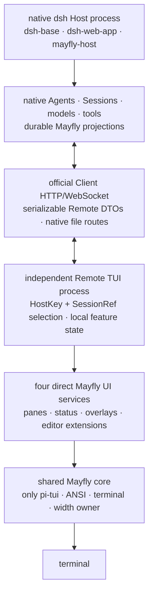
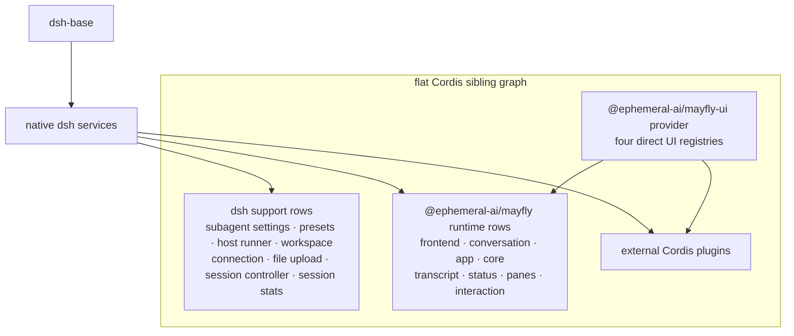

# Mayfly architecture

Mayfly has one product deployment: a native dsh Host and an independent Remote
TUI. The Host runs official Harness `0.2.2-alpha.2`, `dsh-base`, `dsh-web-app`,
and the Mayfly Host bundle. The TUI connects through the official Client API.
Closing or detaching the TUI releases Client resources and keeps Host work alive.

<!-- BEGIN diagram:mayfly-layers -->
<!-- single source: docs/diagrams/mayfly-layers.en.mmd — edit the .mmd, then `pnpm run diagrams:sync` -->

<!-- END diagram:mayfly-layers -->

## Package and process ownership

| Package | Responsibility |
| --- | --- |
| `@ephemeral-ai/mayfly-host` | Host bundle, settings namespace, durable projections, focused `mayflyHost` Remote namespace, startup URL printer |
| `@ephemeral-ai/mayfly-remote` | Client transport, multi-Host selection, feature controllers and writes, standalone TUI composition |
| `@ephemeral-ai/mayfly` | Shared renderer, themes, readonly presentation, editor and transcript controllers; no public root plugin or native composition |
| `@ephemeral-ai/mayfly-ui` | Renderer-neutral contracts, builders, and four direct UI services/provider |
| `@ephemeral-ai/mayfly-cli` | Small global launcher with an exact-version Remote dependency; no Host spawning or runtime archive |

The Host and TUI each have their own Cordis tree. Host plugins use documented
native dsh services in their owning process. TUI plugins contribute through
`mayflyPanes`, `mayflyStatus`, `mayflyOverlays`, and
`mayflyEditorExtensions`. Cross-process calls use serializable Remote DTOs;
Agent, Session, tool definitions, callbacks, and renderer objects never cross.
The shared package's old app, interaction, startup, patch, and preset payload
are private source/reference fixtures and are excluded from publication.

## State and lifetime

Harness owns Agent, Session, model, tool, persistence, and durable projection
state. Host registers `mayflyConversation`, `mayflyConversationFacts`, and
related presentation projections. Remote consumes whole current snapshots;
its event window only overlays the current assistant attempt. It never folds
a second durable conversation history or facts store.

Remote owns the selected `HostKey` plus `SessionRef`, startup coordination,
open side-view descriptors, local drafts, operation feedback, and renderer
preferences. Every identity and asynchronous write includes the selected Host.
Only the displayed conversation and its F7 counterpart retain bindings;
listed descriptors reacquire native bindings when displayed. Passive history
reads never activate a child. An explicit continuable-child reply resumes it
through the native addressed-subagent API. Readonly views keep drafts and
refuse writes.

Startup has no Session unless a task or resume id requires one. Concurrent
first prompts share Session creation. Pending startup plan intent is admitted
through the native command before the first prompt; a failed admission sends
no prompt. `/new` and `/clear` deselect without creating empty Sessions or
stopping Host work. A detached or replaced generation cannot select a late
creation result, reopen a panel, acknowledge a stale operation, or send input.

`/btw <question>` inherits the source's whole current native tail, including an
unfinished first turn. The authorized Host command reads the exact observation
cursor and supplies it to native Session Controller fork; Harness balances any
open turn. The returned inherited boundary controls the side view's transcript
floor. A genuinely empty source uses native creation with the effective Host
directory and source preset, so it has no inherited floor. Remote restores the
source model and clears inherited pending Inbox rows before the child prompt.
Before the source records a model route, Remote reads the native Host default;
this read does not record a parent selection or pin a default reasoning effort.

Registrations, listeners, timers, requests, and pending acknowledgements belong
to their Cordis Fiber or explicit frontend owner. Theme/core reload preserves
valid drafts and selection while discarding terminal handles and compiled
renderers. Closing a BTW or child view releases its frontend binding; it does
not implicitly stop the Host Agent. Native cancellation and explicit subagent
drain remain distinct operations.

## Presentation

Only `packages/mayfly/src/core/` imports pi-tui and owns raw terminal state,
ANSI, focus, layout, and visible-width calculations. The screen keeps fixed
prelude, conversation, local activity, editor, and footer hosts. Features lease
named slots or register readonly UI nodes. UI interaction models own form,
choice, tab, document, prompt, confirmation, and feedback state outside renderer
handles. See [interaction-model.md](./interaction-model.md) for the shared key
grammar and [mayfly-seams.md](./mayfly-seams.md) for extension boundaries.

Shared components cache frozen snapshots by identity and provider revision.
Durable `updatedSeq` and transient presentation revisions use separate clocks.
Live attempt settlement follows explicit native settled-step facts. Renderer
animation timers never measure or decide domain progress. Every component must
return rows no wider than the supplied `render(width)`.

Goal and Todo views reuse the reference's pure presentation builders over whole
native projections. `/goal` is dispatched to the native command with its
parser and objective attachments intact. The status edit action restores the
native edit command in the prompt; revision-bound controls use native writes.

## Installation and verification

Use the root [installation instructions](../README.md#install-and-run).
`script/install-dev.sh` builds and links only the Host bundle into a dedicated
`mayfly-*` profile using the selected exact-line `DSH_BIN`. Start that Host,
then pass its authenticated readiness URL through `MAYFLY_DSH_STARTUP_URL` to
`script/mayfly-remote.sh`. Tokens never enter argv or ordinary diagnostics.

The npm `0.1.4-rc.2` artifact is an immutable UI/workflow oracle, not a second
product deployment. [Split validation](./split-parity-validation.md) requires
independent reference capture, real HTTP/WebSocket scenarios, PTY teardown,
and cell-grid comparison. Shared builders and smoke success alone do not
establish visual parity. The root README lists the four remaining official API
limitations. The validation document defines the evidence still required for
acceptance; only genuine official API limitations may remain partial then.

Run the root change-aware gate while iterating and `pnpm run verify:full` before
architectural acceptance. Public seams require real consumers, exact-Host and
Session isolation, replay/abort/late-result tests, width coverage, publication
closure, and a dedicated real Host/TUI profile acceptance.

## Historical composition fixture

The diagram below records the private in-process source fixture used by older
component and composition tests. It is retained as historical test context;
it does not describe the current installation, published exports, or runtime.

<!-- BEGIN diagram:mayfly-composition -->
<!-- single source: docs/diagrams/mayfly-composition.mmd — edit the .mmd, then `pnpm run diagrams:sync` -->

<!-- END diagram:mayfly-composition -->
