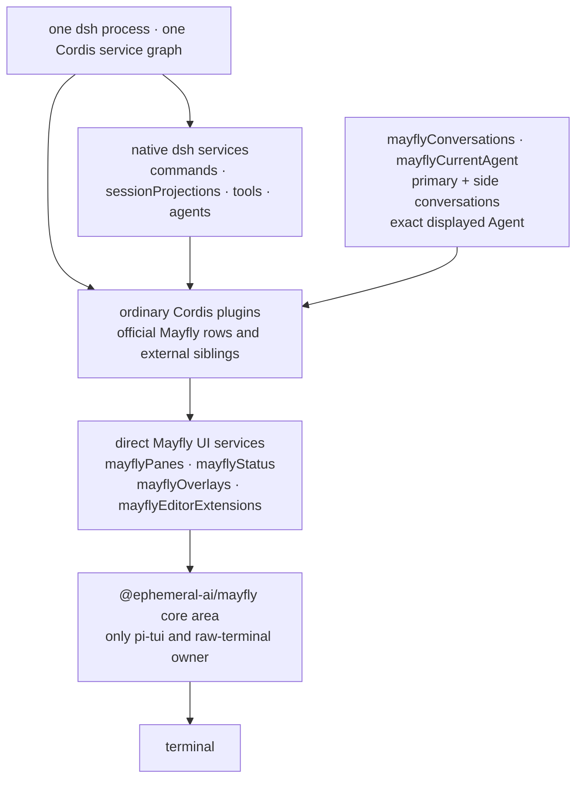
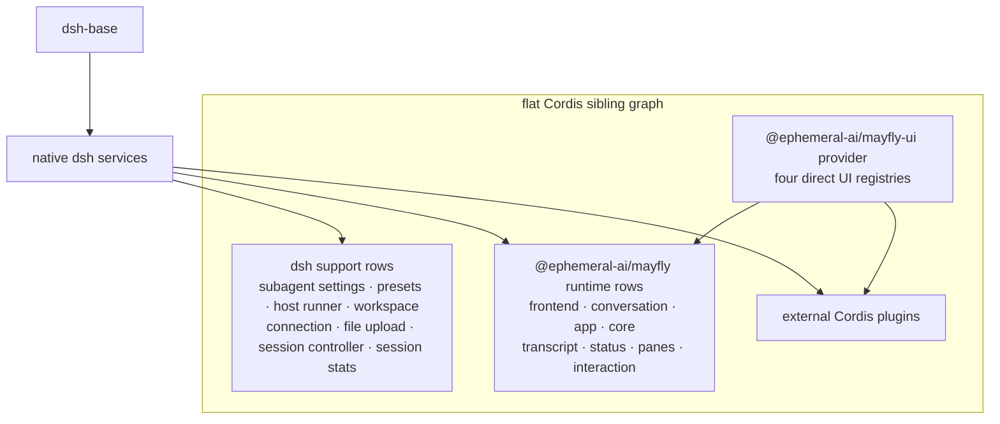

# Mayfly architecture

Mayfly is an out-of-tree, ESM-only terminal UI bundle for DeepSeek Harness. It
is a set of ordinary Cordis sibling plugins on `dsh-base`: it consumes the
native dsh service graph directly and adds only the contribution points a
terminal UI needs. There is no second plugin model, no private runtime realm,
and no compatibility layer.

<!-- BEGIN diagram:mayfly-layers -->
<!-- single source: docs/diagrams/mayfly-layers.en.mmd — edit the .mmd, then `pnpm run diagrams:sync` -->

<!-- END diagram:mayfly-layers -->

## Ownership boundaries

<!-- BEGIN diagram:mayfly-composition -->
<!-- single source: docs/diagrams/mayfly-composition.mmd — edit the .mmd, then `pnpm run diagrams:sync` -->

<!-- END diagram:mayfly-composition -->

| Package | Responsibility |
| --- | --- |
| `@ephemeral-ai/mayfly-ui` | Renderer-neutral wire contracts; `ui.*` builders; `freezeWire`/`isWireSnapshot`; `defineMayflyComponent`; one `compose.*` namespace; the four UI registries and their provider. |
| `@ephemeral-ai/mayfly` | Frontend, conversation, app, core, transcript, interaction, components, theme, composition rows, and the preset. |
| `@ephemeral-ai/mayfly-cli` | Dependency-free global launcher; expands and calibrates the bundled dsh runtime. |

`frontend/`, `conversation/`, `app/`, `transcript/`, `interaction/`, and
`components/` are source-ownership areas and Cordis rows inside
`@ephemeral-ai/mayfly`, not separate packages.

- `frontend/` owns registration-bound interaction services, images, locales,
  and the live assistant stream; its state survives a renderer rebuild.
- `conversation/` owns the transcript history and its presentation facts as
  two frozen projections, `mayflyConversation` and
  `mayflyConversationFacts`, over one shared vocabulary.
- `app/` owns startup, `mayflyConversations`, and `mayflyCurrentAgent`;
  Harness owns every Agent, Session, tool, and command.
- `transcript/` owns the conversation controller, views, status, and notices.
- `interaction/` owns editor, prompt-submit, command, and panel plugins; it
  registers nodes and answers structured actions, but does not render.
- `components/` holds pure fact-to-node functions that import only the kit and
  their siblings; they own no Fiber, width, clock, ANSI, or key binding.

Shared kits keep cross-area helpers single-sourced: `internal/format.ts`
(numbers, durations, bytes), `errors.ts`, `latest.ts` (generation-fenced latest
values), `process.ts` (bounded subprocesses), `interaction/panel.ts`,
`transcript/view-items.ts`, and the locale helpers.

## The UI pipeline

### 1. Admit

A feature publishes a `ui.*` wire tree or a `freezeWire` snapshot. The
provider admits the definition and initial snapshot before effects, assigns a
revision to every `set()`, and publishes upsert/remove deltas. Core admission
validates schema, quotas, control characters, and width; the wire carries no
renderer, Agent, Promise, callback, focus handle, key binding, ANSI, or
terminal width. Lists stay ordinary readonly arrays; only the viewport
neighborhood and visible `when` branches are admitted. Admission memoizes by
wire identity, and a memo hit replays every quota and duplicate check.

### 2. Compile

Core compiles the visible branch: layout ladders, focusable controls, groups,
page paths, and the key grammar. Hidden subtrees compile when first visible.
Compilation memoizes per surface runtime and invalidates on an admission,
palette change, or layout epoch. The compiler owns geometry and dispatch.

### 3. Paint

Painters turn compiled nodes into rows from the node, width, palette, surface
model, and keymap revision. The retained-row cache paints once per epoch and
answers repeat renders from memory until a handled key, focus, viewport, model
revision, keymap revision, or clock tick moves it. A moving cell reads one
clock, armed only while it can be on screen. An ordinary surface caches by
provider revision; the conversation stream keeps row facts by identity while
their content is equal, so a settled turn republishes the same frozen items.

### 4. Hosts

The Screen Shell mounts fixed hosts: prelude, conversation, local activity,
EditorDock, and Footer. Features claim named slot leases (`content`, `dock`,
`footer`), never a new root component. Panes go to the header, side, or bottom
dock; status entries share one row; overlays and editor presentations use the
overlay stack and editor host; `views` panes are status-row views. A null
snapshot occupies no layout. Slot and pane state lives in `mayflyUiInteraction`,
so a screen teardown revokes the lease but keeps the model.

### 5. Terminal

Only `src/core/` imports pi-tui or owns raw terminal state. Its modules group
around `ui/admit`, `ui/compile`, `ui/paint`, and `ui/state`, plus `content/`,
`hosts/`, `terminal/`, `keys/`, `text/`, and `theme/`. These groups own ANSI,
focus, layout, visible width, the alternate screen, capability probing, and key
decoding. A new renderer generation rebuilds these objects; they never enter
public nodes or become a second source for drafts. A core/theme reload
re-projects the same frontend interaction models.

## Runtime rules

Plugins inject and use native dsh services directly; Mayfly adds only the four
direct UI services. Events are facts, projections are readonly state, and
actions are structured writes; a renderer never folds session events into a
second domain store. `mayflyCurrentAgent.current()` returns the exact displayed
Agent, or null for a readonly or resumable conversation. Every registration,
listener, timer, and async continuation belongs to its Cordis Fiber; Fiber
unload is the entire cleanup mechanism. There are no mutable singletons,
private realms, capability hosts, facades, manifests, aliases, shims,
deprecations, or fallback paths.

## Composition

`cordis.patch.yml` inserts ordinary siblings over `dsh-base`: dsh support rows
plus all Mayfly product rows. YAML order does not imply startup order; ordering
comes from `inject`. Presets select the native preset registry; Agent Team is
an optional external plugin under its own preset, not a default mount.

## Verification

`pnpm run check` is the whole gate: build, typecheck, lint, and the full
vitest suite. The suite runs with `MAYFLY_UI_VERIFY_MEMO=1`, so every
retained-row hit repaints and a difference fails. Every component row must fit
`render(width)`; content renderers join the owning `width-scan.spec.ts`.
`packages/mayfly/tests/e2e.spec.ts` proves whole-tree service access, UI contributions, exact
Agent scope, Fiber cleanup, and core reload. Distribution and public-surface
changes also run `check:lib`, `check:examples`, `check:pack`, and
`check:agent-docs`.

Scenarios are a demo tool: `pnpm run scenario` opens a scripted conversation and
`pnpm run frame` writes checkpoints as cell grids, text, and SVG. Tests record
decisions; add them when the owner finalizes an effect.
