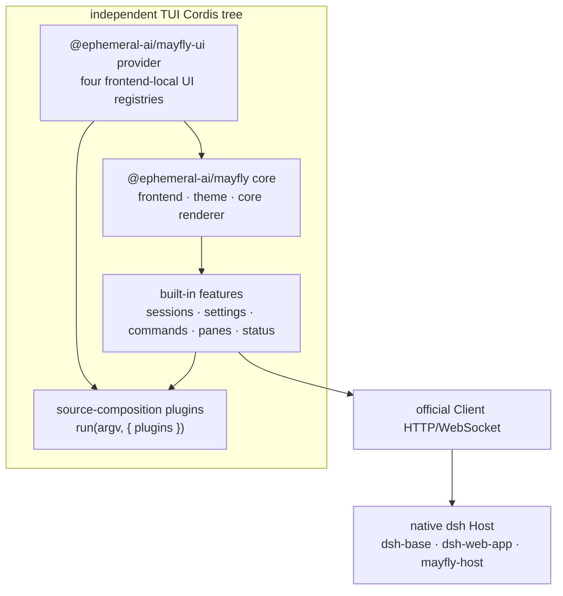

# Built-in plugins

The current product composes separate Host and TUI processes on Harness
`0.2.2-rc.1`.

| Owner | Composition |
| --- | --- |
| Native Host | `dsh-base`, `dsh-web-app`, native services and Agent presets |
| `@ephemeral-ai/mayfly-host` | Durable Mayfly projections, focused `mayflyHost` methods, Host readiness, and the native `mayfly-cordis` preset |
| `@ephemeral-ai/mayfly` | The independent TUI: official Client connections, Session selection, feature controllers, renderer, themes, and the `run(argv, { plugins })` source composition |
| `@ephemeral-ai/mayfly-ui` | Pure builders, contracts, and the four frontend-local UI registries |

Host services stay on Host. Frontend contributions publish through
`mayflyStatus`, `mayflyPanes`, `mayflyOverlays`, and `mayflyEditorExtensions` in
the TUI's tree. Cordis `inject` determines activation order and reload behavior.
Installing a Host bundle does not mount its TUI contribution.

## TUI composition

The TUI loads its UI provider, core, and built-in features, then each
source-composition plugin in order before attaching to a Host.

<!-- BEGIN diagram:mayfly-composition -->
<!-- single source: docs/diagrams/mayfly-composition.mmd — edit the .mmd, then `pnpm run diagrams:sync` -->

<!-- END diagram:mayfly-composition -->
