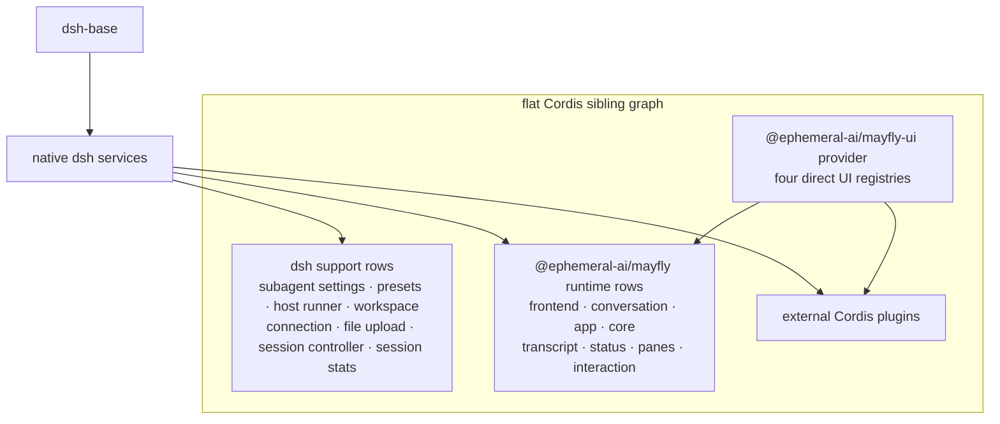

# Built-in plugins

The current product composes separate Host and Remote processes on Harness
`0.2.2-rc.1`.

| Owner | Composition |
| --- | --- |
| Native Host | `dsh-base`, `dsh-web-app`, native services and Agent presets |
| `@ephemeral-ai/mayfly-host` | Durable Mayfly projections, focused `mayflyHost` methods, Host readiness, and the native `mayfly-cordis` preset |
| `@ephemeral-ai/mayfly-remote` | Official Client connections, Session selection, frontend feature controllers, and the TUI composition |
| `@ephemeral-ai/mayfly` | Shared renderer, themes, editor/transcript controllers, and readonly presentation subpaths |
| `@ephemeral-ai/mayfly-ui` | Pure builders, contracts, and the four frontend-local UI registries |

Host services stay on Host. Frontend contributions publish through
`mayflyStatus`, `mayflyPanes`, `mayflyOverlays`, and `mayflyEditorExtensions` in
the TUI's tree. Cordis `inject` determines activation order and reload behavior.
Installing a Host bundle does not mount its TUI contribution.

## Historical test fixture

The diagram records the private in-process fixture used by older renderer and
composition tests. It is not the current installation, published package
contract, or supported extension path.

<!-- BEGIN diagram:mayfly-composition -->
<!-- single source: docs/diagrams/mayfly-composition.mmd — edit the .mmd, then `pnpm run diagrams:sync` -->

<!-- END diagram:mayfly-composition -->
