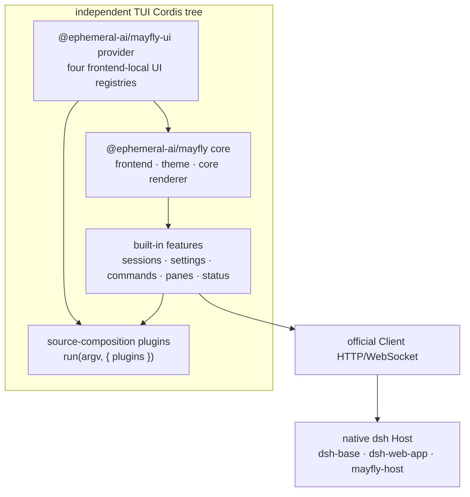

# 内置插件

当前产品在 Harness `0.2.2-rc.1` 上分别组合 Host 与 TUI 两个进程。

| 所有者 | 组合 |
| --- | --- |
| 原生 Host | `dsh-base`、`dsh-web-app`、原生 service 与 Agent preset |
| `@ephemeral-ai/mayfly-host` | 持久 Mayfly 投影、focused `mayflyHost` 方法、Host 就绪输出与原生 `mayfly-cordis` preset |
| `@ephemeral-ai/mayfly` | 独立 TUI：官方 Client 连接、Session 选择、功能控制器、renderer、theme 与 `run(argv, { plugins })` 源码组合 |
| `@ephemeral-ai/mayfly-ui` | 纯 builder、契约及四个前端本地 UI registry |

原生 service 留在 Host。前端 contribution 在 TUI tree 中通过 `mayflyStatus`、
`mayflyPanes`、`mayflyOverlays`、`mayflyEditorExtensions` 发布。Cordis `inject`
决定启动次序与 reload 行为。安装 Host bundle 不会挂载 TUI contribution。

## TUI 组合

TUI 依次加载 UI provider、core 与内置功能，再按顺序加载每个源码组合插件，之后才连接 Host。

<!-- BEGIN diagram:mayfly-composition -->
<!-- single source: docs/diagrams/mayfly-composition.mmd — edit the .mmd, then `pnpm run diagrams:sync` -->

<!-- END diagram:mayfly-composition -->
