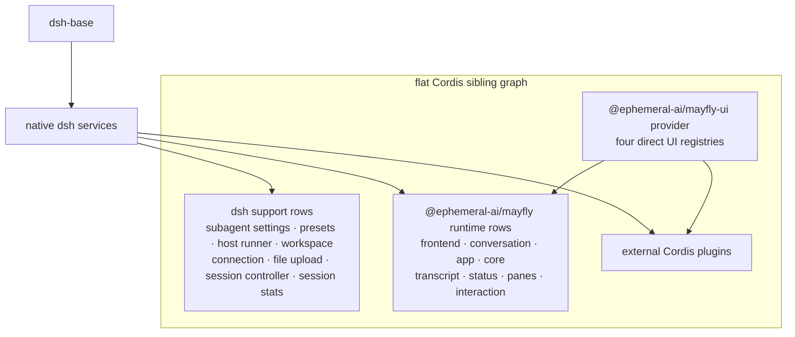

# 内置插件

当前产品在 Harness `0.2.2-rc.1` 上分别组合 Host 与 Remote 两个进程。

| 所有者 | 组合 |
| --- | --- |
| 原生 Host | `dsh-base`、`dsh-web-app`、原生 service 与 Agent preset |
| `@ephemeral-ai/mayfly-host` | 持久 Mayfly 投影、focused `mayflyHost` 方法、Host 就绪输出与原生 `mayfly-cordis` preset |
| `@ephemeral-ai/mayfly-remote` | 官方 Client 连接、Session 选择、前端功能控制器与 TUI composition |
| `@ephemeral-ai/mayfly` | 共享 renderer、theme、editor/transcript controller 与只读展示 subpath |
| `@ephemeral-ai/mayfly-ui` | 纯 builder、契约及四个前端本地 UI registry |

原生 service 留在 Host。前端 contribution 在 TUI tree 中通过 `mayflyStatus`、
`mayflyPanes`、`mayflyOverlays`、`mayflyEditorExtensions` 发布。Cordis `inject`
决定启动次序与 reload 行为。安装 Host bundle 不会挂载 TUI contribution。

## 历史测试 fixture

下图只记录旧 renderer 与 composition 测试使用的私有进程内 fixture，不代表当前
安装方式、公开包契约或受支持的扩展路径。

<!-- BEGIN diagram:mayfly-composition -->
<!-- single source: docs/diagrams/mayfly-composition.mmd — edit the .mmd, then `pnpm run diagrams:sync` -->

<!-- END diagram:mayfly-composition -->
